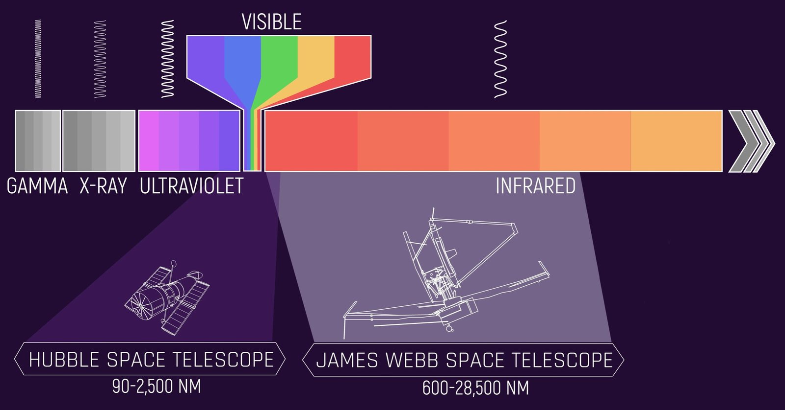
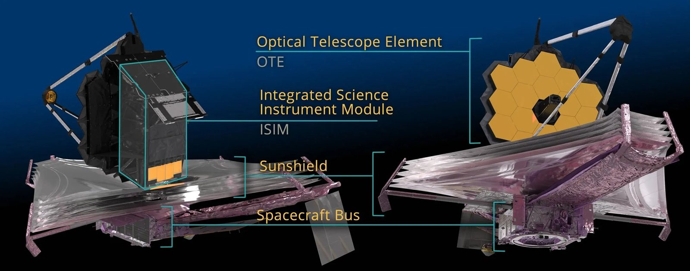
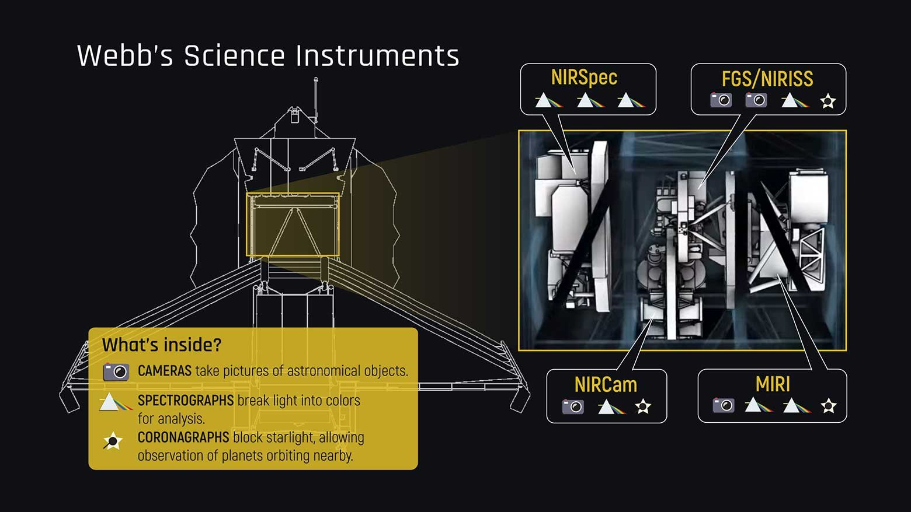
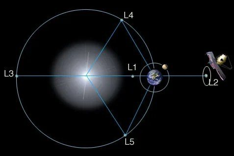
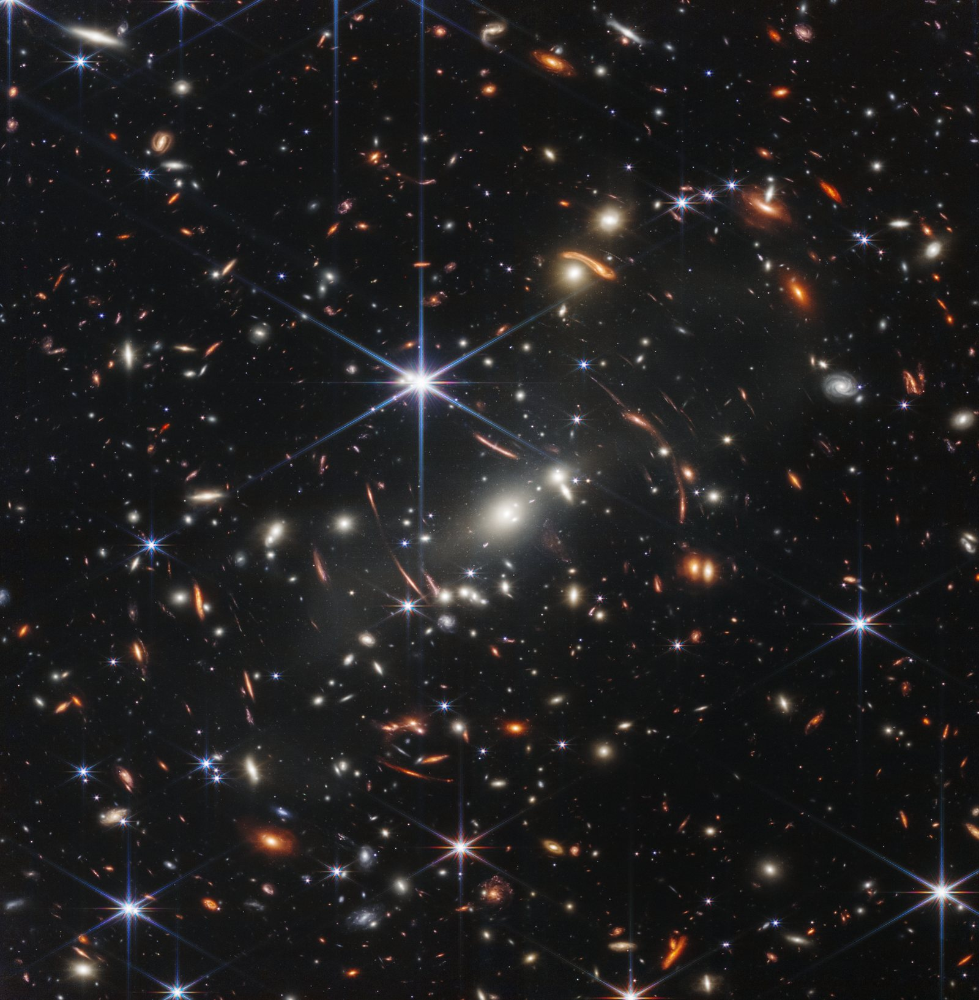
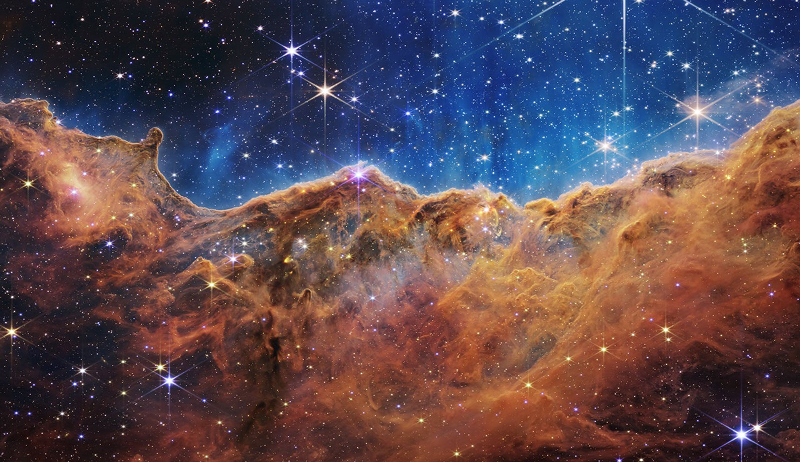
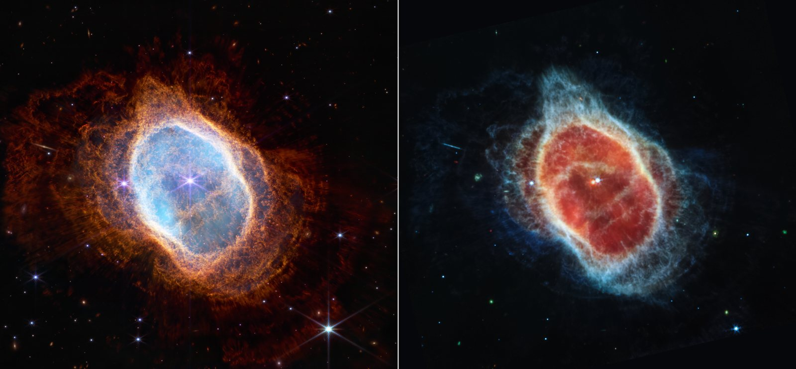
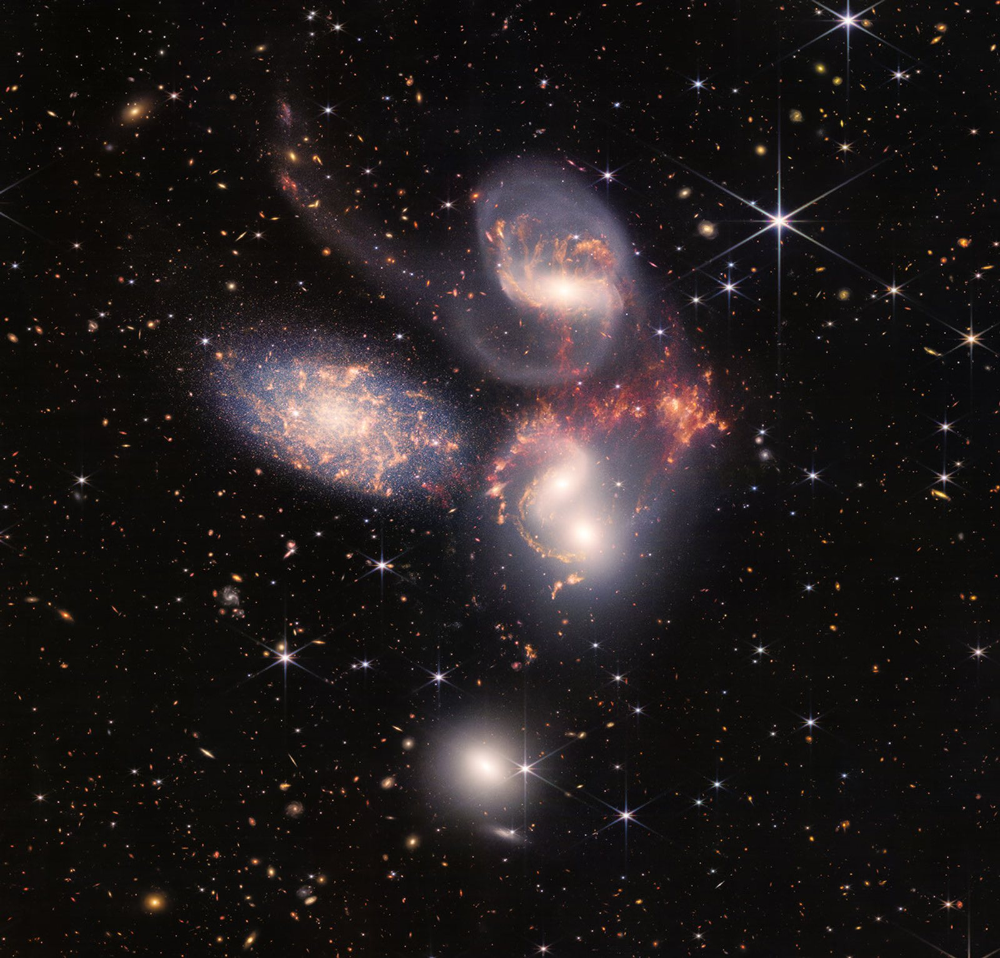
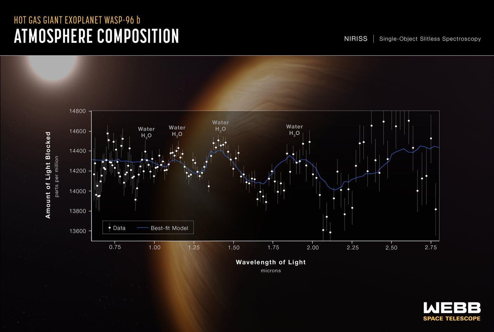

It is the telescope astronomers have been waiting for since 1989. Born from an international collaboration between NASA, ESA (European Space Agency) and CSA (Canadian Space Agency), it is destined to change the story of the universe: welcome to the era of the **James Webb Space Telescope (JWST)**!

## The story: from Hubble to Webb

It is 1989 and the **Hubble Space Telescope (HST)** is still on the ground, but astrophysicists and engineers are already plotting its successor: a telescope able to go where Hubble could never reach.

Hubble is, in every sense, Webb's father, and more than 36 years after its launch it has never stopped offering us its treasures. It has changed our picture of the cosmos forever. By observing Type Ia supernovae, it measured the Hubble constant more precisely and helped discover that the expansion of the universe is not slowing down, but speeding up. It showed that at the heart of every large galaxy lurks a supermassive black hole, whose mass is closely tied to that of the galactic bulge. It explored the nebulae where stars are born and analysed the atmospheres of extrasolar planets. More than 22,000 scientific papers are based on its data.

But even Hubble's eye has its limits. It is sensitive mainly to ultraviolet and visible light, and it cannot catch the faint glow of the first galaxies, born shortly after the Big Bang. Their light travels for about 13 billion years through a universe that, meanwhile, keeps expanding: along the way it gets “stretched”, loses energy and reaches us at a longer wavelength. This is **cosmological redshift**, which shifts the light of the first galaxies from the ultraviolet and visible all the way into the near infrared, beyond Hubble's reach.

This is where Webb steps in, designed precisely to capture the infrared light of the first protogalaxies and galaxies at cosmic dawn. Its goal is to understand when and how they assembled, how they evolved, and how the first stars and the first supermassive black holes switched on. But its infrared vision has another superpower: it sees through clouds of gas and dust. This lets Webb spy on the birth of planetary systems and analyse the atmospheres of exoplanets in search of water and possible traces of life (especially in those orbiting within the habitable zone of their star).

Webb lifted off on Christmas Day 2021, aboard an Ariane 5 rocket launched from Europe's Spaceport in Kourou, French Guiana. Its mission? To try to answer two colossal questions: how did we get here? And are we alone in the universe?

<figure class="post-fig">

<figcaption>The wavelength ranges observable by Hubble and by the James Webb. Although Hubble can detect some near-infrared wavelengths, it was optimised for shorter ones, namely ultraviolet and visible light. The James Webb, instead, can detect the near and mid infrared. The two telescopes are observing partners: they complement each other, giving us a view across a wide range of wavelengths. Credits: NASA, J. Olmsted (STScI).</figcaption>
</figure>

## The telescope

To see the faintest objects in the universe you need an enormous mirror. But Webb's mirror is wider than the rocket that had to carry it into space. The solution? Take inspiration from the art of origami! Webb set off folded up on itself and unfolded piece by piece on its way to the L2 point. A nail-biting feat: engineers had counted 344 “single points of failure”, mechanisms with no backup, any one of which, had it jammed, could have jeopardised the entire mission. About 80% of them involved the unfolding itself, and it was not luck that every single one worked.

Webb is made up of three main parts: the Optical Telescope Element (OTE), the Integrated Science Instrument Module (ISIM) and the Spacecraft Element (SCE).

<figure class="post-fig">

<figcaption>The components of the James Webb Space Observatory. Credits: <a href="https://science.nasa.gov/mission/webb/spacecraftoverview/">https://science.nasa.gov/mission/webb/spacecraftoverview/</a></figcaption>
</figure>

### 1. The Optical Telescope Element (OTE)

We all picture a single large golden mirror, 6.5 m across, made of 18 hexagonal segments arranged like a honeycomb. The truth is that there are four mirrors: the primary collects the light, while three others direct it towards the science instruments. Small motors, called actuators, adjust the position and orientation of each segment with extreme precision, so that the 18 segments work as one single giant mirror.

Beneath the gold lies beryllium, a light, strong and stable metal that keeps its shape even at extremely low temperatures. The gold, spread in a layer just one ten-thousandth of a millimetre thick, makes the mirror as reflective as possible to infrared radiation. There are only 48 grams of it in total, roughly the weight of a golf ball. Protecting it from scratches and particles is a thin veil of glass, amorphous silicon dioxide.

And the hexagonal shape? It is not an aesthetic whim: hexagons fit together leaving very little empty space and, together, form an almost circular mirror that efficiently focuses light onto the detectors.

### 2. The Integrated Science Instrument Module (ISIM)

Webb's scientific “brain”.

Webb sees mainly in the near and mid infrared, but it can also catch the red end of visible light: in total, wavelengths between 0.6 and 28.5 microns. To do this it uses four instruments, each with its own speciality.

<figure class="post-fig">

<figcaption>The science instruments (cameras, spectrographs and coronagraphs) of the James Webb, located behind the primary mirror. Credits: NASA and STScI.</figcaption>
</figure>

**NIRCam** (Near InfraRed Camera) is the main camera and sees from red light to the near infrared (0.6–5 microns). It photographs the first galaxies, the stars of the Milky Way and the most distant objects in the Solar System. Thanks to its coronagraph, which blocks a star's light like a hand held up against the Sun, it can also capture the planets orbiting around it.

**NIRSpec** (Near-Infrared Spectrograph) is a spectrograph working over the same range. It splits light into its colours to reveal the chemical composition and physical properties of celestial objects. Its ace in the hole is a grid of about 250,000 microshutters, each as wide as a few human hairs, which open and close to observe up to 100 objects at once. With NIRSpec we can reconstruct the physical and chemical conditions of the early universe.

**MIRI** (Mid-Infrared Instrument) combines a camera and a spectrograph and explores the mid infrared (5–28 microns). It is the eye for dust: it observes star-forming regions, comets, Kuiper Belt objects and, thanks to its coronagraph, exoplanets too.

Finally there is **FGS/NIRISS** (Fine Guidance Sensor / Near-Infrared Imager and Slitless Spectrograph), two instruments in one. FGS is the “helmsman”: it keeps Webb pointed at its target with extreme precision. NIRISS (0.6–5 microns) specialises in exoplanets and analyses their atmospheres by studying the starlight that passes through them.

### 3. The Spacecraft Element (SCE)

The Spacecraft Bus and the Sunshield.

The Spacecraft Bus is Webb's “engine room”. It provides power through its solar panels, keeps the telescope stable and correctly pointed, handles communications with Earth, and processes and stores the data collected. It also houses the propulsion system, which periodically corrects the orbit.

Then there is the real giant: the sunshield. Webb observes infrared radiation, which is, to a large extent, heat. The heat of the Sun, the Earth, the Moon and even the telescope itself could drown out the faintest cosmic signals. That is why Webb must stay ice-cold. Protecting it is an umbrella the size of a tennis court (21 × 14 m), always facing the Sun, made of five Kapton membranes as thin as a human hair. They are coated with aluminium and, on the first two layers, with doped silicon, which gives the shield its distinctive pinkish-purple colour. The layers are separated by gaps that radiate heat away into space, so each membrane is colder than the one before. The result is a sunscreen with a protection factor of one million: there is a difference of more than 300 degrees between the side facing the Sun and the side in shadow. The telescope thus stays below −223 °C, while NIRCam, NIRSpec and NIRISS work at about −234 °C. MIRI needs it even colder and, thanks to a special helium cryocooler, gets down to −266 °C: just 7 degrees above absolute zero.

## Where Webb is

Hubble circles the Earth at an altitude of about 500 km. Webb lives much farther away: about 1.5 million kilometres from us, four times the distance to the Moon, near the second Lagrange point (L2).

The Lagrange points are five special positions in the Sun-Earth system, studied in the 18th century by the mathematician Joseph-Louis Lagrange as part of the famous *three-body problem*. There, the gravitational pull of the Sun and the Earth and the orbital motion balance out, so a small object can move along with them, as if “hooked on”. At L4 and L5 the equilibrium is stable, while at L1, L2 and L3 it is unstable: a tiny nudge is enough to drift away.

<figure class="post-fig">

<figcaption>Diagram of the Lagrange points. Credits: <a href="https://science.nasa.gov/mission/webb/orbit/">https://science.nasa.gov/mission/webb/orbit/</a></figcaption>
</figure>

Why L2? Because from there Webb travels alongside the Earth on its journey around the Sun and always stays in contact with us. What's more, the Sun, the Earth and the Moon all lie on the same side, so the sunshield can hide all three at once, keeping the telescope in the dark and the cold.

Webb, however, does not sit exactly at L2. Since the equilibrium is unstable, it circles around it along a wide orbit that takes about six months to complete, firing its thrusters every now and then to stay on course.

## First light and the first images

On 2 February 2022 Webb sees its first light: photons from the star HD 84406, after travelling through the telescope's entire optical system, are captured by NIRCam. The star appears 18 times, once for each mirror segment. It is a historic milestone, but also the start of one of the most delicate operations of the whole mission: aligning the 18 segments of the primary mirror, a manoeuvre that took about three months. For the first science image, though, we have to wait until 11 July 2022, when President Joe Biden unveils it in a preview at the White House. Taken by NIRCam, it is the deepest and sharpest infrared image of the distant universe ever obtained up to that moment.

<figure class="post-fig">

<figcaption>SMACS 0723. Credits: NASA, ESA, CSA, STScI.</figcaption>
</figure>

Thousands of galaxies crowd a tiny patch of sky, about the size of a grain of sand held at arm's length. At the centre lies the galaxy cluster SMACS 0723, seen as it was 4.6 billion years ago. Its enormous mass bends space and acts as a gravitational lens: a natural telescope that magnifies and distorts the light of the galaxies behind it, turning them into glowing arcs. Some appear as they were when the universe was less than a billion years old. They look red because the expansion of the cosmos has “stretched” their light into the infrared. Thanks to its resolution, Webb can make out star clusters and star-forming regions in these baby galaxies never seen before. And the MIRI instrument adds a touch of chemical colour: blue galaxies have stars but little dust, red ones are wrapped in thick layers of dust, and green ones contain hydrocarbons and other compounds.

The next day, 12 July 2022, NASA, ESA and CSA hold an international live-streamed event, during which the other four colour images and the telescope's first spectroscopic data are revealed.
The first, obtained by combining NIRCam and MIRI, shows the *Cosmic Cliffs*, a star-forming region called NGC 3324, in the north-western corner of the Carina Nebula.

<figure class="post-fig">

<figcaption>NGC 3324. Credits: NASA, ESA, CSA, STScI.</figcaption>
</figure>

What looks like a mountain landscape under a star-studded sky is actually the edge of a gigantic cavity of gas and dust, with peaks reaching 7 light-years high. Its shapes are sculpted by the ultraviolet radiation and stellar winds of extremely young, massive stars, which slowly erode the walls of the nebula. Even what looks like blue steam rising from the peaks is actually ionised gas and hot dust, blown away by the intense stellar radiation.
Thanks to its infrared vision, Webb can see through the dust, revealing hundreds of previously invisible stars and the jets of material ejected by newborn stars. The youngest appear as tiny red dots, caught in an evolutionary phase that lasts just 50,000–100,000 years: the blink of an eye on a cosmic scale.

The second is the planetary nebula NGC 3132, which shows us how some stars save the best for last. At 2,500 light-years from us, NGC 3132 is what remains of a Sun-like star that ran out of fuel and became a white dwarf.

<figure class="post-fig">

<figcaption>NGC 3132 seen by NIRCam (left panel) and by MIRI (right panel). Credits: NASA, ESA, CSA, STScI.</figcaption>
</figure>

Before fading away, it repeatedly cast off its outer layers, like a rotating sprinkler. Each ring is one of these episodes: the outermost are the oldest, those near the centre the most recent. Reading them is like leafing through the star's diary. A brighter companion orbits beside it, stirring gas and dust and making the nebula asymmetrical. Webb's two cameras tell different stories. NIRCam, in the near infrared, highlights the stars and the thin rays of light filtering through the dust. MIRI, in the mid infrared, makes the dust glow and revealed for the first time that the white dwarf is wrapped in a cloak of dust. That dust will travel for billions of years and may one day become part of new stars and planets.

The third image presents a cosmic dance worthy of an Oscar.

<figure class="post-fig">

<figcaption>Stephan's Quintet. Credits: NASA, ESA, CSA, STScI.</figcaption>
</figure>

In a mosaic of almost 1,000 files and over 150 million pixels, covering about one-fifth of the Moon's diameter, Webb shows us Stephan's Quintet. But the name is misleading: only four galaxies are truly dancing together, about 290 million light-years away. The fifth, NGC 7320, is an intruder in the foreground, “only” 40 million light-years away. There, NIRCam was able to resolve individual stars, including old ones producing dust, which appear as red dots. The other four pull on one another: tidal forces tear away long tails of gas, dust and stars, while the galaxy NGC 7318B ploughs through the group, generating huge shock waves. MIRI captured them, and in the image they appear yellow and orange, while the stars seen by NIRCam are blue and white. At the heart of NGC 7319 lies a supermassive black hole of 24 million solar masses, shining as brightly as 40 billion Suns. The NIRSpec and MIRI spectrographs pierced the dust surrounding it and “sliced” the data like an MRI scan, measuring the speed of the outflowing gas. Crowded groups like this may have been common in the early universe: the Quintet is a nearby laboratory for understanding how collisions made galaxies and black holes grow. Discovered by the French astronomer Édouard Stephan in 1877, it also offers a bonus: thousands of very distant galaxies can be seen in the background.

The last of Webb's first five “images” is not a photograph but a graph, and it may be the most revolutionary of all.
We are looking at the atmospheric spectrum of the exoplanet WASP-96 b, a gas giant about 1,150 light-years from us, in the constellation Phoenix.

<figure class="post-fig">

<figcaption>Atmospheric spectrum of WASP-96 b. Credits: NASA, ESA, CSA, STScI.</figcaption>
</figure>

It has no counterpart in the Solar System: it has less than half the mass of Jupiter but is 1.2 times larger, practically a “puffy” planet. It orbits so close to its Sun-like star that a year there lasts just three and a half days, and its atmosphere reaches about 725 °C. Webb cannot see it directly. The Canadian instrument NIRISS, however, observed the star's light for 6.4 hours as the planet passed in front of it. A tiny fraction of that light passes through the planet's atmosphere, and each molecule absorbs specific colours, leaving its fingerprint. From 280 combined spectra emerged the unmistakable signature of water vapour, along with hints of haze and clouds that earlier observations had ruled out. Hubble had already found water on other exoplanets, the first time in 2013, but this is the most detailed spectrum ever obtained. It is also the first to cover in a single shot the whole range from 0.6 to 2.8 microns, beyond the 1.6-micron limit reachable before, a region also sensitive to methane, oxygen and carbon dioxide. And it is only a taste: almost a quarter of Webb's first year of observations was devoted to exoplanets, including some that might be habitable.

From the baby galaxies of SMACS 0723 to the water vapour of WASP-96 b, Webb's first images kept every promise made over thirty years of design. If Hubble had opened our eyes to the universe, Webb is ready to rewrite its story.

Article by <strong>Anna Elisabetta Borea</strong>

<strong>Sources and credits:</strong> information and images taken from the Webb mission website, <a href="https://science.nasa.gov/mission/webb/">NASA Science &ndash; Webb</a>, and from materials by NASA, ESA, CSA and STScI. Redshifted is not affiliated with these organisations and their use does not imply any endorsement.

