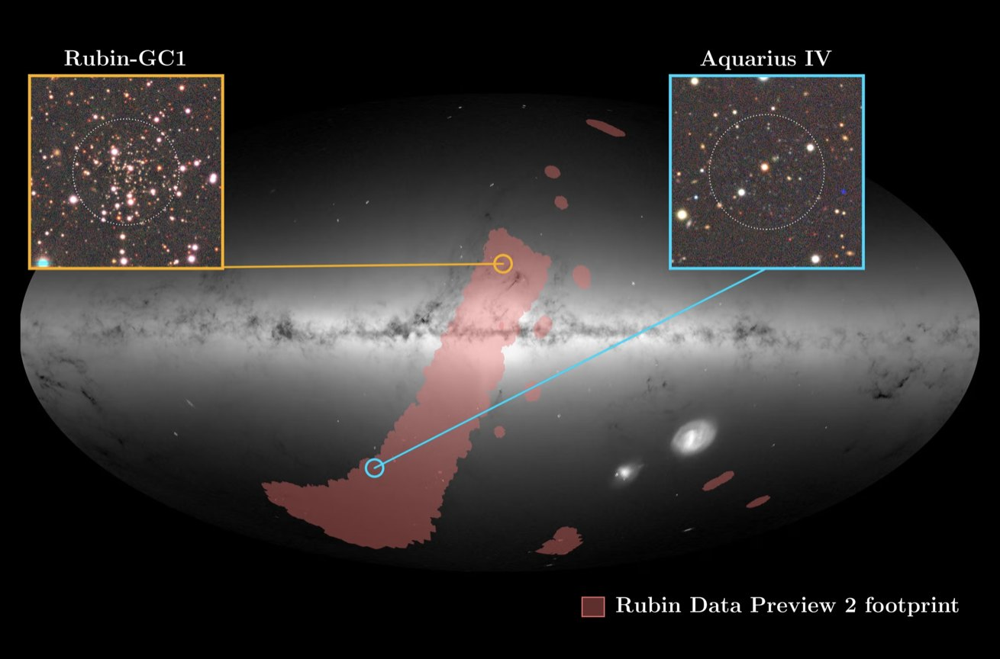
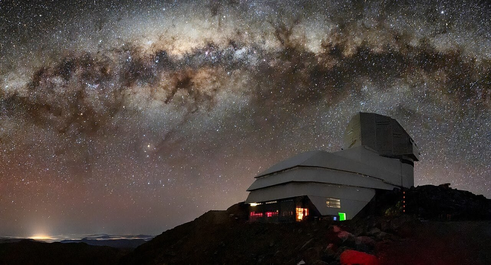
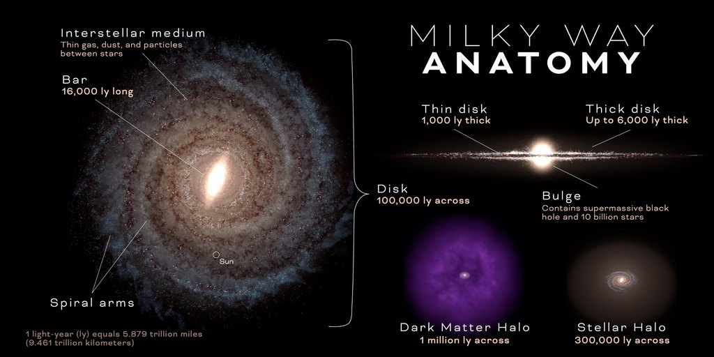

For billions of years they have been out there, orbiting our Galaxy, without anyone noticing. The first is a handful of ancient stars, adrift in the dark at the edge of the Milky Way, so faint it blends into nothingness. The second is a cluster of stars buried behind a shroud of dust: perhaps the wreckage of another galaxy, which ours is slowly tearing apart.

Now, at last, we have seen them. And a single glance was enough.

They were tracked down by the **Vera C. Rubin Observatory**, on Cerro Pachón, in Chile. The first object is called **Aquarius IV**: a probable ultra-faint dwarf galaxy, about 355,000 light-years from us, in the most remote regions of the Milky Way's halo. The second is **Rubin-GC1**, a small globular cluster that had stayed hidden towards the constellation Ophiuchus, behind a region packed with stars and dust.

<figure class="post-fig">

<figcaption>A representation of the Milky Way and its surroundings. The area highlighted in red marks the portion of sky explored by the Rubin Observatory, whose observations led to the identification of the new objects. The two newly discovered galactic satellites are shown in the detail panels: the orange one shows the globular cluster Rubin-GC1, clearly visible, while the other shows Aquarius IV, an extremely faint and much more distant galaxy, barely perceptible in the image. Credits: NSF–DOE Vera C. Rubin Observatory/NOIRLab/SLAC/AURA, ESA/Gaia/DPAC, W. Cerny.</figcaption>
</figure>

The most surprising part is when the discoveries came. They are not the fruit of years of observations, but of Rubin's preliminary data, collected before the survey proper had even begun. These data were made public on 27 July 2026 with Early Data Preview 2 (EDP2): deep images and catalogues covering about 7% of the entire sky. With coverage still this limited, Rubin has already found two satellites of the Milky Way that had escaped every previous search.

The results are described in two separate papers. The first, *Discovery of the Distant, Ultra-faint Milky Way Satellite Aquarius IV with the Vera C. Rubin Observatory Early Data Preview 2*, is led by William Cerny, of Yale University, and is published in *Research Notes of the AAS*. The second, *Rubin Observatory Reveals a Dust-shrouded Halo Globular Cluster in Ophiuchus*, is led by Aashay Pai, of the University of Chicago, and is published in *The Astrophysical Journal Letters*.

<figure class="post-fig">

<figcaption>The Vera C. Rubin Observatory, on Cerro Pachón in Chile, scans the southern sky in search of still-unknown celestial objects. Its ability to explore vast regions of the sky in great depth promises to bring to light many new members of the Milky Way's family of satellites. Image credits: NSF-DOE Rubin Observatory/AURA/B. Quint.</figcaption>
</figure>

Rubin is equipped with the largest digital camera ever built for astronomy and repeatedly photographs wide swathes of the sky: this allows it to catch extremely faint objects and follow how they change over time. But to understand why these two discoveries matter so much, we first need to get to know the family they belong to.

## The Milky Way's invisible retinue

The Milky Way does not travel alone. Around it moves a retinue of **galactic satellites**: smaller systems bound to our Galaxy by gravity. They include dwarf galaxies, globular clusters and diffuse structures, witnesses to a history billions of years long, made of mergers, close encounters and collisions.

Many of them inhabit the **galactic halo**, a vast, roughly spherical structure that extends far beyond the Galaxy's disc and contains stars, globular clusters and dark matter. Despite decades of observations, the census is still incomplete: about 65 satellite galaxies are known, and numerous globular clusters have been identified in the halo. But these are almost certainly only part of the real population. Many satellites are so faint and diffuse that they blend into the stellar background. Others hide behind blankets of interstellar dust, or in regions of the sky crowded with enormous numbers of stars.

<figure class="post-fig">

<figcaption>Diagram of the structure of the Milky Way. At the centre lies the galactic disc, where most of the stars are concentrated. Around it extends the stellar halo, a much larger and more rarefied region hosting old stars, globular clusters and stellar streams, often formed from the remains of dwarf galaxies gradually torn apart by the Milky Way's gravity. In the outermost regions orbit the satellite galaxies, small galactic systems gravitationally bound to our Galaxy. The figure also shows the dark matter halo, a component distinct from the stellar one and far more extended, which envelops the entire galactic structure. Credits: NASA's Goddard Space Flight Center; graphic design: Scott Wiessinger.</figcaption>
</figure>

Among the most elusive members of the retinue are the **ultra-faint dwarf galaxies** (**UFDs**). They contain very few stars, almost all formed more than 10 billion years ago, and shine so faintly that they go unnoticed even by the most sensitive instruments. They are relics of the early universe: having survived almost intact to the present day, they hold precious information about the first stages of the formation of cosmic structures.

Their stars contain very few heavy elements, which astrophysicists call *metals*: all the elements heavier than helium. This is the mark of a chemical evolution that remained almost frozen. In these galaxies star formation switched off early, before new generations of stars could enrich the gas with the elements forged inside them.

There is an even deeper reason to hunt for them: **dark matter**. According to the current cosmological model, galaxies are born inside enormous haloes of this invisible component, which neither emits nor absorbs light and which we know mainly through its gravitational effects. It is the hidden skeleton of the universe, the gravitational scaffolding on which galaxies were built. In UFDs there are so few stars that dark matter can dominate the mass: they are galaxies made almost entirely of shadow. This makes them precious laboratories for studying how dark matter is distributed and for testing the predictions of cosmological models.

Then there are the **globular clusters**: concentrations of stars with extremely high densities, populated largely by old stars. Some may not have been born in the Milky Way at all, but in smaller galaxies that ours captured and dismembered, one piece at a time. Often, these clusters are all that remains of those devoured worlds: survivors of a shipwreck, still orbiting among the remains of their galaxy of origin. Reconstructing their orbits and studying their chemical composition allows us to trace the mergers that built the Galaxy we observe today.

Every new satellite, then, is not just one more object in a catalogue: it is a clue to the history of the Milky Way. And the two newcomers tell two very different stories.

## Aquarius IV: a galactic fossil at the edge of the Milky Way

The first satellite is Aquarius IV, also catalogued as Rubin J2201−0234. Its light is so faint that looking was not enough to find it: it took an algorithm, called *simple*, adapted to analyse Rubin's data.

The algorithm searches the sky for groups of stars that behave like a population of a given age and chemical composition, described by a theoretical model called an *isochrone*. The comparison is made in the colour-magnitude diagram, which relates the colour of stars to their brightness. For Aquarius IV, the authors used a 13-billion-year isochrone, with a metallicity about 140 times lower than the Sun's: in practice, they were looking for some of the oldest and most primitive stars in the cosmos. And they found them. Aquarius IV emerged from Rubin's data with a statistical significance of about 8 sigma, and was then independently confirmed in archival images from the Dark Energy Camera, where it had always been present without anyone noticing.

A single star was enough to measure its distance: a **blue horizontal branch** star, an old star in an advanced stage of its evolution, whose brightness is known with good precision, making it an excellent distance indicator. The result places Aquarius IV about 355,000 light-years from Earth. At that distance, in the outer halo, our Galaxy's stars become extremely rare: Aquarius IV is a small archipelago of ancient light, suspended in the void at the edge of the Milky Way.

What suggests it is an ultra-faint dwarf galaxy is above all its extremely low luminosity and its relatively large size. Its nature, however, is not yet certain: further observations will be needed to rule out that it is a globular cluster. If confirmed, we would be looking at an extremely faint and remote system, probably dominated by dark matter, useful for understanding the role of this invisible component in the birth of the smallest galaxies. Getting there, though, will require deeper observations and, above all, spectroscopic measurements.

## Rubin-GC1: the cluster buried behind the dust

If Aquarius IV hid in distance and faintness, Rubin-GC1 chose a very different hiding place. It is a globular cluster towards the constellation Ophiuchus, close to the direction of the galactic centre, but on the far side of the Galaxy from the Sun.

To reach us, its light must cross almost the entire Milky Way: an extremely crowded star field and thick clouds of interstellar dust. Dust absorbs and scatters light, especially at optical and ultraviolet wavelengths, and lets red light through more easily: the stars thus reach us faded and reddened, as if seen through smoked glass. This is **interstellar extinction**, one of the main obstacles when trying to reconstruct the stellar population of the Galaxy's inner regions.

Rubin-GC1, then, was not hidden because it was too far away, but because it was buried behind a curtain of dust, amid a crowd of stars belonging to our own Galaxy. The EDP2 data nonetheless brought it to light as a concentration of stars consistent with a globular cluster. It lies about 31,000 parsecs from the Sun, or about 101,000 light-years: much closer than Aquarius IV, and very different. Its stars have an estimated age of about 9.2 billion years, so they are much younger than those of Aquarius IV, and its metallicity is much higher. It is a compact, moderately metal-rich system, far from the primordial purity of its companion in discovery.

But the most unsettling detail concerns its origins. To understand it, we must turn to a nearby galaxy undergoing a slow agony: the **Sagittarius dwarf spheroidal galaxy**. Orbit after orbit, the Milky Way's gravity exerts tidal forces on it that tear away its stars and scatter them along its path, like shreds left along a trail. The result is an immense river of stars, a **tidal stream**, divided into two components: the *leading arm*, which runs ahead of the galaxy along its orbit, and the *trailing arm*, which follows it.

The authors compared the position and motion of Rubin-GC1 with numerical models simulating the disruption of Sagittarius and the formation of its stream. The result points to a possible association of the cluster with the leading arm. Globular clusters, in fact, can be dragged away together with the stars of the galaxy they belonged to and later become satellites of the Milky Way. If the hypothesis is confirmed, Rubin-GC1 would be a fragment of Sagittarius: a survivor of the galaxy that ours is still devouring. Verifying this will require new spectroscopic observations, above all to measure the cluster's radial velocity and to study the chemical composition of its stars in more detail.

## Two satellites, two different stories, one great opportunity

For a long time we thought of the Milky Way's satellites as objects that were by now largely known, at least in our neighbourhood. Aquarius IV and Rubin-GC1 show that the picture is still incomplete. An almost invisible galaxy at the edge of the halo and a cluster hidden by dust in one of the most crowded regions of the sky managed to escape every previous search. They were found by an observatory that has only just begun to show what it can do.

And if this is the result of just 7% of the sky, one cannot help wondering how many other presences are still waiting, in the dark, to be discovered. In the coming years the number of known dwarf galaxies around the Milky Way could grow considerably. New globular clusters may emerge, remnants of galaxies long gone, and stellar structures we do not yet even know we should be looking for.

Every new discovery will give us back a fragment of our Galaxy's history: a story of encounters and mergers, in which smaller galaxies were captured, dismembered and scattered across the halo. By studying these small companions, we will better understand how the universe we observe today was built.

Around us, the retinue is far larger than we thought. And Rubin has only just begun to count its members.

## References

- Cerny, W. et al. (2026), *Discovery of the Distant, Ultra-faint Milky Way Satellite Aquarius IV with the Vera C. Rubin Observatory Early Data Preview 2*, *Research Notes of the AAS*, 10, 239. DOI: <a href="https://doi.org/10.3847/2515-5172/ae993b">10.3847/2515-5172/ae993b</a>. arXiv: <a href="https://arxiv.org/abs/2608.02601">2608.02601</a>.
- Pai, A. et al. (2026), *Rubin Observatory Reveals a Dust-shrouded Halo Globular Cluster in Ophiuchus*, *The Astrophysical Journal Letters*, 1011, L28. arXiv: <a href="https://arxiv.org/abs/2609.15872">2609.15872</a>.

<strong>Sources and credits:</strong> information and images taken from materials by the Vera C. Rubin Observatory, <a href="https://rubinobservatory.org/">rubinobservatory.org</a>, from NSF–DOE Vera C. Rubin Observatory, NOIRLab, SLAC, AURA, ESA/Gaia/DPAC, W. Cerny and NASA's Goddard Space Flight Center. Redshifted is not affiliated with these organisations and their use does not imply any endorsement.

