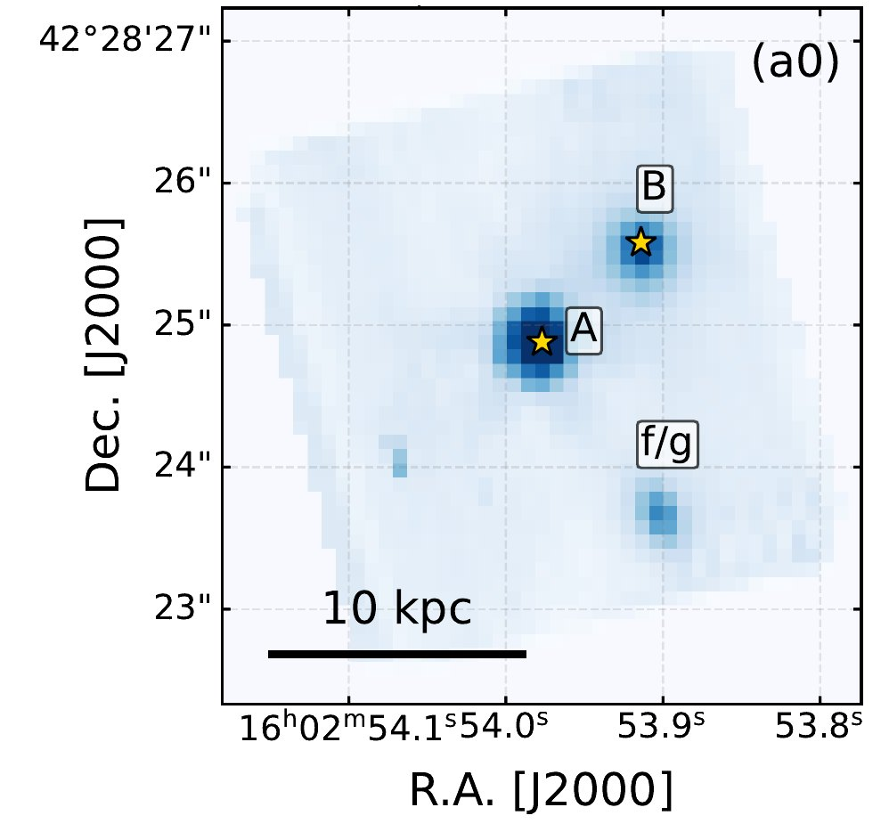
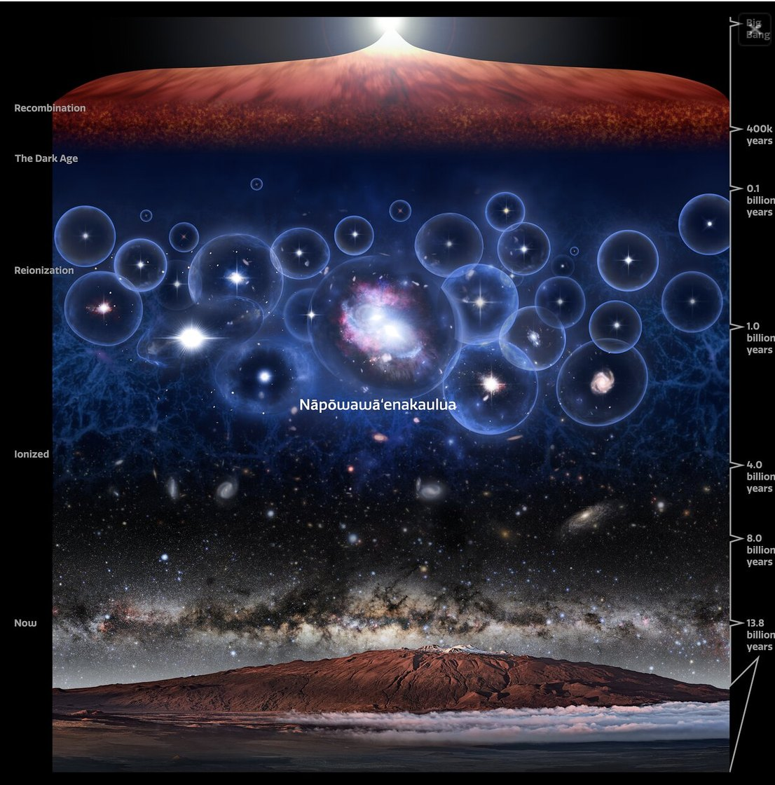

## In the dark, something was feeding

There is an era, at the edge of time, when the universe was still a hostile place with no memory. It was barely 900 million years old. The first galaxies were taking shape among clouds of gas and shells of dark matter, and the first stars were lighting isolated fires in the primordial night.
But in the dark, something was already feeding.
Two **supermassive black holes**, two faceless dark lords, were dragging in boundless quantities of gas, like a tribute owed to them. Before vanishing forever, that matter wound around them in an incandescent whirlpool, and in its final spasm it burned until it shone as brightly as hundreds, even thousands, of galaxies like our own. And so, at the margins of the infant universe, two quasars blazed into being: two cosmic beacons fuelled by hunger.

The **James Webb Space Telescope** and the **Gemini North** telescope caught them together, side by side, separated by just 18,100 light-years: the oldest compact **quasar pair** ever observed. Indeed, according to the study reporting the discovery, it is the closest candidate quasar pair known in the Epoch of Reionisation, and only the third quasar pair ever discovered at cosmic dawn.
Finding them was quite a feat. Their light travelled for almost thirteen billion years before reaching us, and the two are so close that each blurs into the other's glare: even the most powerful telescopes struggle to tell them apart. But their existence raises a question that troubles astrophysicists: how did the first black holes become so powerful, so quickly, when the universe was still so young? And what do they tell us about the assembly of the first great cosmic structures, the nests from which ever more massive and complex galaxies would be born?

In astronomical catalogues they bear a cold, almost clinical designation: J1602+4228AB, where A and B denote the two quasars of the pair.

<figure class="post-fig">

<figcaption>The field observed by the NIRSpec spectrograph of the James Webb Space Telescope around Nāpōwawāʻenakaulua. The yellow stars mark the two quasars, A and B, separated by just 0.98 arcseconds. The label “f/g” marks the candidate foreground galaxy near B. Credits: Onorato et al. 2026, The Astrophysical Journal Letters 1011, L59, Figure 2 (panel a0, cropped), DOI: 10.3847/2041-8213/aeb11f, licensed under CC BY 4.0.</figcaption>
</figure>

But their true name sounds like an ancient incantation: **Nāpōwawāʻenakaulua**. In the Hawaiian language it means “Two celestial bodies of unfathomable and powerful darkness, in the brilliance of the heat that reincarnates energy into the universe”. The name was chosen through the A Hua He Inoa programme of the ʻImiloa Astronomy Center of Hawaiʻi, which promotes the use of the indigenous Hawaiian language in naming astronomical objects, with the contribution of Larry Kimura, associate professor of Hawaiian language and studies at the University of Hawaiʻi at Hilo and a co-author of the study.
Those words hold all the dread and beauty of what we have found: the unfathomable darkness of the two black holes and the radiance of the matter plunging towards them, screaming light before it disappears. For this is the cruellest paradox of the cosmos: a black hole emits no light, yet it can hide at the heart of one of the most luminous objects in the universe.
And this time, in the glow of cosmic dawn, the dark lords were two.

<figure class="post-fig">

<figcaption>The Gemini North telescope, with its 8.1-metre mirror, on the summit of Maunakea, Hawaiʻi, more than 4,200 metres above sea level, above a sea of clouds. Its GNIRS and GMOS spectrographs collected the bluer part of the light from the two quasars of Nāpōwawāʻenakaulua, complementing the observations of the James Webb Space Telescope. Credits: International Gemini Observatory/NOIRLab/NSF/AURA.</figcaption>
</figure>

## Dark lords clothed in light

To understand what was stirring in that darkness, we must travel back to a universe less than 7% of its present age. An infant cosmos, yet already in the grip of violence. Gravity was weaving a gigantic web of dark matter filaments, and along those threads gas slid towards the densest knots. There, galaxies were born, drew close, collided and sometimes devoured one another, giving rise to ever larger structures. In those knots reigned the most fearsome lords of the early universe: black holes with masses of millions or even billions of times that of the Sun. When one of them feeds at a frenzied pace, the nucleus of its host galaxy turns into a quasar, one of the brightest sources in the cosmos. The two quasars of Nāpōwawāʻenakaulua shine like about 60,000 billion and 14,000 billion Suns respectively.

And here is the mystery that haunts astrophysicists. We still cannot truly explain how a black hole could grow to such colossal masses in less than a billion years of cosmic history. It is like finding a grown king in a cradle.
We do know, however, how it feeds. A black hole grows by pulling in and swallowing gas and other matter. But its tribute does not fall straight into the abyss: before crossing the event horizon, the boundary beyond which nothing, not even light, can ever return, the matter circles around it in a swirling spiral, the accretion disc. There it is compressed, torn apart and heated to extreme temperatures, until it releases immense amounts of energy in the form of light.
It is this light, emitted not by the black hole but by the matter it is about to devour, that betrays the presence of a quasar. The nucleus can shine so intensely that it outshines all the stars of its host galaxy. The dark lord remains invisible: what we see is the glow of its victims.

Nāpōwawāʻenakaulua hides two of these dark lords, both already grown, already enormous, while the universe was still in its infancy.

<figure class="post-fig">

<figcaption>Artist's impression of the history of the universe, from the Big Bang (top) to the present day (bottom), with the Milky Way rising above Maunakea, Hawaiʻi. After recombination, the cosmos sinks into the Dark Ages. Then the first galaxies and quasars begin to carve bubbles of ionised gas into the neutral hydrogen, bubbles that grow until they merge: this is the epoch of reionisation. In the central bubble, just 900 million years after the Big Bang, the two dark lords of Nāpōwawāʻenakaulua blaze: two quasars, two supermassive black holes devouring matter and turning it into light. It is the most distant, and therefore oldest, compact quasar pair ever observed. Credits: International Gemini Observatory/NOIRLab/NSF/AURA/P. Marenfeld/M. Zamani</figcaption>
</figure>

## The second lord in the shadows

Their discovery began like every self-respecting horror story: with a detail out of place.
Astronomers were examining data from the Aether programme, an observing campaign carried out with the NIRSpec spectrograph of the James Webb Space Telescope, which observed 200 quasars of the early universe: about 43% of those known in the period between 750 million and one billion years after the Big Bang.
One of them was J1602+4228, a quasar known since 2004. An old acquaintance. But this time, in Webb's observations, there was something else beside it: a second luminous source, at practically the same distance from us. For more than twenty years that companion had gone unnoticed, crouching in its neighbour's glare. Spotting it was far from straightforward: the two objects are so close that separating them is a real challenge. Webb flushed it out, measured its position and captured its spectrum: it is from that dispersed light that astronomers derived the masses of the two black holes. To complete the portrait, however, the spectrographs of Gemini North were also needed. Keeping watch from the summit of **Maunakea**, Hawaiʻi, the telescope collected the bluer part of their light.

Webb's observations show that, on the sky, the two dark lords are separated by just 0.98 arcseconds: roughly the width of a human hair seen from about twenty metres away. Translated into cosmic distance, that sliver corresponds to about 18,100 light-years, roughly a fifth of the diameter of the Milky Way. On a cosmic scale, practically side by side.
This does not mean, however, that the two are already locked in a deadly embrace, nor that their galaxies were merging. That figure is their separation projected onto the sky: the real distance, in three-dimensional space, could be different. There is, however, a clue that gives them away. In the expanding universe, the farther away an object is, the faster it recedes from us: its velocity, measured through its redshift, therefore also reveals its distance. And the velocities of the two dark lords are almost identical: they differ by a mere fifteen or so kilometres per second. A sign that, in all likelihood, they are close in depth too, not just on the sky. It is not definitive proof, because every galaxy also has its own motion that can blur the measurement; but everything suggests that they are travelling together. And that alone is enough to make the system extraordinarily interesting.

## Sovereigns in the cradle of the universe

Then came the masses. The brighter component (J1602+4228A) hides a black hole of about 1.5 billion times the mass of the Sun. Its companion (J1602+4228B), fainter, conceals one of about 400 million solar masses.
To grasp how far off the scale they are, think of the black hole slumbering at the centre of our Galaxy, Sagittarius A*: about four million Suns. The two lords of Nāpōwawāʻenakaulua are roughly one hundred to almost four hundred times more massive.

But their bulk is not the most unsettling thing.
Both were going through a phase of furious accretion, with luminosities close to, or slightly above, the so-called **Eddington limit**. They were devouring matter at very high rates, close to the theoretical maximum, unleashing torrents of energy.
The Eddington limit describes, under ideal conditions, the point at which the pressure of the radiation emitted by the infalling material manages to counteract the gravity pulling it towards the black hole. Beyond that threshold, light itself should begin to push the tribute away. Exceeding it is not impossible, but it requires special conditions, and it must be interpreted with caution, taking into account the uncertainties of the measurements.

The picture that emerges is a nightmare: two dark lords, already enormous, both in a full feeding frenzy, at a time when the first great galaxies were still under construction.

## A double or an illusion?

Every horror story has its double. And before speaking of a pair, astronomers had to confront the most unsettling suspicion of all: what if A and B were the same dark lord, seen twice?
This is not science fiction. A galaxy lying between us and the quasar could act as a gravitational lens: its mass curves space, bends light and can split the image of the source in two, like a warped mirror.
The two images, however, would not necessarily be identical: their light arrives with a delay, showing us the quasar at two different moments, and the stars of the lensing galaxy can distort them differently. This is why the authors looked for a witness that the lens cannot alter: the narrow lines of ionised oxygen ([O III]), produced by gas so extended that it is unaffected by those distortions. If A and B were the same quasar, these lines would have the same shape. They do not: A's line shows a more pronounced blue wing, the signature of stronger gas winds (outflows). Two lords, then, each with its own breath.

One shadow remains, however. Archival Hubble images show a possible foreground galaxy near B, which could explain why B appears far more reddened by dust and could, in theory, act as a lens. Its appearance suggests that it is too close to us to split such a remote object, but only a spectrum will be able to measure its distance.
For now, then, the authors favour a genuine quasar pair, but they warn that gravitational lensing cannot yet be ruled out completely. Until then, the suspicion of the double remains, suspended in the dark.

## Two lords, one kingdom

If the two dark lords are real, another question remains, perhaps even more unsettling: why are two such rare sovereigns so close together?
In the early universe, quasars like these were extremely rare: on average, just one in a cube of space about one and a half billion light-years across, measured at the present-day size of the universe. Finding two of them 18,100 light-years apart is like discovering, in a boundless desert, two exceedingly rare sovereigns ruling over the same territory.

Astronomers measure this tendency to stay close with **clustering**: how often a quasar has a companion nearby, compared with what would happen by pure chance. Around the 199 quasars of the Aether programme, at such a small distance, only one companion turned up. Yet even a single case is too many: extending the clustering measurements made on larger scales down to this one, we would expect one hundred to one thousand times fewer.

But beware: the cosmological models are not disproved. Measurements made over large distances describe how quasars living in different dark matter haloes are arranged, each in its own kingdom. At 18,100 light-years, instead, the two quasars share the same halo, the same kingdom: and a kingdom large enough to feed one dark lord can also host a second. This is why, at such small distances, an excess is partly expected.
The point is that this excess is so large that the shared kingdom alone may not be enough to explain it. Living in the same halo makes it likely to have a neighbour, but not that the neighbour is awake: the quasar phase is a relatively brief moment of frenzy in a black hole's life, and catching two hungry dark lords at the same instant, so close together, is a huge coincidence. Unless something woke them up together.

And this is where the story grows darker. If the two host galaxies are drawing closer, their mutual attraction could disrupt them, driving gas towards their respective centres and serving the banquet to both lords at the same time. Nāpōwawāʻenakaulua could then be the first clue to an entire population of quasar pairs born from galaxy collisions at cosmic dawn.
It is a fascinating scenario, but not yet proven: it rests on a single pair, and only finding more will make it possible to distinguish a real physical effect from a chance encounter. For now we know only one thing: among 199 quasars explored, at least one kingdom with two lords exists.

## What gazes at us from the dawn of time

Nāpōwawāʻenakaulua shows us a universe very different from the one we imagine when we look at the night sky, so quiet and still.

When the cosmos was just 900 million years old, two supermassive black holes had already reached masses of hundreds of millions and billions of Suns. They appeared separated by just 18,100 light-years and were both devouring matter relentlessly. Studying them is a rare opportunity to understand how the first great black holes were born and grew, and what role encounters between galaxies played in their evolution.

But the questions remain suspended in the darkness. Are they truly two dark lords, or a single one reflected twice? Are their galaxies interacting? Did their closeness fuel their hunger, or is it merely the sign of an exceptionally dense cosmic kingdom?

For now, the universe does not answer.

What reaches our telescopes today is light that set out almost thirteen billion years ago: a message from the most remote past, showing us the two dark lords as they were then. What they have become, we cannot know. But the Hawaiian name chosen for them seems to capture exactly what we see: two unfathomable darknesses, wrapped in the incandescent glow of the matter that feeds them.
And in the dark, perhaps, others like them are still waiting to be discovered.

## References

- Onorato, S. et al. (2026), *Nāpōwawāʻenakaulua: A Close Quasar Pair at Cosmic Dawn in the Aether Survey*, *The Astrophysical Journal Letters*, 1011, L59. DOI: <a href="https://doi.org/10.3847/2041-8213/aeb11f">10.3847/2041-8213/aeb11f</a>.

<strong>Sources and credits:</strong> information taken from the study by Onorato et al. (2026), <a href="https://doi.org/10.3847/2041-8213/aeb11f">The Astrophysical Journal Letters, 1011, L59</a>, published under a CC BY 4.0 licence (Figure 2, panel a0, cropped). Images from International Gemini Observatory/NOIRLab/NSF/AURA, P. Marenfeld and M. Zamani. Redshifted is not affiliated with these organisations and their use does not imply any endorsement.

