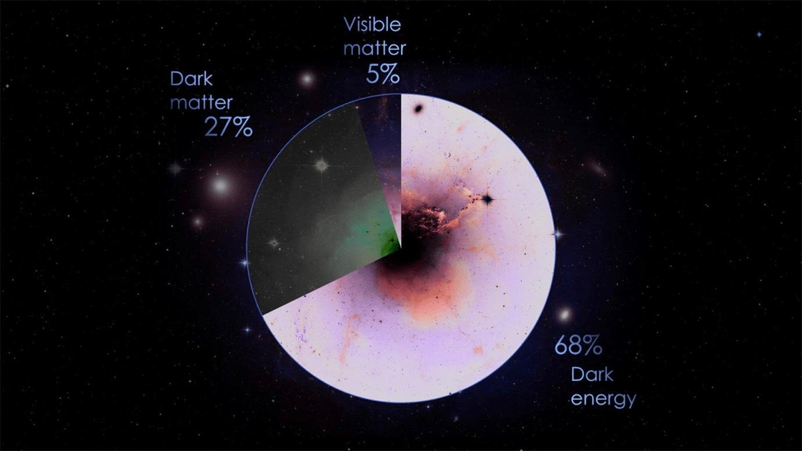
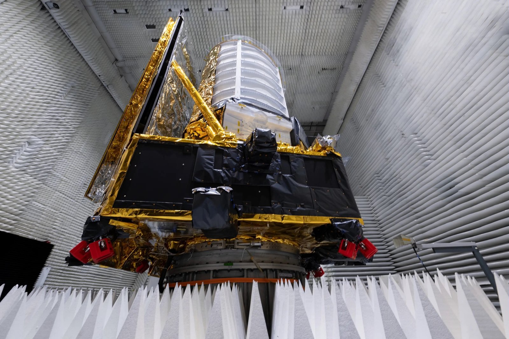
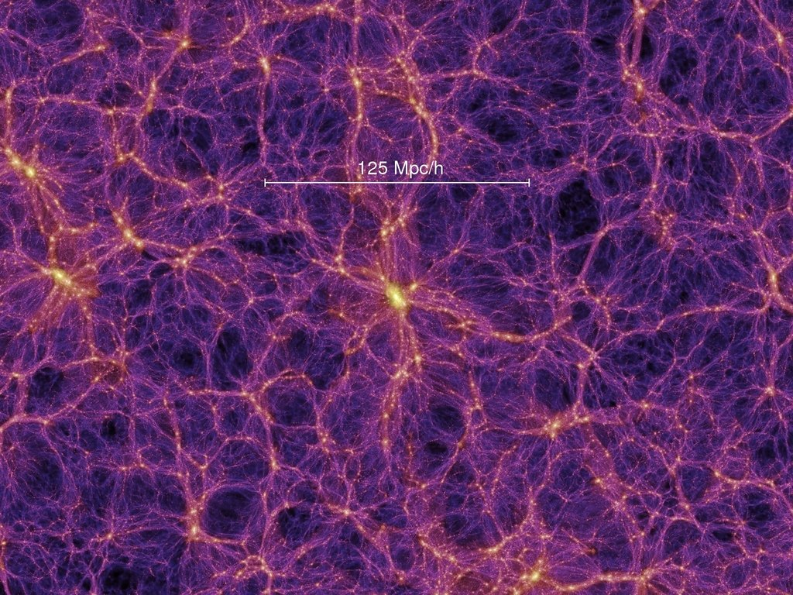
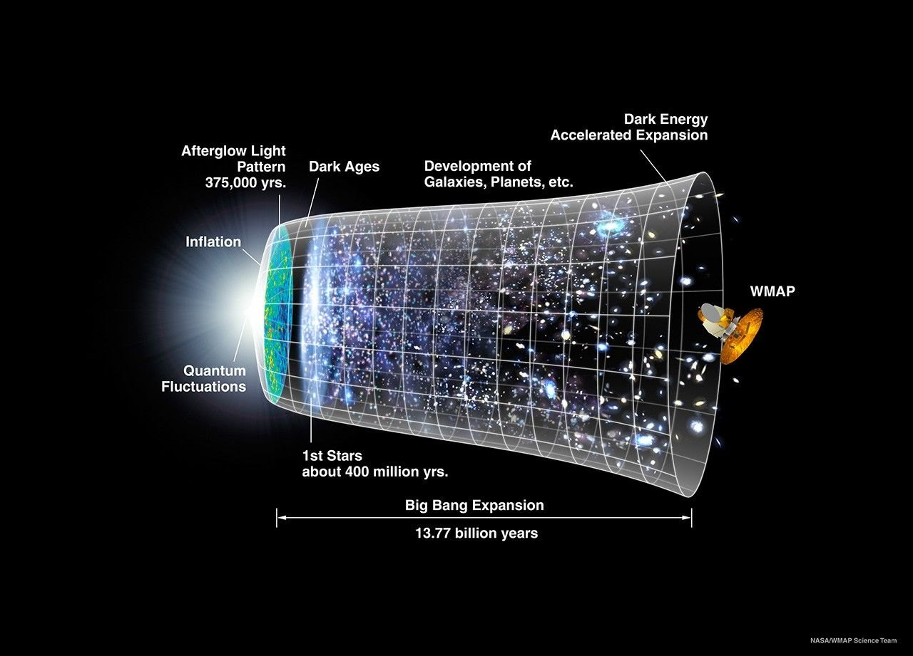
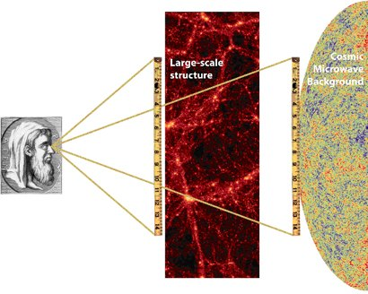
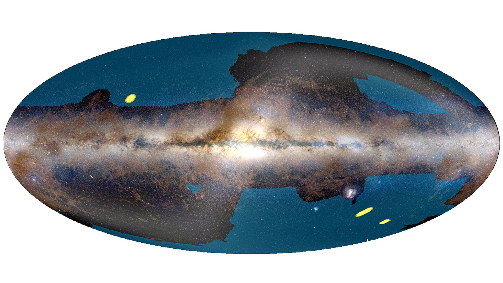
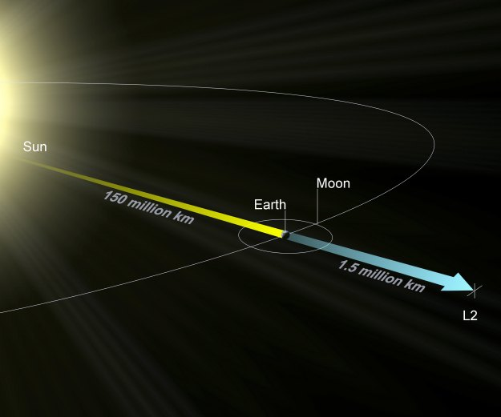
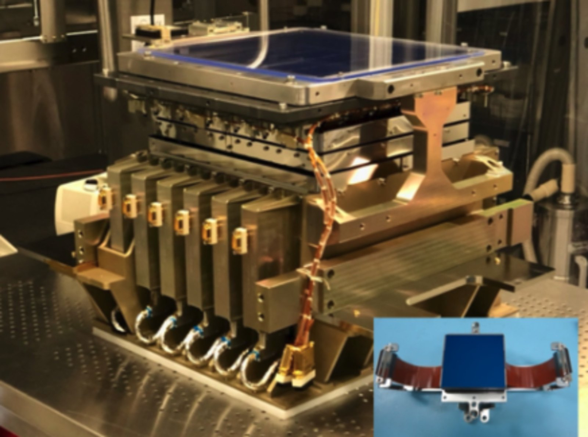
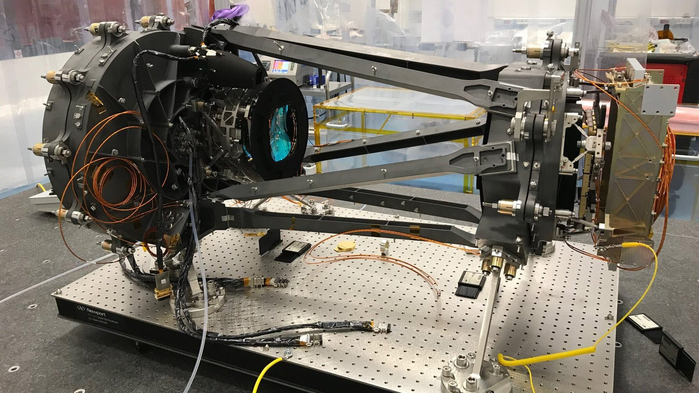

Looking up at the night sky, it is natural to think that stars, galaxies and nebulae are all that exists. They are not. Ordinary matter (known in the jargon as baryonic matter), the stuff that stars, planets and we ourselves are made of, accounts for only about 5% of the content of the universe. The rest is dominated by two mysterious components: dark matter and dark energy.

<figure class="post-fig">

<figcaption>The energy budget of the universe: ordinary matter (known as baryonic matter), which makes up stars, planets and galaxies, accounts for only about 5%; the rest is dark matter (about 27%) and dark energy (about 68%). Credits: NASA’s Goddard Space Flight Center</figcaption>
</figure>

**Dark matter** neither emits, absorbs nor reflects light. It is invisible, but its gravity gives it away: it is precisely by observing how it attracts visible matter that we can infer its existence and reconstruct its distribution, from individual galaxies up to cosmological scales.

**Dark energy**, on the other hand, is the name we give to the cause of the accelerating expansion of the universe, discovered in the late 1990s. What it is, we do not know. It could be the cosmological constant introduced by Einstein, an energy spread uniformly throughout space; or it could be a sign that our understanding of gravity, on the largest scales, is still incomplete.

How do you study something you cannot see? By observing how it affects what we can see. And the influence of the dark universe is enormous: it is the density of matter and that of energy, dark components included, that determine the geometry of the cosmos. This is the challenge taken on by the **Euclid space telescope**, the latest arrival in the ESA family, designed to reconstruct the geometry and evolution of the universe. It is no coincidence that it bears the name of Euclid of Alexandria, the Greek mathematician who lived around 300 BC and is regarded as the father of geometry.

<figure class="post-fig">

<figcaption>The Euclid space telescope in Thales Alenia Space’s test chamber in Cannes, France, during its electromagnetic compatibility tests, the final test before launch. Lined with cones that absorb radio signals, the chamber simulates the electromagnetic environment of deep space. Credits: ESA–Manuel Pedoussaut.</figcaption>
</figure>

The goal is a gigantic three-dimensional map of the universe, built by observing billions of galaxies out to ten billion light-years away. And since looking far away means looking back in time, the third dimension of this map is time itself: Euclid will follow the growth of cosmic structures across some ten billion years of history, spanning the entire era in which dark energy took over, accelerating the expansion of the universe.

## The science goals: mapping the dark universe

Euclid was designed to answer some of the open questions of modern astrophysics.

### What is dark matter?

The first clue came in the 1930s. The Swiss-American astronomer Fritz Zwicky measured the speeds of the galaxies in the Coma Cluster and found that they were moving too fast: the visible matter was not enough to explain their motion. In the 1970s the American astronomer Vera Rubin found the same puzzle in individual galaxies, whose outer regions rotate much faster than expected. And in 1974 a study led by the American physicist James Peebles estimated that, for every kilogram of luminous matter, there were at least ten kilograms of invisible matter. It could not simply be gas that had yet to form stars: searches failed to find enough of it. Astronomers had to venture beyond known physics, towards as-yet-unknown particles that do not interact with light but do produce gravity. Today it is interpreted as so-called **cold dark matter** (CDM), made of slow-moving particles, a pillar of the standard cosmological model, the **Lambda-CDM model**. Without it, neither the motion of galaxies nor the speed at which cosmic structures formed could be explained. CDM outweighs ordinary matter by about five to one. And yet, after decades of experiments, no detector has managed to catch it. Euclid is trying to break the deadlock by another route: reconstructing its distribution by following the growth of the cosmic structures it helped to shape, and measuring how it distorts the images of distant galaxies. Knowing where it is and how it behaves will provide valuable clues to its identity.

<figure class="post-fig">

<figcaption>The cosmic web in the Millennium Simulation: the distribution of dark matter in today’s universe, in a slice of space about 70 million light-years thick. Dark matter gathers into long filaments (purple and pink) that intersect in very dense knots, where galaxies and large clusters are born (yellow); between the filaments lie vast voids (dark purple and black). The bar marks 125 Mpc/h, about 560 million light-years. Credits: V. Springel / Virgo Consortium, Millennium Simulation (Springel et al. 2005, Nature 435, 629).</figcaption>
</figure>

### What is dark energy?

In the late 1990s, two independent teams, the Supernova Cosmology Project led by Saul Perlmutter and the High-z Supernova Search Team led by Brian Schmidt, with Adam Riess playing a crucial role, studied type Ia supernovae. These stars all explode with roughly the same energy: from their apparent brightness one can work out their distance, and hence the history of cosmic expansion. Astronomers expected to find an expansion that was slowing down, braked by the gravity of all the celestial bodies. In 1998 both teams found the opposite: the expansion is accelerating. A discovery that earned the three scientists the 2011 Nobel Prize in Physics. No known physics could explain it, and the cause of this acceleration was named dark energy. According to estimates from ESA’s Planck mission, it makes up about 68% of the matter and energy content of the universe: more than everything else put together. It seems to be a property of the vacuum itself: the more space there is, the more dark energy there is, and the more its effects are felt. The simplest hypothesis is the **cosmological constant**, introduced by Einstein in 1917 to keep the universe static and later abandoned when it was discovered that the universe is expanding. But there are alternatives: a new force of nature, or a theory of general relativity that does not work as we think on the largest scales. Each predicts a slightly different evolution of the acceleration over time, and so far no experiment has been precise enough to tell them apart. Euclid was designed precisely for this. By mapping the galaxies of the last ten billion years, it is required to measure how the cosmic acceleration changes with an accuracy better than 10%, revealing whether the cosmological constant really is constant. And it will measure the growth rate of cosmic structures to within 2%, putting general relativity itself to the test. If either of these tests failed, the Lambda-CDM model would have to be replaced: new physics would be needed.

<figure class="post-fig">

<figcaption>The history of the universe, from the Big Bang to the present. For most of cosmic time, the expansion was slowed by gravity; over the last few billion years, however, it has begun to accelerate again: this is the effect of dark energy, which no one has ever seen but whose imprint we can measure. Credits: NASA/WMAP Science Team.</figcaption>
</figure>

### Gravity as a cosmic lens: weak lensing

To answer these questions, Euclid relies on two cosmological phenomena: weak gravitational lensing and galaxy *clustering*, that is, the way galaxies are distributed and grouped in space. Both make it possible to reconstruct the distribution of matter and follow its evolution over time; combined with the distances of galaxies, they put cosmological models to the test. Light does not always travel in a straight line: when it passes close to a large concentration of mass, gravity bends its path. This is gravitational lensing, one of the effects predicted by Einstein’s general relativity. In **weak gravitational lensing**, the effect is tiny. No spectacular arcs or multiple images: the apparent shape of distant galaxies is stretched only very slightly. Taken on its own, one of these distortions is indistinguishable from the galaxy’s natural shape. But by analysing millions of them statistically, astronomers can reconstruct the minute distortions produced by all the matter the light has encountered along its path. And this is where dark matter comes in: although invisible, it contributes to the gravity that distorts the light of background galaxies. By measuring these distortions, we obtain the distribution of all the mass, visible and dark; by comparing it with that of luminous matter, we discover where the dark component is hiding. To achieve this, Euclid must measure the shapes of galaxies with exceptional sharpness and stability. The result will be a map of the matter in the universe and of its evolution over time.

### The sound echo of the Big Bang: BAO

Euclid’s second tool is the study of the distribution of galaxies on very large scales. This distribution is not random: it preserves an imprint of the conditions in the early universe, the **baryon acoustic oscillations** (**BAO**). In the first few hundred thousand years after the Big Bang, the universe was a hot, dense plasma of photons, electrons and atomic nuclei. Gravity tended to make matter collapse, while radiation pressure pushed it back: from this tug-of-war arose genuine sound waves, which travelled through the plasma. Then the universe cooled enough for the first neutral atoms to form. Radiation decoupled from matter and the waves stopped, frozen in place. Their trace remained imprinted in the distribution of matter, and today we find it as a preferred distance between galaxies: a characteristic scale, the *sound horizon*, which acts as a cosmic ruler. By measuring it at different epochs, astronomers can reconstruct the relationship between distance and redshift and understand how the expansion of the universe has changed over time. Lensing and BAO are independent and complementary probes: the former weighs matter, the latter measure the geometry of the universe and the history of its expansion.

<figure class="post-fig">

<figcaption>The cosmic ruler of BAO: the same characteristic scale, the sound horizon, is imprinted both on the cosmic microwave background (right), the oldest light in the universe, and on the large-scale distribution of galaxies and matter (centre). By measuring its apparent length at different epochs, Euclid reconstructs the geometry and expansion history of the universe. Credits: ©ESA.</figcaption>
</figure>

### Beyond cosmology: Legacy Science

Euclid was born to investigate dark matter and dark energy, but its eyes see much more. A huge field of view, razor-sharp images in visible light and observations in the near infrared: a combination that serves dozens of other fields of research. This is **Legacy Science**, the wealth of data that the mission will leave to the entire scientific community. With Euclid it will be possible to study the formation and evolution of galaxies, the growth of clusters and the structure of the cosmic web. It will be possible to track down active galactic nuclei, quasars, dwarf galaxies and systems so faint that they blend into the background of the sky. Strong gravitational lenses will play a special role: here a foreground galaxy turns the light of a distant source into arcs, rings or multiple images, true laboratories for weighing galaxies and magnifying objects that would otherwise be too faint to see. Our own Galaxy will also take centre stage, with its stellar populations and structures, along with variable sources and transient phenomena, whose brightness changes over time. In short, Euclid will not just answer two big questions: its vast collection of images, spectra and catalogues will fuel astronomical research for decades.

<figure class="post-fig">

<figcaption>Map of Euclid’s surveys across the whole sky. The bright horizontal band is the plane of the Milky Way. The blue lines enclose the regions of the Wide Survey, more than a third of the sky, chosen away from the stars and dust of our Galaxy and from the zodiacal light of the Solar System. In yellow, the three Deep Survey fields: Euclid Deep Field North, in the constellation Draco, and Fornax and South, in the southern sky, about 50 square degrees in total. Credits: ESA/Euclid/Euclid Consortium/NASA/Planck Collaboration/A. Mellinger; acknowledgment: J.-C. Cuillandre, J. Dinis and Euclid Consortium Survey Group, <a href="https://creativecommons.org/licenses/by-sa/3.0/igo/">CC BY-SA 3.0 IGO</a>.</figcaption>
</figure>

## From Earth to L2: Euclid’s journey

To measure such tiny distortions, Euclid needs razor-sharp images, stable temperatures and a sky free from atmospheric interference. That is why it works in space, in a special region of the Sun-Earth system: the second Lagrange point, **L2**. The journey began on 1 July 2023, when Euclid lifted off from Cape Canaveral, Florida, aboard a SpaceX **Falcon 9** rocket. It was originally due to fly on a Russian Soyuz rocket from French Guiana, but after the invasion of Ukraine ESA had to change launcher. About four weeks later, the telescope reached L2, some 1.5 million kilometres from Earth, in the direction opposite the Sun: four times the distance to the Moon. The Lagrange points are five special positions where the gravitational pull of two celestial bodies and the orbital motion balance out, allowing a third, much smaller body to move along with them. At L2, a spacecraft accompanies Earth on its journey around the Sun, always keeping the same configuration with respect to both. Euclid, however, does not sit motionless exactly at L2: it circles around it in a wide orbit, like the James Webb Space Telescope. From there, the Sun, Earth and Moon always remain on the same side of the sky. The sunshield can thus constantly protect the telescope and instruments from direct light, while the solar panels keep receiving energy and the antenna remains pointed towards Earth. After arriving at L2, months of checks and calibrations began. On 14 February 2024 routine science observations started: the great exploration of the dark universe had officially begun.

<figure class="post-fig">

<figcaption>The second Lagrange point of the Sun-Earth system, L2, lies about 1.5 million kilometres from Earth, on the line joining the Sun and Earth, on the side opposite the Sun: about four times the distance to the Moon. From here, Euclid can keep the Sun, Earth and Moon always behind it and observe deep space in extremely stable conditions. Credits: ©ESA.</figcaption>
</figure>

## The telescope

Behind the ability to observe billions of galaxies lies a complex machine, designed to work autonomously and stably for years in deep space. Euclid is about 4.7 metres tall, about 3.7 metres in diameter and weighs about two tonnes. The spacecraft was built in Turin by Thales Alenia Space Italy, ESA’s prime contractor, while the telescope module was built by Airbus Defence and Space; NASA provided NISP’s infrared detectors. Its architecture is divided into two main parts, kept separate to isolate the science instruments as far as possible from the heat and vibrations of the service systems.

### 1. The Payload Module (PLM): Euclid’s eyes

It houses the telescope, the two science instruments and the fine guidance sensor, which keeps the pointing extremely precise during exposures. A single requirement drove its design: stability. To measure the minute distortions of weak lensing, the images must not be altered by mechanical movements or temperature changes. The optical heart is a telescope with a 1.2-metre primary mirror, in a three-mirror Korsch configuration: a design that provides a very wide field of view and sharp images across its whole extent. The mirrors and structure are made of silicon carbide (SiC), a stiff, lightweight ceramic that barely deforms as the temperature changes: perfect for a telescope that must keep its optics aligned with extreme precision. In a single shot, Euclid captures about half a square degree of sky: more than two and a half times the area of the full Moon. The collected light is then split by an optical element called a *dichroic*, which sends the visible part to one instrument and the infrared part to the other. In this way, both instruments observe the same patch of sky at the same time.

**VIS** (Visible Instrument) is Euclid’s camera and sees visible light, between about 550 and 900 nanometres. Its focal plane is a mosaic of 36 CCD sensors, for a total of about 600 million pixels. Its task is to measure very precisely the shape and orientation of an enormous number of galaxies: it is the key instrument for weak lensing. And precisely for this reason, even the slightest instability in the instrument could introduce artificial distortions and corrupt the measurements.

<figure class="post-fig">

<figcaption>The focal plane of the VIS instrument: at the top, under a protective cover, the mosaic of 36 CCD sensors, about 600 million pixels in total; below, separated by thermal shields, the electronics that control them and digitise the 144 data channels. Inset: a single CCD in its transport jig. Credits: CEA, e2v, Airbus, IAS, APCO.</figcaption>
</figure>

**NISP** (Near-Infrared Spectrometer and Photometer) works in the near infrared, up to about 2 microns, and combines two functions. As a photometer, it observes galaxies through three filters, called Y, J and H, and measures their colour and brightness: valuable information for estimating their photometric redshift, a first estimate of distance. As a spectrograph, it splits light into its colours, producing a spectrum for each source. And it does so without a slit (*slitless spectroscopy*): instead of selecting one object at a time, it disperses the light from the entire field of view, obtaining the spectra of a great many galaxies in one go. From the emission and absorption lines comes the spectroscopic redshift, which is far more precise.

<figure class="post-fig">

<figcaption>The NISP instrument before being wrapped in insulating foil and integrated into the spacecraft. This is where the infrared light collected by the telescope is filtered, for photometry in the Y, J and H bands, or dispersed, to obtain spectra, before reaching the focal plane with its 16 infrared detectors provided by NASA. Credits: NISP team/LAM.</figcaption>
</figure>

It is this combination that gives the map its depth: the images tell us where galaxies are on the sky, and the redshift tells us how far away they are, and therefore in which epoch of cosmic history we are seeing them. To work, the telescope and instruments must stay cold, cooled passively by radiators that dissipate heat into space. The primary mirror stays below −140 °C, the VIS sensors operate at around −120 °C and the more demanding NISP sensors go down to about −180 °C.

### 2. The Service Module (SVM): the engine room

If the Payload Module is Euclid’s eyes, the Service Module is what keeps it alive. It contains the systems that generate and distribute power, control attitude and orbit, handle propulsion and communications, and process and store data. Attitude control is crucial: during exposures, Euclid must stay pointed at a precise region of the sky, without vibrations or movements that could spoil the images. The sunshield is also part of the service module, combined with the solar panels: on one side it generates power, on the other it keeps the telescope in shade. And so as not to lose a single bit, there is an onboard mass memory of about 4 terabits, which stores the observations until they are transmitted to Earth.

## From spacecraft to data: the ground segment

A space mission does not end when the telescope takes the picture. The data have to reach Earth and be checked, calibrated, processed and turned into science products. All of this is the job of the **ground segment**, which for Euclid has two sides. The *Operations Ground Segment* is the mission control centre, based at ESA’s European Space Operations Centre (ESOC) in Darmstadt, Germany. It keeps in touch with Euclid through the large antennas at Cebreros, in Spain, and Malargüe, in Argentina; it monitors the spacecraft’s health, sends commands and receives both telemetry and science data. Every day, in a window of about four hours, Euclid sends hundreds of gigabits of data to Earth. The *Science Ground Segment*, by contrast, turns observations into science. It is coordinated from ESA’s European Space Astronomy Centre (ESAC), near Madrid, and distributed across numerous centres of the Euclid Consortium. Raw data are not immediately usable: instrumental effects must be removed, images reconstructed, sources identified and measured, and spectra extracted and analysed. The result is catalogues listing the position, brightness, shape, colour and redshift of every object observed.

## How to build a map of the universe

Euclid does not observe at random. Every pointing follows a strategy planned down to the finest detail, which has to take into account the characteristics of the telescope, thermal constraints, the orientation with respect to the Sun and the need for homogeneous observations. The method is called *step-and-stare*. The telescope points at a region of the sky, stays still during the exposures and collects images and spectra of everything in its field of view. Then it moves on to the next region and starts again. Each field is observed with several exposures slightly shifted from one another, a technique called *dithering*: these small offsets cover the gaps between one sensor and the next, improve the sampling of the images and reduce the effects of any defects in the detectors. The mission includes two major programmes. The **Wide Survey** is the heart of the mission: about 14,000 square degrees of extragalactic sky, more than a third of the whole celestial sphere, away from the plane of the Milky Way and from that of the Solar System. Its aim is to observe an enormous number of galaxies, enough to make the cosmological analyses robust. Alongside it is the **Deep Survey**: three deep fields, totalling about 50 square degrees, observed dozens of times over the course of the mission. By adding up the exposures, Euclid uncovers fainter and more distant sources and follows the evolution of galaxies through different cosmic epochs. Each pointing must also respect the constraints imposed by the spacecraft’s position: the telescope must be kept shielded from the Sun, the solar panels must keep receiving light, the temperature must remain stable and stray light must be kept out of the instruments. This is how Euclid’s map comes together, piece by piece, from tens of thousands of fields observed and calibrated over the years.

## Euclid is already at work: the first major results

Since its first colour images, presented in November 2023, Euclid has kept collecting data, extending its coverage of the sky day after day. In March 2025 it offered a first taste with the *Quick Data Release* Q1, some sixty square degrees of sky. The real leap came on 12 November 2026, with **DR1-Foundation**, the first part of the mission’s first major data release (*Data Release 1*). It comprises about 13 months of observations: images, catalogues and spectra covering about 1,900 square degrees of sky, 14% of the area planned for the Wide Survey. The numbers are staggering: over 900 million galaxies, spectra of more than 160 million sources, over 60 million quasar candidates and around 15,000 strong gravitational lens candidates, the largest catalogue ever compiled, bigger than all previous ones combined. And yet this is only the beginning. DR1-Foundation provides the basic images and catalogues for a vast range of astrophysical research. The complete DR1, expected in mid-2027, will add the higher-level science products needed for cosmological analyses based on weak gravitational lensing and galaxy clustering. Euclid is no longer a promise: it is already delivering an extraordinary amount of data to the astronomical community, with which to explore the universe on unprecedented scales and to unprecedented depths.

## A new look at the universe

Euclid springs from a simple yet dizzying question: what is the universe made of, and how did it become what we see today? Dark matter and dark energy remain two of the greatest puzzles of modern physics. We cannot see them, but we can follow their traces: in the distribution of galaxies, in light bent by gravity, in the expansion of space. Through billions of observations, Euclid will turn these traces into precise measurements, reconstructing the geometry of the cosmos and the growth of its structures over time. Its three-dimensional map will not just be a spectacular portrait of the universe. It will be a tool for putting our theories to the test, looking for possible cracks in the cosmological model and finally understanding what dominates the cosmos. And as Euclid continues to scan the sky, every new galaxy adds a piece to one of the greatest scientific investigations ever undertaken: the quest to uncover the true nature of the dark universe.

<strong>Sources and credits:</strong> information and images taken from the materials of ESA's Euclid mission, <a href="https://www.esa.int/Science_Exploration/Space_Science/Euclid">ESA &ndash; Euclid</a>, and of the Euclid Consortium, and from NASA, the WMAP Science Team, the Virgo Consortium and the Planck Collaboration, as indicated in the individual captions. Redshifted is not affiliated with these organisations and their use does not imply any endorsement.

