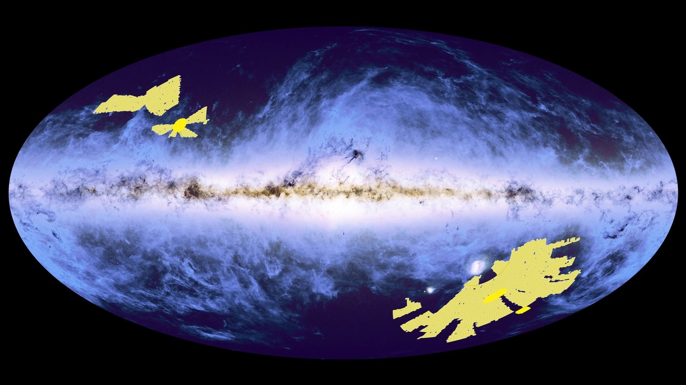
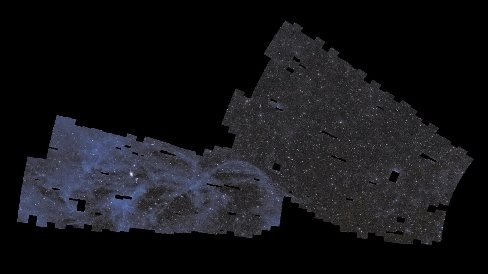
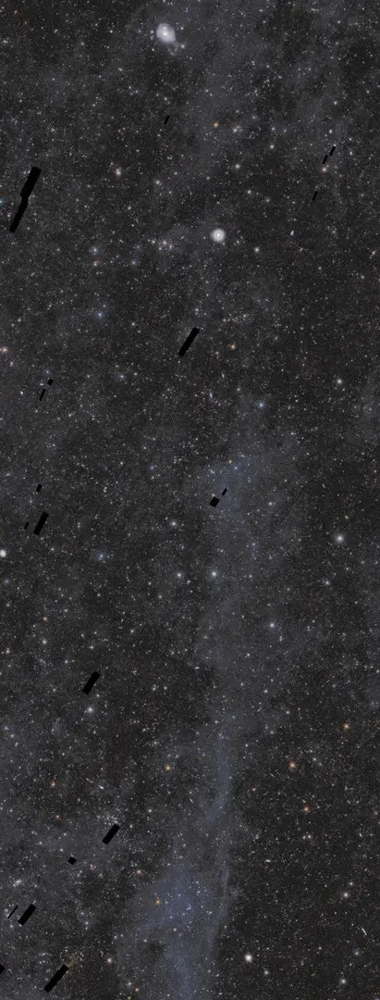
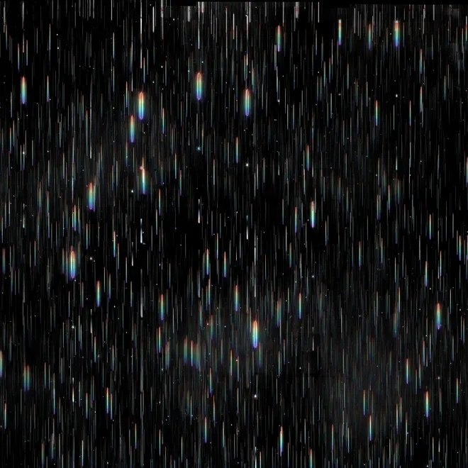
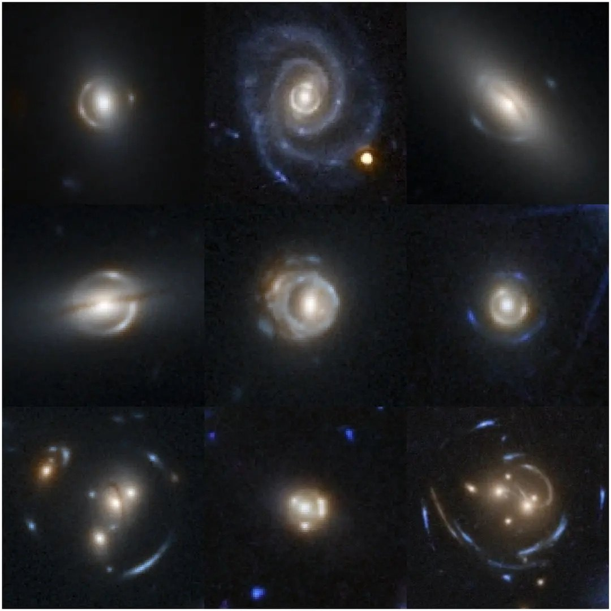
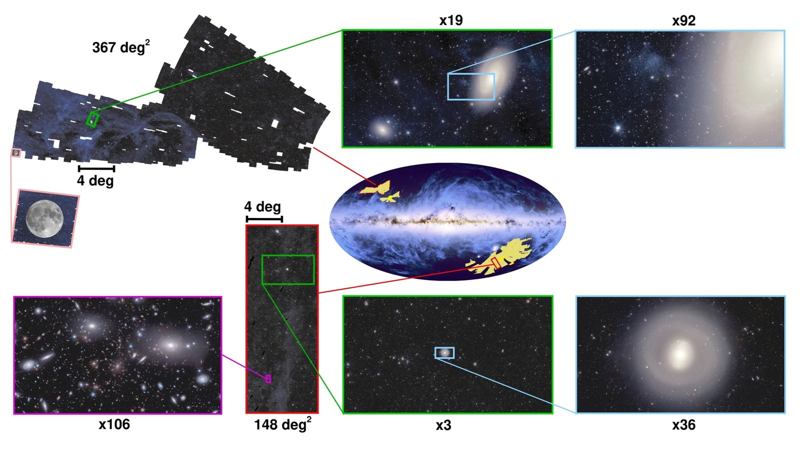
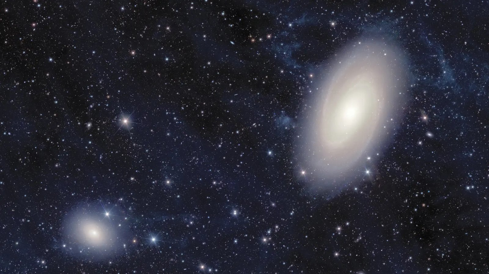
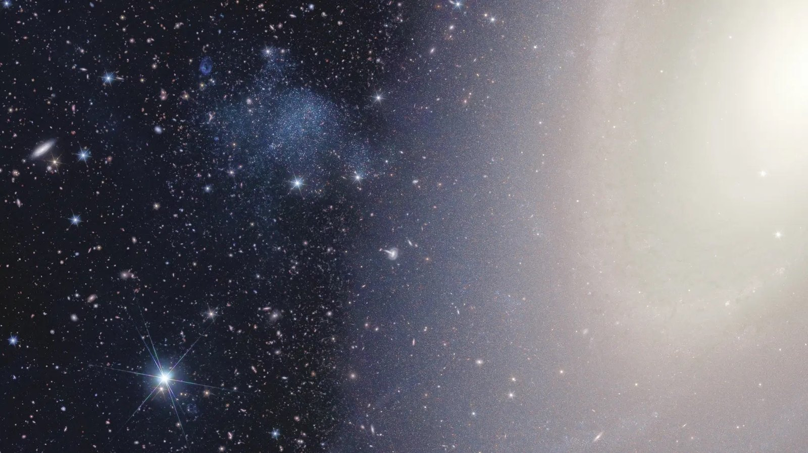
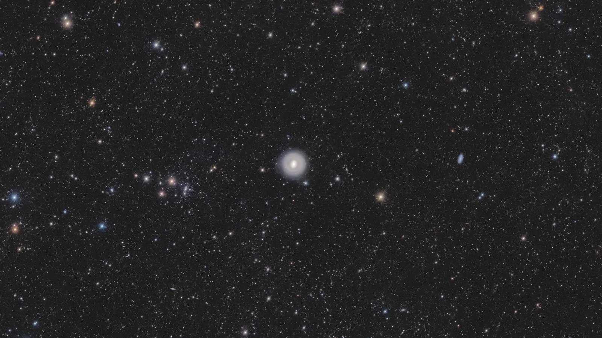
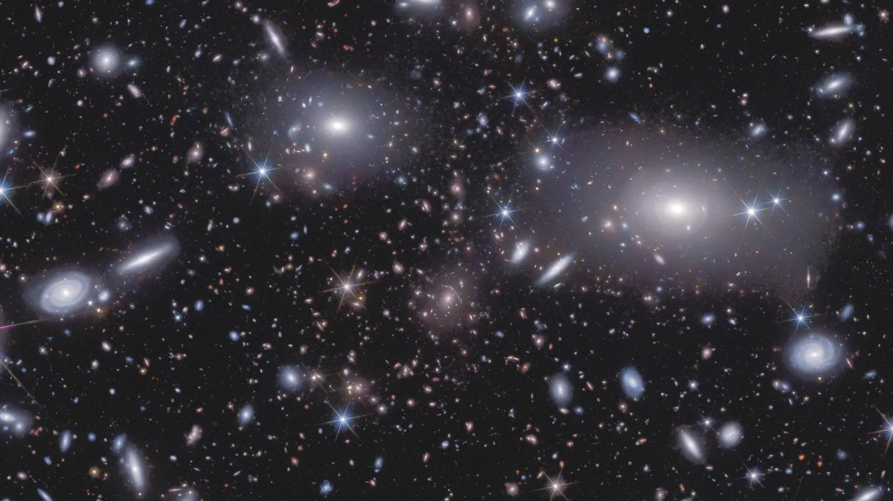

For more than a year, a million and a half kilometres from Earth, an eye has been staring into the darkness. It was not looking for what shines: it was looking for what hides behind the light. On 12 November 2026 it delivered its first report, and the numbers are dizzying: more than a billion cosmic objects, 900 million galaxies, around 15,000 likely gravitational lenses. Let me introduce the beginning of **Euclid**'s dark atlas!

What we see in the sky is just a glaze: stars, galaxies, nebulae, everything that shines is a minority. The rest belongs to two presences that no one has ever seen: dark matter (whose gravity holds up the scaffolding of the cosmos) and dark energy (the force that is driving the universe to expand ever faster). We cannot observe them; we can only follow their footprints: the way they bend light, the way they gather galaxies, the way they shape space. To do so, however, it is not enough to look at one galaxy at a time: we must reconstruct the entire universe, in its geometry and in its history. This is the mission the European Space Agency (ESA) has entrusted to its Euclid space telescope, the detective of the dark universe.

## A billion witnesses

The report is called **DR1-Foundation**, and it is the mission's first major data release. It gathers around 13 months of observations and covers about 1,900 square degrees of sky: an expanse as large as 9,500 full Moons. It is not a single block of sky, but a mosaic of regions scattered across both hemispheres, chosen far from the blinding light of our own Galaxy.

<figure class="post-fig">

<figcaption>The regions of sky included in DR1-Foundation, highlighted in yellow on a view of the whole celestial sphere: in light yellow the areas of the Wide Survey, in deeper yellow those of the Deep Survey. Some smaller areas lie in the northern sky, at upper left; a much larger region stretches across the southern sky, at lower right. The observations were gathered over roughly a year, between spring 2024 and spring 2025. The bright, dusty band across the centre is the plane of the Milky Way, which Euclid avoids: its stars and dust would blind its view of the distant universe. The star map comes from the Gaia mission, the dust map from the Planck mission. Credits: ESA/Euclid/Euclid Consortium/NASA; ESA/Gaia/DPAC; ESA/Planck Collaboration, <a href="https://creativecommons.org/licenses/by-sa/3.0/igo/">CC BY-SA 3.0 IGO</a>.</figcaption>
</figure>

Within these regions lies a staggering census:

- over 900 million galaxies;
- around 15,000 candidate strong gravitational lens systems, the largest catalogue ever compiled, bigger than all previous ones combined;
- over 60 million quasar candidates;
- spectra of more than 160 million sources;
- about 1.7 million gigabytes of data, that is, 1.7 petabytes.

To show what is hidden in that data, ESA has opened two windows onto the dark, one for each hemisphere: two immense mosaics stitched together from hundreds of observations.

<figure class="post-fig">

<figcaption>Euclid's two windows onto the dark. <em>Left</em>: the mosaic of the northern sky, 740 observations between autumn 2024 and spring 2025, nearly 500 gigapixels covering 367 square degrees. In the left half, the blue filaments of galactic cirrus, dust in our own Milky Way, wrap around the galaxy Messier 81 and other nearby galaxies; the right half is darker and more uniform. <em>Right</em>: the mosaic of the southern sky, 370 observations in 18 days covering 148 square degrees, as much as 740 full Moons. Here lies the Horologium supercluster, around 800 million light-years away, but Euclid's gaze reaches as far as 10 billion light-years; at the top, in the foreground, stand out the lenticular galaxy NGC 1316 and the ring galaxy NGC 1291. In both mosaics, the colours combine the four bands of VIS and NISP, around 0.7, 1.1, 1.3 and 1.7 microns, mapped onto the blue, green and red channels; the stars show six spikes caused by the diffraction of light in the telescope's optics. The empty areas were avoided during the survey because of very bright stars, which would have blinded the instruments; the tilted rectangles mark regions hit by X-rays and masked out during processing. Credits: ESA/Euclid/Euclid Consortium/NASA, image processing by J.-C. Cuillandre and E. Bertin, <a href="https://creativecommons.org/licenses/by-sa/3.0/igo/">CC BY-SA 3.0 IGO</a>.</figcaption>
</figure>

But the true power of this archive does not lie in the number of witnesses. It lies in the possibility of questioning them together: of working out where each one is, how far away it is, and with whom it gathers in the dark.

## How to draw the dark atlas

Look at the night sky: galaxies seem like dots scattered across a flat dome. It is an illusion. Some are relatively close, others lie billions of light-years away. To find out where they really are, we must question their light. As it crosses the expanding universe, the light of a galaxy is stretched: its wavelengths grow longer, its colours slide towards the red. This is **cosmological redshift**, and the longer the journey, the redder the light when it arrives. By splitting that light into a spectrum, astronomers look for the reference lines that give it away and measure how far those lines have shifted compared with those observed in the laboratory. From this they obtain the redshift and, with a cosmological model, the distance of the galaxy and the epoch when its light set off. For this work Euclid uses its NISP instrument, which splits light in the near infrared.

<figure class="post-fig">

<figcaption>The sky as seen by Euclid's spectrograph. The NISP instrument does not select one object at a time: it splits the light of all the sources in the field at once, and every star or galaxy turns into a thin vertical streak, its spectrum. The coloured bands reveal how the light is distributed across different wavelengths: this is where the redshift, and hence the distance, comes from. Since NISP observes in the near infrared, invisible to our eyes, the rainbow colours are a representation. Credits: ESA/Euclid/Euclid Consortium/NASA, image processing by B. Granett, <a href="https://creativecommons.org/licenses/by-sa/3.0/igo/">CC BY-SA 3.0 IGO</a>.</figcaption>
</figure>

The signal it hunts is the **H-alpha line** of hydrogen, the glow of gas lit up by the light of newborn stars. The spectra of 160 million sources provide the third coordinate of a map that no longer has two dimensions, but three. And when the galaxies are put in their place, something unsettling emerges: they are not scattered at random. They line up in endless filaments, crowd into dense knots and leave immense voids between them, cosmic deserts where almost nothing shines. This is the **cosmic web**, and it is woven above all by **dark matter**: its invisible filaments have gathered gas with their gravity, and there the galaxies were born. What we see is only the dew glistening on an invisible web. Mapping the dark atlas means beginning to glimpse the shape of the web, that is, discovering where dark matter lurks and how it is distributed.

## Fifteen thousand lenses in the dark

Among all the treasures of DR1-Foundation, there is one that astronomers had been awaiting for years: around 15,000 candidate **strong gravitational lens** systems. A gravitational lens forms when an enormous mass comes between us and a distant galaxy: a galaxy, or an entire cluster. That mass warps the geometry of spacetime, and the light passing through is forced to follow its folds. The mass in the foreground thus becomes a distorting lens: it stretches the image of the source hidden behind it, magnifies it, sometimes multiplies it. Luminous arcs appear, double or quadruple images of the same galaxy, like ghosts repeating in the dark. And when the alignment is almost perfect, the light closes into a complete ring: an Einstein ring. Behind these hypnotic shapes lies a secret. The bending of light depends on all the mass of the lens, including the mass that emits no light. By studying the geometry of these lenses, astronomers can weigh galaxies and clusters and reconstruct the haloes of dark matter that envelop them. And they can use them as natural telescopes, to magnify extremely distant galaxies that would otherwise be too faint to see. But these lenses are extremely rare: only one galaxy in several thousand forms one. To hunt them down among a billion sources, Euclid needed allies: artificial intelligence algorithms trained to recognise them, and thousands of citizen volunteers who combed through the images with the Space Warps project, on the Zooniverse platform. For the first time, strong lenses are no longer isolated curiosities: they are a population to be studied statistically. The catalogue also includes configurations that until now were one-off discoveries. Compound lenses, in which a single galaxy bends the light of several galaxies at different distances, drawing rings one inside the other. Spiral galaxies acting as lenses, although they are usually too light to do so. And multiplied quasars: their light changes over time, and the different images of the same quasar brighten and fade with a delay relative to one another. Measuring that delay makes it possible to calculate how fast the universe is expanding.

<figure class="post-fig">

<figcaption>A sample of the strong gravitational lenses discovered by Euclid. <em>First row, from left</em>: a classic galaxy–galaxy lens; an Einstein ring around a face-on spiral; a galaxy with an inclined dusty disc. <em>Second row</em>: an edge-on dusty galaxy; a lensed galaxy with visible star-forming regions; a compound lens, with several rings produced by background galaxies at different distances. <em>Third row</em>: a galaxy group acting as a lens; a lensed quasar; a second galaxy group, wrapped in blue arcs and rings. Credits: ESA/Euclid/Euclid Consortium/NASA, image processing by N. Lines and T. Li, <a href="https://creativecommons.org/licenses/by-sa/3.0/igo/">CC BY-SA 3.0 IGO</a>.</figcaption>
</figure>

## Welcome to the cosmic funfair

Euclid's catalogue is not a list: it is a funfair of the dark, but its attractions are made of light. In the darkness of the archive move over 60 million **quasar** candidates. They are among the brightest objects in the universe, and their brilliance has a sinister origin. At the centre of a galaxy, a supermassive black hole draws in gas and dust; before vanishing, that matter swirls around it in a white-hot disc, and friction heats it until it shines brighter than entire galaxies. Euclid has found some whose light set off when the universe was just 5% of its current age. Then come the biggest attractions in the park: **galaxy clusters**! They are the most imposing structures held together by gravity: hundreds or thousands of galaxies immersed in scorching gas and in a halo of dark matter that dominates them all. Euclid has even caught these giants before their birth: **protoclusters**, structures still in the midst of collapse, the progenitors of today's clusters. Thanks to the spectra, Euclid measures their redshift directly, that is, their distance.

## Portraits from the dark

Alongside catalogues and spectra, DR1-Foundation holds images that show what Euclid's eye is capable of: moving from vast stretches of sky to the detail of a single galaxy, without losing sharpness.

<figure class="post-fig">

<figcaption>A journey through the DR1-Foundation data, from the whole sky down to individual galaxies. At the centre, the celestial sphere with the regions observed by Euclid highlighted in yellow. <em>Top</em>: the 367-square-degree northern mosaic (with the full Moon to scale, at lower left); the green box magnifies Messier 81 and its companion NGC 3077 19 times, the light-blue one reaches 92 times, on the disc of Messier 81 and the dwarf galaxy Holmberg IX. <em>Bottom</em>: the 148-square-degree southern mosaic, in the region of the Horologium supercluster; the green and light-blue boxes magnify the ring galaxy NGC 1291 3 and 36 times, while the purple one reaches 106 times, on the galaxy cluster Abell 3128. Credits: ESA/Euclid/Euclid Consortium/NASA, image processing by J.-C. Cuillandre and E. Bertin, <a href="https://creativecommons.org/licenses/by-sa/3.0/igo/">CC BY-SA 3.0 IGO</a>.</figcaption>
</figure>

In the northern sky, a mosaic of nearly 500 gigapixels, stitched together from 740 observations gathered between autumn 2024 and spring 2025, spans 367 square degrees. There, wrapped in bluish filaments of dust from our own Galaxy, the so-called galactic cirrus, shines **Messier 81**: a *grand-design* spiral with a bright centre and broad, well-defined arms, around 12 million light-years from us. It is the heart of a group of some forty galaxies, and its gravity leaves its neighbours no peace. The smaller NGC 3077 is distorted by it: the interaction ignites episodes of intense star formation and slowly reshapes it. Not far away glows a cloud of blue stars, the irregular dwarf galaxy Holmberg IX: its stars may have been born precisely from the gravitational clash between Messier 81 and its neighbour Messier 82. Messier 81 is close enough for Euclid to make out its individual stars: specks of light that, despite 12 million light-years of distance, stand out one by one from the veil of the disc.

<figure class="post-fig">

<figcaption>The heart of the Messier 81 group, around 12 million light-years from us. <em>Left</em>: at upper right the large <em>grand-design</em> spiral Messier 81, at lower left the smaller NGC 3077, distorted by its gravity; the blue filaments in the background are galactic cirrus, dust in our own Milky Way. The image covers about one square degree, five times the full Moon, and was captured by Euclid in just over an hour. <em>Right</em>: Euclid at maximum resolution. On the right, the disc of Messier 81 dissolves into a pale glow in which individual stars can be made out; just to its left, the cluster of bluish stars is the irregular dwarf galaxy Holmberg IX. All around shine much more distant background galaxies, some reddish, others spirals with blue arms. Credits: ESA/Euclid/Euclid Consortium/NASA, image processing by J.-C. Cuillandre and E. Bertin, <a href="https://creativecommons.org/licenses/by-sa/3.0/igo/">CC BY-SA 3.0 IGO</a>.</figcaption>
</figure>

In the southern hemisphere, Euclid took 18 days and 370 observations to portray 148 square degrees of sky, an area as large as 740 full Moons. Here, around 800 million light-years away, stretches the **Horologium supercluster**, a gathering of more than 30 galaxy clusters. But the image is a bottomless well: in front of the supercluster float much closer stars and galaxies, while behind it objects from the early universe can be glimpsed, as far as 10 billion light-years away. In the foreground, two more presences stand out. The lenticular galaxy NGC 1316, visible at the top of the southern mosaic, drags long streams of stars behind it, the scars left by encounters with its companions. A little lower down, around 33 million light-years away, the ring galaxy NGC 1291 stares at the sky like a pale eye; in its ethereal disc, tiny blue specks betray stars that are still being born. One of the richest members of the supercluster is **Abell 3128**, which gathers hundreds of galaxies: swirling spirals and hazy ellipticals. At its centre hides one of the 15,000 lenses: the light of a more distant galaxy, bent by the mass in the foreground, stretches into blue arcs. And the frame conceals another secret: along the same line of sight, some 5 billion light-years further back, a second cluster overlaps, ACT-CL J0330-5227. Two lairs of galaxies, one in front of the other, separated by an abyss that the eye flattens.

<figure class="post-fig">

<figcaption>Two portraits from the southern sky. <em>Left</em>: the ring galaxy NGC 1291, around 33 million light-years from us, at the centre of a 14-square-degree field, 70 times the full Moon, captured by Euclid in about a day and a half. The frame also includes the galaxy cluster Abell 3122, at centre left, and the blue spiral galaxy MCG-07-07-007, on the right. <em>Right</em>: the galaxy cluster Abell 3128, one of the richest in the Horologium supercluster, around 800 million light-years away: two large pale ellipticals dominate the upper part, surrounded by hundreds of smaller galaxies. At the very centre of the image, a strong gravitational lens bends the light of a more distant galaxy into blue arcs. A second cluster, ACT-CL J0330-5227, actually some 5 billion light-years further away, overlaps in the same frame. This view, covering 0.12 square degrees, just over half a full Moon, took about 70 minutes and shows Euclid at its maximum resolution. Credits: ESA/Euclid/Euclid Consortium/NASA, image processing by J.-C. Cuillandre and E. Bertin, <a href="https://creativecommons.org/licenses/by-sa/3.0/igo/">CC BY-SA 3.0 IGO</a>.</figcaption>
</figure>

## The first page of an unfinished atlas

And yet, all this is only the beginning. The roughly 1,900 square degrees of DR1-Foundation are just 14% of the sky that Euclid will explore over its six-year mission. The full release, DR1, is expected in mid-2027. It will add **weak lensing** measurements, and calculations of how galaxies and clusters fit into the cosmic web. If strong lenses force themselves upon the eye, weak lensing is a whisper: distortions so faint that, in a single galaxy, they cannot be seen at all. Only by adding up millions of them, and then billions, does the outline of the invisible mass that fills the universe emerge. Strong and weak lenses, spectra, catalogues of galaxies and clusters: these are the clues from which the dark atlas will be born. Together, they will make it possible to reconstruct the history of cosmic expansion, to measure dark matter and to put to the test the models with which we believe we have understood the universe. Euclid has not finished its work yet. It has delivered the first page of its atlas, but it is a page of clues, not yet a map. The invisible web that holds the cosmos together cannot be seen: it can only be sensed from the dew glistening on its threads. To draw it, we will need the measurements of the full DR1 and the years of observations still to come. This is only the first page. The others still lie in the dark.

<strong>Sources and credits:</strong> information and images taken from the materials of the DR1-Foundation data release of ESA's Euclid mission, <a href="https://www.esa.int/Science_Exploration/Space_Science/Euclid">ESA &ndash; Euclid</a>, and of the Euclid Consortium, as indicated in the individual captions (ESA/Euclid/Euclid Consortium/NASA, ESA/Gaia/DPAC, ESA/Planck Collaboration). Redshifted is not affiliated with these organisations and their use does not imply any endorsement.

