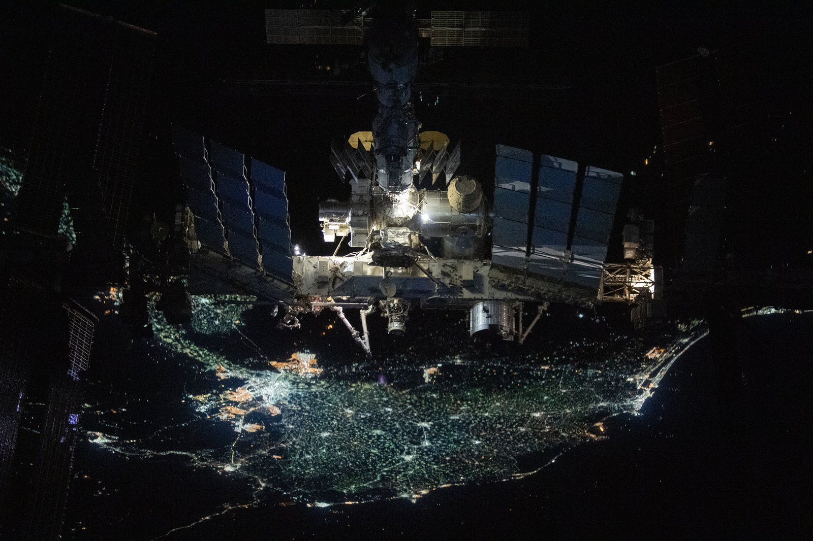
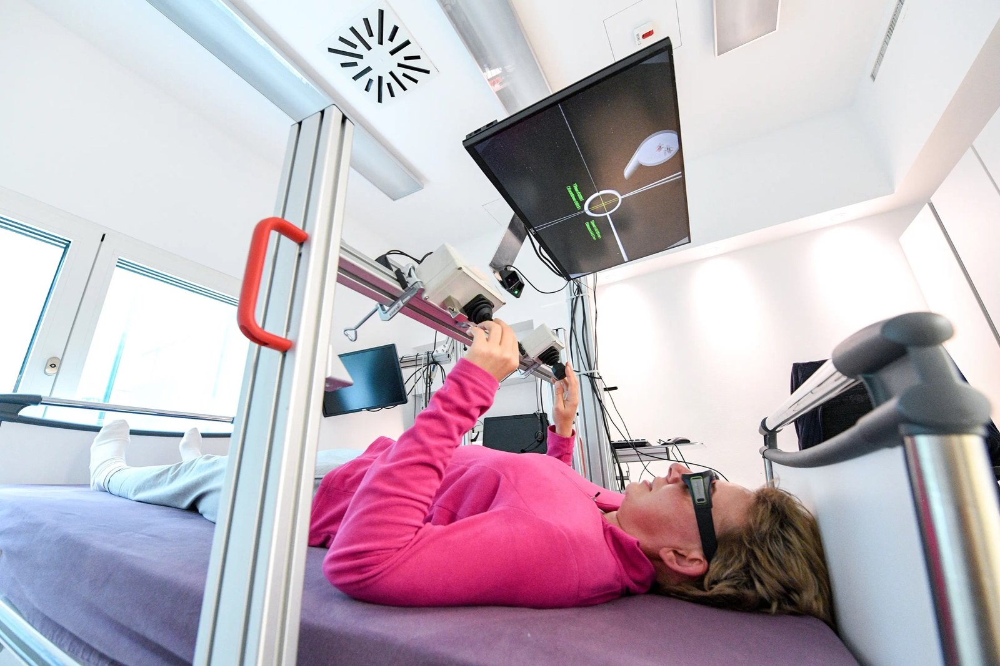
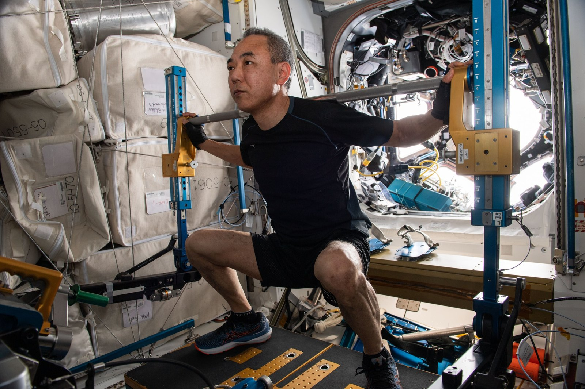
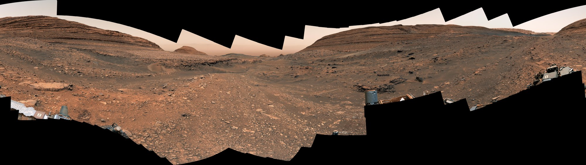
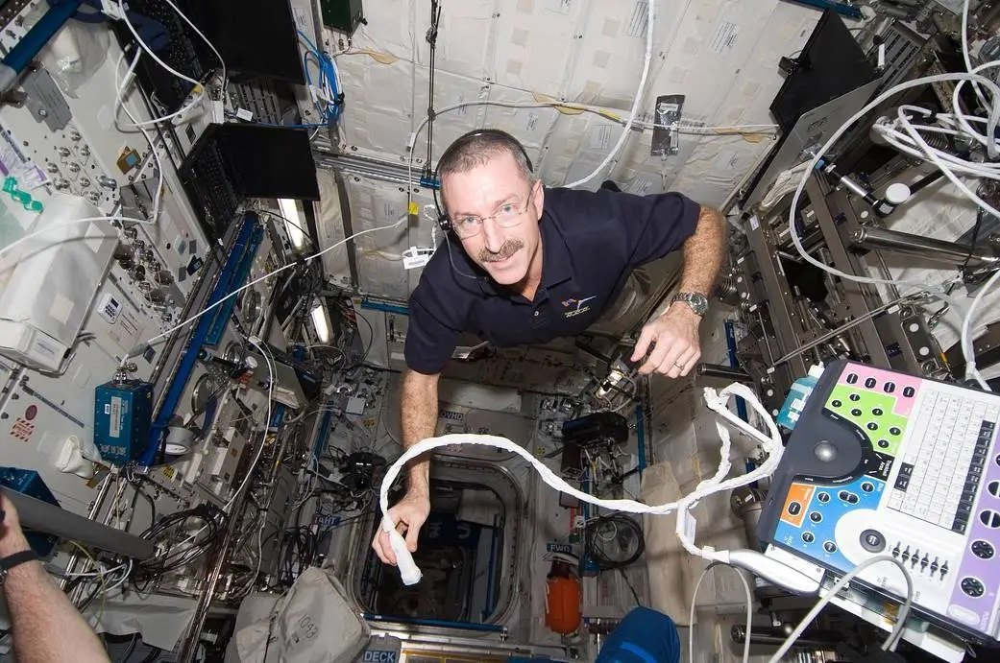
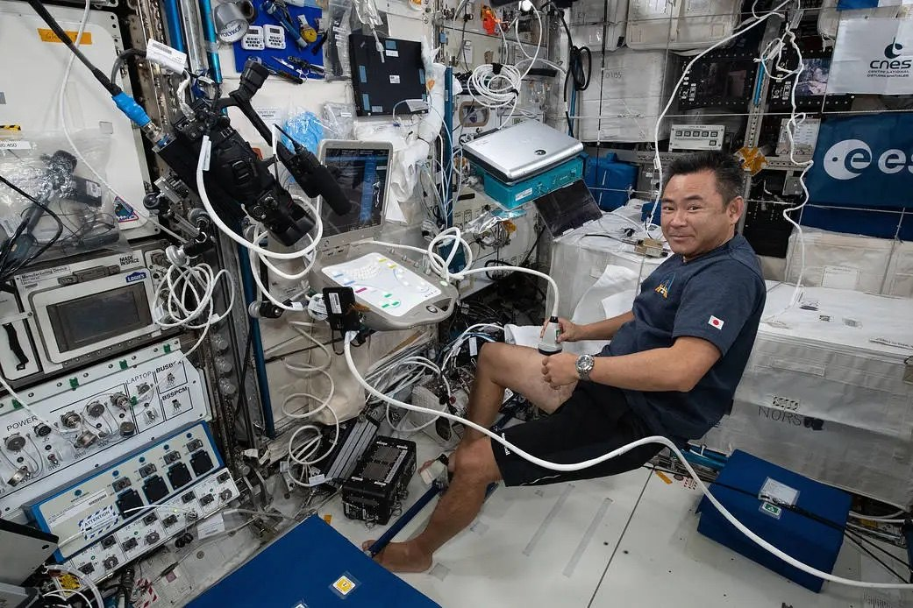

Up there, where nothing weighs anything, the **human heart** changes shape!

Throughout our lives, our heart fights a silent battle against a force we cannot see. Every time we stand up, gravity drags our blood downwards, into the legs, below the level of the heart; and the heart, beat after beat, has to push it back up again, all the way to the brain. But what happens when that force stops making itself felt? When the heart finds itself, for months, with nothing left to fight against?

## The invisible enemy

Let us imagine the circulatory system as a set of tubes filled with liquid, as tall as our body. In a column of liquid, pressure increases as you go down, because each layer has to support the weight of all the liquid above it: this is Stevin's law, the same reason why the water pressure at the bottom of a swimming pool is greater than at the surface. When we are standing, the blood in our legs is therefore under greater pressure than the blood in our head, and it tends to pool downwards. To keep the brain well supplied with blood, the heart has to work “uphill”, against gravity. Our body is so used to this effort that it does not even notice it: within moments of standing up, our blood vessels narrow and our heart rate rises to compensate. It is a refined balance, built over millions of years of evolution on the surface of a planet with a very specific gravity. Space breaks it.

## What microgravity really is

First of all, let us dispel a myth: on the **International Space Station** (**ISS**) gravity is by no means zero. The Station orbits at an altitude of about 400 km, where the Earth's pull is still about 90% of what we feel on the ground. If we could climb all the way up there on a very long ladder, we would weigh only a little less than we do now. So why do astronauts float? To understand this, we need to look at how the Station moves. The ISS is not standing still up there: it races around the Earth at about 28,000 km/h and completes a full orbit in about an hour and a half. Think of a stone tied to a string and swung in a circle: if the string breaks, the stone flies off in a straight line along the tangent. To keep it turning, something has to pull it continuously towards the centre. For the Station, this “string” is the Earth's gravity: it is gravity that keeps bending its path and holds it in orbit. Now let us put ourselves in the astronauts' shoes, as they turn together with the Station. Anyone on something that rotates, such as a merry-go-round or a car taking a bend, feels pushed outwards: this is the **centrifugal force**. On board the ISS this push, directed away from the Earth, balances the gravitational pull, directed towards the Earth. In fact, the Station, the astronauts and every object on board follow the same orbit at the same speed, so the balance holds for everyone in the same way: no floor pushes against their feet, nothing presses on anything, and apparent weight almost disappears. This is why we speak of **microgravity**: gravity is very much there, but on board it is offset by the orbital motion. All that remains are tiny residual accelerations, of the order of a millionth of what we feel on the ground. For our circulatory system, however, the result is the same as in a world without gravity: the column of blood no longer “weighs” anything and the body begins to transform.

<figure class="post-fig">

<figcaption>The International Space Station suspended in the night, more than 400 km up, above the lights of the Nile Delta in Egypt. It was photographed on 8 November 2021 by the crew of the SpaceX Crew Dragon capsule <em>Endeavour</em>, during the fly-around of the Station after undocking. Credits: NASA (<a href="https://www.flickr.com/photos/nasa2explore/51814547213/">iss066e080034</a>).</figcaption>
</figure>

## The great shift

As soon as astronauts reach orbit, the body's fluids, no longer dragged downwards, migrate from the legs towards the chest and the head. The body interprets this inflow as an excess of fluid and reacts by reducing the volume of plasma, the liquid part of the blood. With less blood in circulation, the heart fills less with each beat and pumps a smaller volume: what physiologists call **stroke volume**, the amount of blood ejected with each contraction, decreases and the heart, which no longer has to push blood uphill, begins to adapt to its new, lighter life.

## A rounder heart

In 2014 a research group led by James Thomas, then NASA's lead scientist for ultrasound, presented the results of a study of 12 ISS astronauts at the annual meeting of the American College of Cardiology. The astronauts had been trained to use the on-board ultrasound machine to capture images of their own hearts before, during and after the mission. The result was surprising: in microgravity the heart became 9.4% *more spherical*! Normally the heart has an elongated shape; in space it tended to become rounder. The change was close to that predicted by the mathematical models developed for the study, and it was temporary: shortly after returning to Earth, the heart regained its usual shape. The problem is that, according to the researchers, a more spherical shape might indicate that the heart is working less efficiently. Thomas himself warned: in space the heart works less, and this can lead to a loss of muscle mass.

## A muscle that wastes away

The heart is a muscle, and like every muscle it shapes itself around the work it has to do. In athletes it grows larger; in people with high blood pressure it thickens. And when the load decreases, it shrinks: this is **cardiac atrophy**. In 2001 the group of Benjamin Levine, a cardiologist at UT Southwestern in Dallas, used magnetic resonance imaging to measure the hearts of volunteers confined to bed for weeks. After 42 days of bed rest, the mass of the left ventricle, the chamber that pumps blood throughout the body, had decreased by 8%. In four astronauts, after just 10 days of flight, the average reduction had been 12%, although with such a small sample the result did not reach full statistical significance. The most famous case is that of astronaut Scott Kelly, who spent 340 days on the ISS between 2015 and 2016. Despite exercising six days a week, on the exercise bike, the treadmill and with strength training, his left ventricle lost an average of 0.74 grams of mass per week. Yet his heart kept working well: it had simply adapted to a lighter load. A curiosity: in the same study, the researchers observed a similar atrophy in the heart of Benoît Lecomte, the swimmer who in 2018 attempted to swim across the Pacific Ocean. Hours and hours in the water every day, in a horizontal position and with low-intensity activity: for the heart, almost like being in space.

### Space, on Earth

And here is an unsettling detail: for the heart, staying in bed for a long time is very similar to living in orbit. This is why space agencies use **bed rest** as an Earth-based laboratory for microgravity. The international standard, set in 1979 by American and Soviet researchers, requires volunteers to lie with their heads tilted 6° downwards: in this position fluids shift towards the head, just as they do in space. Volunteers stay like this for as long as 60 days, without ever getting up: they eat, drink, work and even go to the toilet lying down! These studies have shown that the loss of heart mass is genuine atrophy, and not simply “dehydration” of the muscle. To understand how to counter it, NASA carried out a further experiment: 26 volunteers stayed in bed for 70 days, some doing nothing, others following an intensive training programme. In those who had remained sedentary, the mass and function of the heart declined progressively; in those who exercised, the decline was reduced. This is why the main countermeasure on the ISS is precisely physical exercise. Astronauts train for about two hours a day on average: they run on a treadmill, pedal on an exercise bike and lift “weights” with ARED, a piston-driven machine that reproduces weightlifting in weightlessness. A study published in 2023 in the *Journal of the American College of Cardiology* used magnetic resonance imaging to measure the hearts of 13 astronauts, before and after about five months on the ISS. In orbit the heart had worked less, yet on their return the mass of the left ventricle had not changed significantly. With this training, atrophy therefore seems to be avoidable.

<figure class="post-fig">

<figcaption>Two ways to fight the slow erosion of the body. <em>Left</em>: a volunteer in the first bed rest study carried out jointly by ESA and NASA, at DLR’s :envihab facility in Cologne, in 2019. For 60 days she lies with her head tilted 6° downwards, to reproduce the effects of microgravity on Earth; here, wearing a virtual reality headset, she tries to dock a spacecraft with an orbiting station. Credits: DLR. <em>Right</em>: JAXA astronaut Satoshi Furukawa exercises on ARED, in the Tranquility module of the ISS, on 19 January 2024. The machine reproduces the forces of weightlifting on Earth. Credits: NASA.</figcaption>
</figure>

## The Mars problem

All this becomes crucial when we think about the next great journey. Reaching Mars will take months of flight through space; and on arrival the astronauts will once again have to face gravity, about 0.38 times that of the Earth. Will a heart weakened by the journey be able to sustain them when they have to walk, work, perhaps deal with an emergency on the surface of the red planet?

To find out, an international group led by Vinesh Appadurai, with James Thomas (now at Northwestern University) and Benjamin Levine among the authors, followed the hearts of **13 astronauts** (9 men and 4 women, average age 49) during ISS missions with an average duration of about five and a half months: a time comparable to that of a journey to Mars. The study was published in 2026 in the journal *Circulation*.

<figure class="post-fig">

<figcaption>The world that awaits the astronauts' hearts. NASA’s Curiosity rover captured this panorama inside Gediz Vallis, a channel on the slopes of Mount Sharp, in Gale Crater, on 21 and 22 September 2024, by stitching together 341 images from its Mastcam camera. The colours have been adjusted to show the scene as a human eye would see it under Earth-like lighting. To the right of centre is a field of white stones: it was here that Curiosity, by driving over a rock and cracking it open, discovered pure sulfur on Mars for the first time. Credits: NASA/JPL-Caltech/MSSS (<a href="https://photojournal.jpl.nasa.gov/catalog/PIA26410">PIA26410</a>).</figcaption>
</figure>

### Looking inside a heart in orbit

The tool chosen was **Doppler echocardiography**. Ultrasound waves, sent through the chest, bounce off the structures of the heart and make it possible to reconstruct its shape, size and movement. The Doppler effect adds a valuable piece of information: when a wave is reflected by something moving, such as flowing blood, its frequency changes, just as the sound of an ambulance siren changes as it approaches or moves away. By measuring that change, one can work out the speed of the blood and therefore how efficiently the heart is pumping. Earlier studies had relied on magnetic resonance imaging, which cannot be used in orbit. The ultrasound machine, on the other hand, is on board the Station. The astronauts, trained before launch, examined one another, guided in real time by the research team on the ground, after about 14, 30, 75 and 135 days of flight and finally 15 days before their return.

<figure class="post-fig">

<figcaption>Their own doctors, 400 km from Earth. <em>Left</em>: NASA astronaut Dan Burbank, commander of Expedition 30, prepares to perform a heart ultrasound on a crewmate, out of frame, in the Columbus laboratory of the ISS. The scan was part of the <em>Integrated Cardiovascular</em> experiment, which studied how the heart atrophies during long missions and how this affects the amount of blood pumped with each beat and the shape of the heart. <em>Right</em>: on 25 May 2021 JAXA astronaut Akihiko Hoshide, commander of Expedition 65, uses the ultrasound device to scan the femoral artery in his own right leg for the <em>Vascular Aging</em> study, which investigates how long stays in space affect astronauts' cardiovascular risk. Credits: NASA.</figcaption>
</figure>

### Simulating Mars with a tilt table

Before launch, each astronaut's heart was examined in three different positions: lying down, to simulate weightlessness; sitting, for Earth's gravity; and on a table tilted at 22°, to simulate the gravity of Mars. Within a day of returning, the examination was repeated lying down and on the tilted table. Why 22° exactly? This is where a little high-school physics comes in. On an inclined plane, gravity splits into two components: one perpendicular to the plane and one parallel to it, along the body. It is the latter that determines how much blood slides towards the legs, and it is equal to g · sin 22° ≈ 0.37 g. That is almost exactly 3/8 (0.375) of Earth's gravity: practically that of Mars, which is 0.38 g! A simple tilted table thus makes it possible to “transport” an astronaut's heart to the red planet without leaving the Earth.

### What they found

After two weeks in orbit, compared with the measurements taken on the ground lying down, the heart held less blood at the end of the filling phase, stroke volume had fallen and the parameters describing how the muscle deforms during contraction had also changed. A curious detail: these values were mostly similar to those measured before launch with the astronauts standing upright, as if the heart, in weightlessness, behaved more like that of a person standing upright than that of a person lying down. This was the most delicate moment of the mission: many astronauts initially suffer from motion sickness while the body adapts, and operational commitments leave little room for exercise. Then, as the weeks went by, heart volume and stroke volume rose back towards their initial values. After about six months in space, in the simulation of Martian gravity none of the volume and flow measurements indicated a greater load or strain on the heart than it had sustained, before launch, standing upright on Earth. In other words: with current countermeasures, the heart seems ready for Mars!

### The role of exercise

The countermeasures come down mainly to one: physical exercise. According to Northwestern University, during the mission the astronauts exercised for up to about two hours a day, between 30 and 45 minutes of aerobic exercise and between 60 and 75 minutes of strength training, following NASA's programme. For Levine, it was precisely this training that kept the heart in shape. But we should be careful not to jump to conclusions. The authors themselves describe their work as a small, exploratory study: 13 people, all of them exercising, with no comparison group that did not exercise. It therefore cannot measure precisely how much exercise matters and six months is less than the total duration of a mission to Mars, which also includes the stay on the planet and the return journey. It is an important step, not the final word.

## And what about us, down here?

These studies are not only useful for astronauts. On the contrary, some of their most valuable benefits concern those who will never leave the Earth.

### 1. The diseases of gravity

When we stand up after sitting or lying down, blood flows down towards the legs and for a moment blood pressure drops. Usually the body compensates without our noticing; but if it fails to do so, dizziness and, sometimes, fainting follow. This is **orthostatic intolerance**.

For astronauts it was for a long time one of the most serious problems: according to Levine, between a quarter and two thirds of astronauts returning from short missions, of one or two weeks, were unable to remain standing for more than 10 minutes. Today things are much better: in a 2019 study of 12 astronauts who had spent six months on the ISS, had exercised for up to two hours a day in orbit and had received intravenous fluids on landing, none experienced dizziness or fainting during normal daily activities in the following 24 hours. The problem has not disappeared entirely, because in the most demanding tests tolerance of the upright position generally remains reduced after flight; but in everyday life it is under control.

On Earth there is a disorder with much in common: **postural orthostatic tachycardia syndrome** (**POTS**), which mainly affects young women and can be very disabling. When moving from lying down to standing, the heart rate increases by more than 30 beats per minute, accompanied by dizziness, fatigue and palpitations. Levine's group has been studying these “diseases of gravity” for more than thirty years, including through astronauts and bed rest volunteers, who are their natural model. This research gave rise to a gradual training programme which, according to Levine himself, is already helping many patients. It begins with exercises that do not require standing, such as rowing, the recumbent bike or swimming; only from the second month do patients move on to upright exercise, adding leg strengthening. Exercise, together with a higher intake of salt and fluids, strengthens the heart and increases blood volume, helping patients to tolerate the upright position better.

### 2. Those confined to bed

If the heart atrophies in space as it does during a long period in bed, what we learn to protect it in orbit can also be useful on Earth. As early as 2014, Thomas suggested that the exercise programmes developed for astronauts could help keep the hearts of people with severe physical limitations healthy, such as those who must stay in bed for a long time or who suffer from heart failure.

### 3. Ultrasound from another world

There is no X-ray machine on the ISS. This is why NASA focused on ultrasound, developing techniques that allow non-physician astronauts to perform complex examinations, guided in real time by specialists on the ground. With about 3 hours of training, compared with about 500 for a professional, the astronauts were able to obtain images useful for diagnosis. These same **remotely guided ultrasound** techniques later returned to Earth, adapted to bring ultrasound diagnosis to remote, low-resource areas, where there is no expert sonographer, but there is a connection.

## What space teaches us

The human body is not made for space. It was shaped by gravity, and when gravity vanishes it deforms, wastes away, loses its bearings. But it adapts. And every time we learn how to help it survive up there, we discover something about how to heal it down here.

Perhaps the first human heart to beat on Mars will be a little rounder, a little lighter than when it set off. But, if we have trained it well, it will keep on beating.

## References

- Appadurai V. et al. (2026). *Impact of Prolonged Spaceflight on Cardiac Structure and Function: An Exploratory Longitudinal Observational Study*. Circulation, 154, 1444–1455. DOI: <a href="https://doi.org/10.1161/CIRCULATIONAHA.125.078665">10.1161/CIRCULATIONAHA.125.078665</a>
- Perhonen M.A. et al. (2001). *Cardiac atrophy after bed rest and spaceflight*. Journal of Applied Physiology, 91(2), 645–653. DOI: <a href="https://doi.org/10.1152/jappl.2001.91.2.645">10.1152/jappl.2001.91.2.645</a>
- MacNamara J.P. et al. (2021). *Cardiac Effects of Repeated Weightlessness During Extreme Duration Swimming Compared With Spaceflight*. Circulation. DOI: <a href="https://doi.org/10.1161/CIRCULATIONAHA.120.050418">10.1161/CIRCULATIONAHA.120.050418</a>
- Scott J.M. et al. (2018). *Efficacy of exercise and testosterone to mitigate atrophic cardiovascular remodeling*. Medicine and Science in Sports and Exercise, 50(9), 1940–1949. <a href="https://pmc.ncbi.nlm.nih.gov/articles/PMC6095799">PMC6095799</a>
- Shibata S. et al. (2023). *Cardiac Effects of Long-Duration Space Flight*. Journal of the American College of Cardiology, 82(8), 674–684. DOI: <a href="https://doi.org/10.1016/j.jacc.2023.05.058">10.1016/j.jacc.2023.05.058</a>
- Fu Q. et al. (2019). *Impact of Prolonged Spaceflight on Orthostatic Tolerance During Ambulation and Blood Pressure Profiles in Astronauts*. Circulation, 140(9), 729–738. DOI: <a href="https://doi.org/10.1161/CIRCULATIONAHA.119.041050">10.1161/CIRCULATIONAHA.119.041050</a>

<strong>Sources and credits:</strong> information taken from UT Southwestern Medical Center, <a href="https://www.utsouthwestern.edu/newsroom/articles/year-2026/sept-exercise-keeps-astronauts-hearts-strong.html">Exercise keeps astronauts’ hearts strong enough for flight to Mars</a> (2026); Northwestern Medicine, <a href="https://www.eurekalert.org/news-releases/1148289">Exercise helps astronauts’ hearts handle months in space, boosting prospects for Mars</a> (2026); American College of Cardiology, <a href="https://www.acc.org/about-acc/press-releases/2014/03/29/09/09/may-hearts-in-space">Study Finds Astronauts’ Hearts Become More Spherical in Space</a> (2014); NASA, <a href="https://www.nasa.gov/learning-resources/for-kids-and-students/what-is-microgravity-grades-5-8/">What Is Microgravity?</a>; NASA, <a href="https://www.nasa.gov/missions/station/ultrasound-scans-in-space-transform-medicine-on-earth/">Ultrasound Scans in Space Transform Medicine on Earth</a>. Images: NASA, NASA/JPL-Caltech/MSSS and DLR, as indicated in the individual captions; cover illustration by Redshifted. Redshifted is not affiliated with these organisations and their use does not imply any endorsement.

