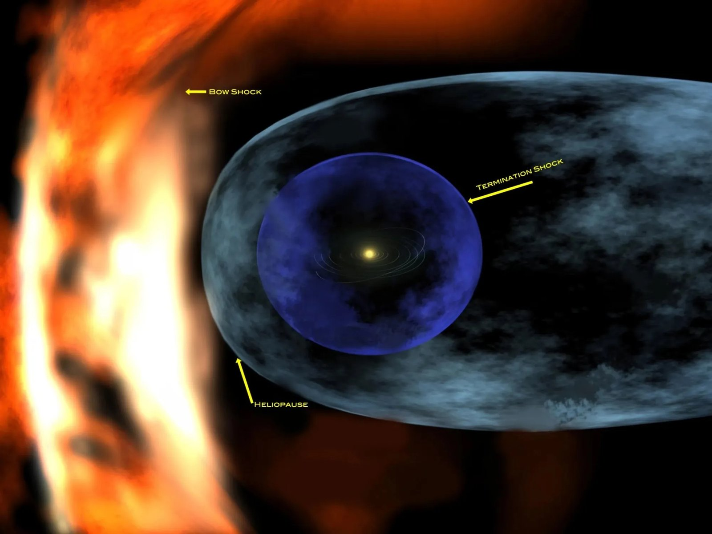
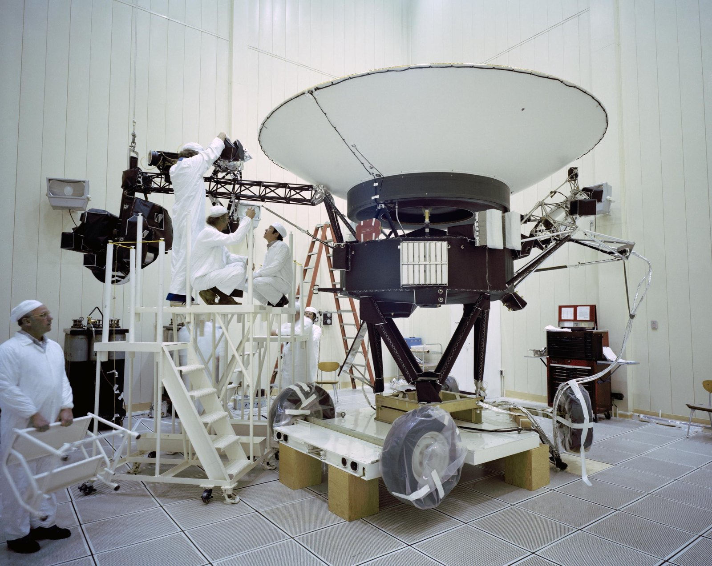
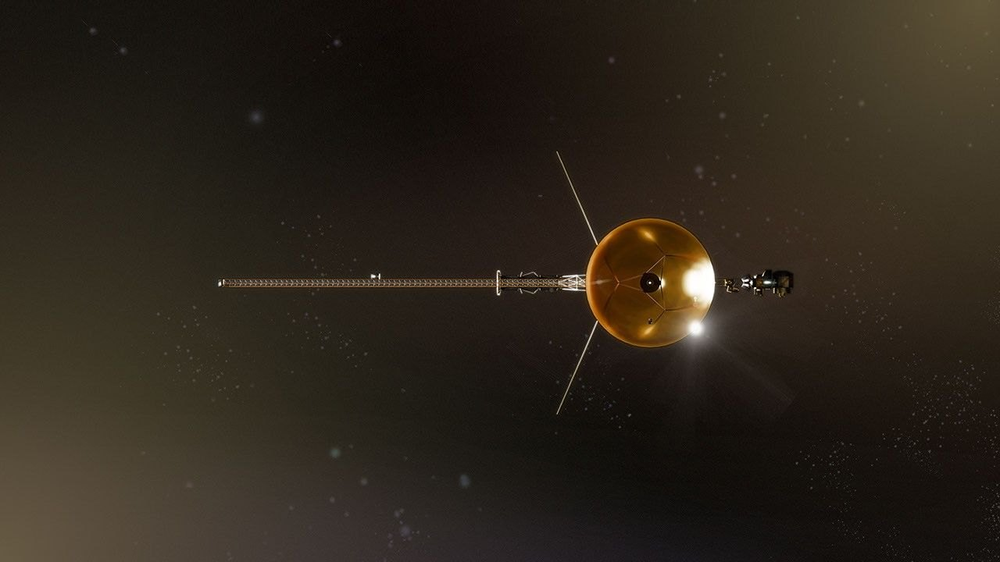
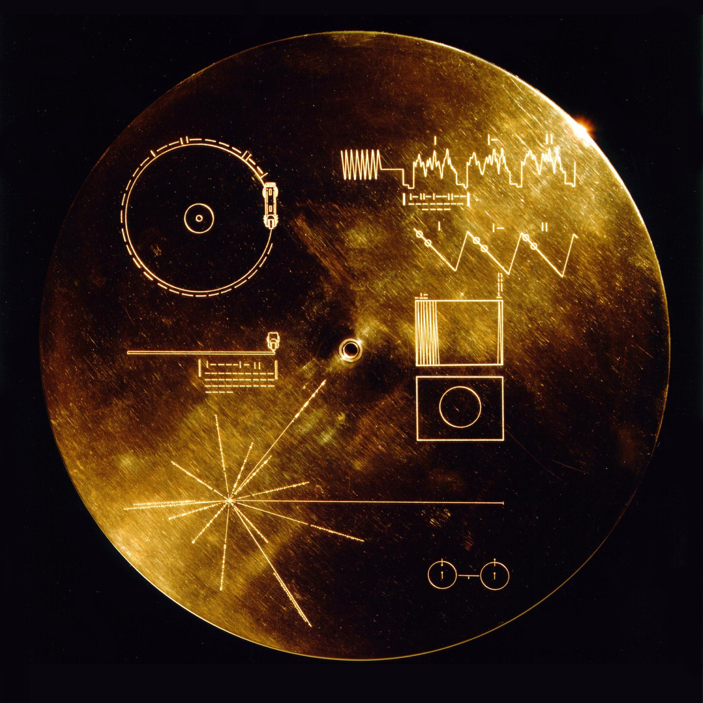
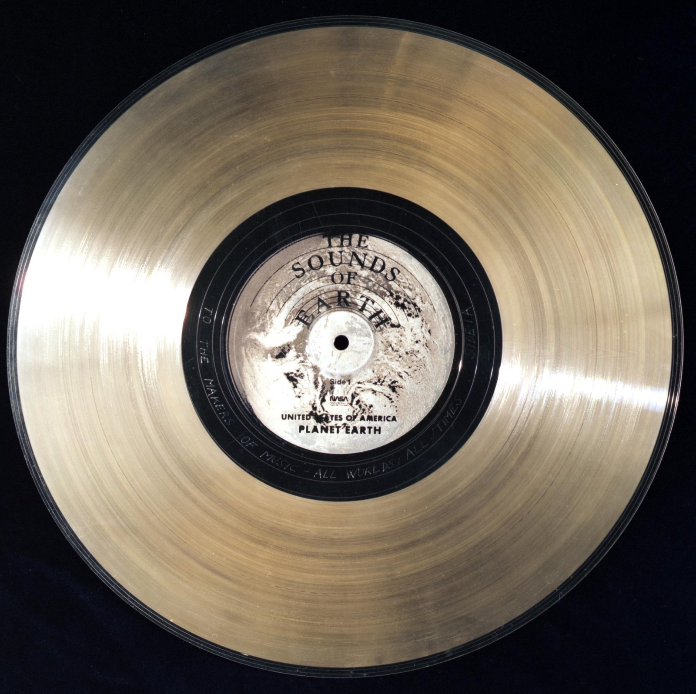

For the first time, a human-made object is one **light-day** away from Earth!

Some journeys are measured in kilometres, others in years. The journey of the **Voyager 1** and **Voyager 2** probes is now measured by the time it takes light to reach them. On 18 November 2026 Voyager 1 crossed a threshold that no human-made object had ever crossed before: a radio signal, leaving Earth at the speed of light, takes a whole day to reach it. Twenty-four hours of silence between a question and the moment the probe receives it. Another twenty-four before its answer gets back home.

## Two messengers in the dark

Voyager 2 left first, on 20 August 1977; its twin, Voyager 1, followed on 5 September. They had been built to explore the giant planets, on a mission designed to last five years. Almost half a century later, they are still alive. After flying past Jupiter and Saturn, Voyager 1 headed out of the Solar System. Voyager 2 took an even longer route, flying past Uranus and Neptune as well: it is the only probe ever to have visited them up close. Then, one after the other, they left the planets behind and kept racing towards the dark.

## Beyond the Sun's bubble

The Sun does not just shine: it blows. A stream of charged particles, the **solar wind**, pours endlessly from its surface, inflating a vast magnetic bubble around the Sun and its planets: the **heliosphere**. It is a shell that partly shields us from the cosmic rays arriving from the Galaxy. But every bubble has an edge. Where the pressure of the solar wind can no longer push back the thin gas that fills the space between the stars lies the **heliopause**. Voyager 1 crossed it in August 2012, Voyager 2 in November 2018, both at about 120 times the distance between the Earth and the Sun. Since then they have been the only probes to reach interstellar space while still working, and therefore the only ones to have measured it directly: an environment that until then we knew only through theoretical models and indirect measurements. And yet, in a sense, they have not left home. The heliopause is not the gravitational boundary of the Solar System: the Sun's pull extends much further, out to the **Oort Cloud**, the enormous reservoir of icy bodies from which long-period comets come. Voyager 1 will take about 300 years just to reach its inner edge, and perhaps 30,000 to leave it.

<figure class="post-fig">

<figcaption>The heliosphere, the bubble that the solar wind inflates around the Sun and the planets (artist’s impression). The blue sphere is the <em>termination shock</em>, where the solar wind abruptly slows down; further out, the <em>heliopause</em> marks the beginning of interstellar space. Voyager 1 and 2 crossed it in 2012 and 2018, at about 120 astronomical units from the Sun. The <em>bow shock</em> on the left, on the other hand, probably does not exist: according to data from NASA’s IBEX spacecraft, the Sun moves too slowly to create one. Credits: NASA.</figcaption>
</figure>

## A slow agony of watts

Out there, sunlight is too faint to power a solar panel. The Voyagers live on a different source of energy: each is powered by three radioisotope thermoelectric generators, which turn the heat released by the decay of plutonium-238 into electricity. But the plutonium is running out, and the probes' lives with it. Every year each Voyager loses about 4 watts of power: less than a light bulb uses, but enough to force the engineers into painful choices. To keep them alive, they switch off heaters, non-essential systems and finally science instruments, one after another, knowing that every command may silence a piece of science for ever. Today Voyager 1 has only two instruments left: the magnetometer (which measures the magnetic field) and the plasma wave instrument (which listens to the vibrations of the ionised gas around it). The last to be switched off, on 17 April 2026, was the low-energy charged particle detector. Voyager 2 still has three: the same two, plus the cosmic ray detector, saved at the last minute in July 2026 by a delicate reorganisation of the on-board systems that the engineers nicknamed the “Big Bang”. They are humanity's only instruments immersed in interstellar space. When they fall silent, that darkness will become mute again.

<figure class="post-fig">

<figcaption>From a clean room to the darkness between the stars. <em>Left</em>: engineers working on the Voyager 2 spacecraft on 23 March 1977, a few months before launch. <em>Right</em>: its twin, Voyager 1, in an artist’s impression. On 18 November 2026, after more than 49 years of travel, it became the first human-made object to reach a distance of one light-day from Earth, about 25.9 billion kilometres: a radio signal, travelling at the speed of light, takes 24 hours to reach it. Credits: NASA/JPL-Caltech.</figcaption>
</figure>

## A phone call with a 24-hour delay

Communicating with a probe billions of kilometres away is not like phoning someone on the other side of the world. Radio signals travel at the speed of light, the highest speed possible in the universe, but even that is not enough to make a conversation instantaneous across such distances. On 18 November 2026, at 2:16 a.m. US Pacific time, Voyager 1 reached the staggering distance of one light-day from Earth: about 25.9 billion kilometres! A command sent today reaches it tomorrow, and the reply comes back the day after. Real-time intervention is impossible: every instruction must be carefully prepared, sent into the void and checked only two days later. Listening to them is NASA's **Deep Space Network**, a network of large radio antennas spread across three complexes: Goldstone, in California; Madrid, in Spain; Canberra, in Australia. This way, as the Earth turns, at least one of them is always facing the right part of the sky.

And right at the time of the milestone, Voyager 1's voice grew faint. On 14 November the Canberra antenna locked on to its signal, but the signal was empty: there was only the carrier (the radio wave that normally carries the data), but no science or engineering data. That bare signal still tells us a lot: the probe is alive, its antenna is still pointed towards home and its transmitter is working. Thanks to it and to trajectory calculations, the engineers were able to confirm the light-day milestone. The fault seems to involve the on-board computer that collects data from the instruments and prepares it for transmission and, as I write, the mission team may still be trying to fix it. It is not the first time. Just a month earlier, on 18 and 19 October, Voyager 1's signal had disappeared completely, only to return on its own on 20 October, before the engineers had even sent a command. After almost fifty years in space, every message that arrives from out there is the result of a fragile balance between technology, distance and human ingenuity.

## A message for ET

The Voyagers do not carry only science instruments. On board both of them is also one of the most symbolic objects ever launched into space: the **Golden Record**. It is a gold-plated copper phonograph record, about 30 centimetres in diameter, designed as a kind of time capsule for any extraterrestrial civilisations that might encounter the probes in the distant future. The idea came from a group of scientists and artists led by the astronomer Carl Sagan. The record's content is a portrait of the Earth and its inhabitants, built from images, sounds and music. The record contains 115 images, greetings in 55 languages, natural sounds of our planet and about 90 minutes of music from different cultures and eras. You can listen to compositions by Bach, Beethoven and Mozart, but also to songs by artists such as Chuck Berry and Blind Willie Johnson. Among the recorded sounds are wind, rain, thunder, birdsong and even the beating of a human heart. The cover, too, was designed to convey information to any possible recipients. It contains illustrated instructions for playing the record and decoding the images, as well as a map showing the position of the Sun relative to fourteen pulsars. A diagram of the hydrogen atom also provides a universal reference for interpreting the units of measurement used in the message. The cover also carries a small sample of uranium-238, whose radioactivity could allow a possible observer to estimate how much time has passed since launch.

Of course, we do not know whether anyone will ever find these records. The chances that an extraterrestrial civilisation will intercept one of the two probes are extremely low, given the immense size of interstellar space. But the Golden Record was not conceived only as a message to be delivered to a possible extraterrestrial civilisation. It is, first and foremost, a self-portrait of humanity: an attempt to tell who we are, what we have learnt and what beauty we have been able to create. Among the countless ways of describing our species, the choice was made to share what unites us: music, art, knowledge, emotions and the voices of different peoples. It is an image of what humanity can be at its noblest: a world of diversity, harmony and coexistence. Ultimately, that record holds a pact: to take care of one another, of the small blue pebble that is our home and of all the forms of life that inhabit it. A message entrusted to space almost fifty years ago, but one that today, perhaps more than ever, we should listen to again. Because before addressing it to whoever might find us one day, it is a message we should address to ourselves.

<figure class="post-fig">

<figcaption>A message in a bottle cast into the cosmic ocean. <em>Right</em>: the Golden Record, carried on board both Voyager probes. It is a gold-plated copper disc 30 cm in diameter, containing greetings in 55 languages, 115 images, sounds of nature and music from different eras and cultures; the dedication “To the makers of music – all worlds, all times” is hand-etched on its surface. <em>Left</em>: the aluminium cover that protects it. The drawings explain how to play the record and, in the lower left, a map of 14 pulsars shows the position of the Sun in the Galaxy; a sample of uranium-238 deposited on its surface acts as a radioactive clock for dating it. Credits: NASA/JPL-Caltech.</figcaption>
</figure>

## Towards a distant star

Reaching one light-day is above all a symbolic milestone, but no less dizzying for that. Its twin, Voyager 2, travelling in a different direction, should get there in November 2035, although it is unlikely still to be able to tell us about it. Sooner or later the two probes will stop talking to us. They will no longer have the energy to communicate, nor to keep their circuits warm. But they will keep travelling. They are not heading for any planet and will never enter orbit around another star: they will follow their trajectories in silence, like two wrecks drifting among the stars. Astrophysicists, however, already know where their journey will take them. In about 40,000 years Voyager 1 will pass about 1.7 light-years from Gliese 445, a small red dwarf star now more than 17 light-years away from us. It will be closer to that star than to the Sun, but it will not be a real encounter: the probe will cross that region of space without approaching any planetary system the star might have, and no one will notice.

It is hard to imagine what will be left of the Earth, of our civilisation or even of our species in such a distant future. And yet the Voyagers will still be out there, cold and silent, with a small fragment of our history fastened to their side.

Perhaps no one will ever listen to the Golden Record. Perhaps no one will ever read the instructions engraved on its cover. But this does not make the gesture that made it possible any less extraordinary. When the Voyagers were launched, in 1977, their task was to explore the outermost planets of the Solar System. Almost half a century later they have become something much greater: our species' first ambassadors to interstellar space, so far away that to receive a message from them we must wait a whole day, and to get an answer almost two. It is an enormous distance, but the thread that binds us to them has not yet broken. A radio signal, faint and stubborn, keeps crossing the darkness to tell us what lies out there.

And, at least for now, we are still here listening.

<strong>Sources and credits:</strong> information and images taken from the materials of NASA's Voyager mission, <a href="https://science.nasa.gov/mission/voyager/">NASA Science &ndash; Voyager</a>, as indicated in the individual captions (NASA, NASA/JPL-Caltech). Redshifted is not affiliated with these organisations and their use does not imply any endorsement.

