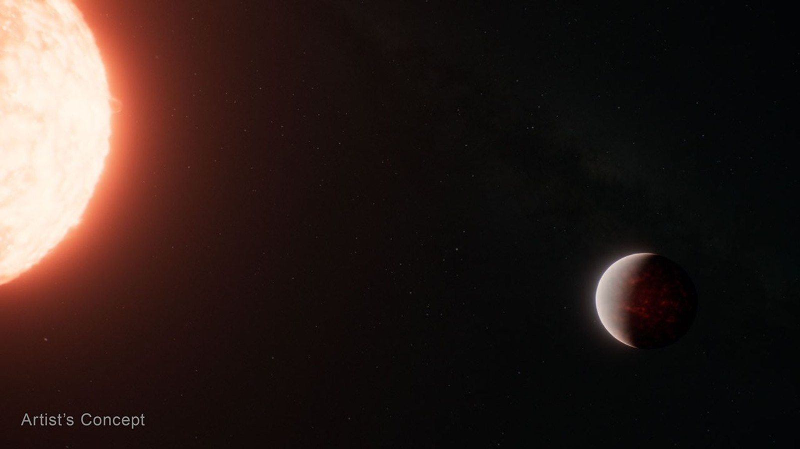
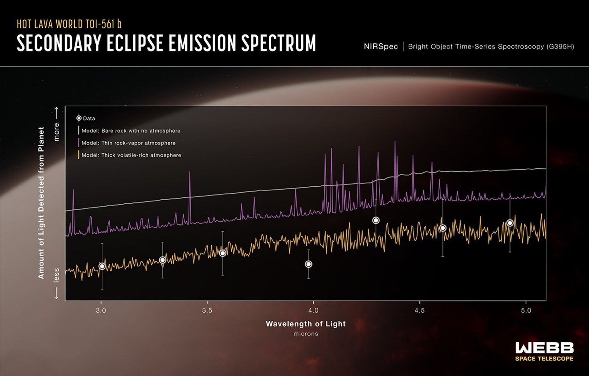
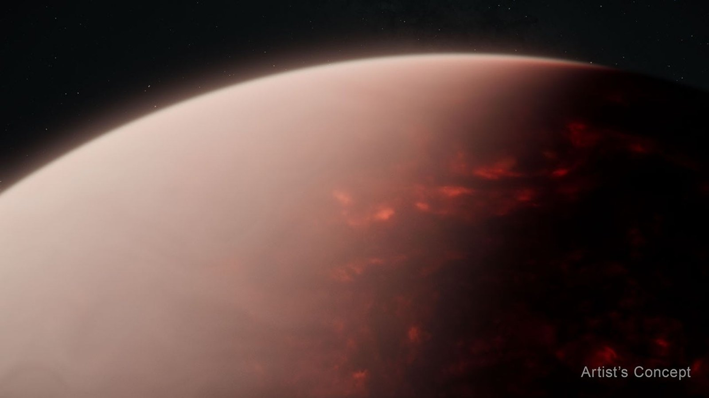

There is a world, 280 light-years from us, where a year lasts less than eleven hours. It circles its star so closely that the rock on its sunlit face cannot stay solid: it melts into an ocean of magma covering the planet. According to the laws of physics as we thought we knew them, a world like this should be naked, stripped of any atmosphere by billions of years of radiation. Instead, the **James Webb** Space Telescope has found that **TOI-561 b** is still breathing: it is wrapped in a thick blanket of gas, and its sky reflects light like that of Venus!

It is a story in two acts. In 2025 a first study took the planet's temperature and concluded that it must have an atmosphere. In 2026 a second study, based on the same observations but analysed in full, confirmed the verdict and found something unexpected: the sky of that hellish world is so bright that it sends about three quarters of the light it receives back into space.

## A world at the mercy of its star

TOI-561 b lies in the constellation of Sextans. Its name comes from NASA's TESS satellite, which detected its transit: TOI stands for *TESS Object of Interest*. It is a **super-Earth**: its radius is about 1.4 times that of the Earth and its mass about 2.2 Earth masses. Its gravity is only slightly stronger than the Earth's: there, a 70 kg person would weigh what a 78 kg person weighs on our planet. But nobody could ever walk there.

The planet completes a full orbit around its star in 10 hours and 43 minutes, at about 1.6 million kilometres from it: almost forty times closer than Mercury is to the Sun. From there the star is not a point of light in the sky, but an enormous disc almost 44 degrees across: about eighty times the size of the Sun as seen from the Earth. Every square metre of the planet receives about 4,700 times the energy the Earth receives.

Like almost all planets this close to their stars, TOI-561 b is in *synchronous rotation*: it spins on its axis in the same time it takes to complete an orbit, and always shows the same face to its star, just as the Moon always shows the same hemisphere to the Earth. TOI-561 b therefore has one hemisphere in perpetual day and one in perpetual night. On the dayside the temperature exceeds the melting point of most rocks: that is where the **magma ocean** lies.

TOI-561 b belongs to a rare class of planets, the **ultra-short-period planets** (USPs): worlds with a radius up to twice the Earth's that complete an orbit in less than a day. About 0.5% of Sun-like stars host one, roughly as many as host hot Jupiters. So close to the star, when the planetary system was forming, it was too hot even for the dust from which planets are born: this is why these worlds are thought to have formed farther out and then slipped towards the fire.

<figure class="post-fig">

<figcaption>Artist’s concept of TOI-561 b and its star. The planet orbits so close to its star that it completes a circuit in less than eleven hours. The illustration is based on spectroscopic data and other indirect observations: Webb has not photographed the planet. Credits: NASA, ESA, CSA, Ralf Crawford (STScI). <a href="https://science.nasa.gov/asset/webb/super-earth-exoplanet-toi-561-b-and-its-star-artists-concept">Source</a>.</figcaption>
</figure>

## A star from another era

TOI-561 b's star also comes from another time. It is slightly smaller and cooler than the Sun, but much older: it is about 10 billion years old, more than twice the Sun's 4.6 billion years. It had already been shining for billions of years when the cloud that would give birth to our Solar System had not yet begun to collapse. It is poor in iron, containing in proportion about 40% as much as the Sun, and relatively rich in the so-called alpha elements, such as oxygen, magnesium and silicon.

It belongs to the **thick disc** of the Milky Way, a population of ancient stars moving on more “puffed-up” and tilted orbits than the thin disc where the Sun lives. These stars formed when the Galaxy was young and still contained few heavy elements. As Johanna Teske, an astronomer at Carnegie Science and lead author of the 2025 study, has pointed out, the planet must have formed in a chemical environment very different from that of the planets in the Solar System.

## A sentence written in physics

A small, scorching planet, according to theory, is condemned to lose its atmosphere. X-rays and ultraviolet light from the star heat the upper layers of gas, which gain enough energy to escape the planet's gravity and scatter into space: astronomers call this **atmospheric evaporation**. For a world like TOI-561 b, an envelope of hydrogen should evaporate in much less than a billion years. Webb, after all, has already observed several highly irradiated rocky planets, and their data are consistent with bare-rock surfaces: worlds that have long since lost their breath.

In the Solar System this rule even has a name: the *cosmic shoreline*. It is an imaginary line separating bodies that have an atmosphere from those that do not, and it depends on how much radiation they receive and how strong their gravity is. Mercury and the Moon sit on the “dry” side, the Earth, Venus and Titan on the side with an atmosphere. TOI-561 b, with the enormous amount of radiation it receives, should sit on the dry side without any doubt.

## The first clue: a world too light

Even before Webb, something did not add up. Knowing the radius (from the transit, that is, from the dip in light when the planet passes in front of the star) and the mass (from the wobble the planet imposes on the star), we can calculate the density. That of TOI-561 b is about 4.3 grams per cubic centimetre. For comparison, the Earth reaches 5.5.

The point is not the direct comparison with the Earth, but with what we would expect: a planet of that mass with a composition similar to ours, rock plus an iron core, would be much more compressed and therefore denser. TOI-561 b, instead, has about two thirds of the expected density. Most ultra-short-period planets, by contrast, have densities consistent with an Earth-like composition.

There were two possible explanations. The first is an unusual interior, with a small iron core and rocks less dense than the Earth's, a plausible hypothesis for a planet born around an iron-poor star. The second is a thick atmosphere. During a transit we do not see the planet: we see its shadow, that is, how much of the star's light it blocks. The densest layers of a thick atmosphere block the light too, and the shadow turns out larger than that of the rocky body alone, like the silhouette of a person wrapped in a padded coat. The radius we measure therefore includes part of the atmosphere as well. The gas, however, adds much more volume than mass. And since density is mass divided by volume, the planet as a whole appears less dense than its rocky body. According to the authors, a light interior alone cannot explain everything: even a planet made only of rock, with no iron, should be slightly smaller than TOI-561 b.

## 2025: Webb takes the temperature of an invisible planet

To find out which of the two hypotheses was right, the team led by Johanna Teske pointed Webb at TOI-561 b. The observations were made between 1 and 3 May 2024, as part of the GO 3860 programme: more than 37 hours in a row, almost four complete orbits, with the **NIRSpec** spectrograph in the near infrared, between 3 and 5 micrometres. The results were published in December 2025 in *The Astrophysical Journal Letters*.

Webb cannot photograph TOI-561 b. Seen from 280 light-years away, the planet and the star are separated by an angle a thousand times smaller than the finest detail Webb can resolve, and the star is tens of thousands of times brighter: to the telescope they are a single dot. To measure the planet's light, astronomers make use of the **secondary eclipse**, the moment when the planet passes behind the star and disappears for a little over an hour. Just before the eclipse, Webb collects the light of the star plus that of the planet's dayside, which at that moment faces us. During the eclipse it collects only the light of the star. From the difference, obtained by fitting a model to the whole light curve before, during and after the eclipse, astronomers derive the light of the planet's dayside.

The dip is tiny: between 25 and 46 parts per million, depending on the wavelength. It is like noticing that, in a stadium lit by 40,000 light bulbs, one or two have gone out. This is why the observations covered four consecutive eclipses and were analysed with two independent procedures, to check that the signal really came from the planet and not from the instrument.

Between 3 and 5 micrometres, in the infrared observed by NIRSpec, the light coming from the planet is almost entirely thermal emission: radiation the planet itself emits because of its temperature, not reflected starlight. From its intensity we derive the **brightness temperature**: the temperature a black body, an ideal emitter, would need to have in order to emit the same intensity at those wavelengths.

The result was surprising. If TOI-561 b were a dark, bare rock, its dayside should reach about 2,950 kelvin, almost 2,700 °C. Webb measured instead between about 1,800 and 2,150 kelvin, depending on the analysis, that is, between about 1,500 and 1,900 °C. It is still an inferno, but much colder than expected: it is even colder than the roughly 2,300 kelvin that would result if the heat were spread perfectly evenly over the whole planet. Something on that world is cooling the dayside.

<figure class="post-fig">

<figcaption>The emission spectrum of the dayside of TOI-561 b measured by NIRSpec during the secondary eclipses. The white circles are Webb’s data. The grey line is the prediction for a dark rock with no atmosphere, the purple line for a thin atmosphere of rock vapour: both are too bright, that is, too hot. The data agree best with an atmosphere rich in volatile substances. Credits: NASA, ESA, CSA, Ralf Crawford (STScI); science: Johanna Teske, Anjali Piette, Tim Lichtenberg, Nicole Wallack. <a href="https://science.nasa.gov/asset/webb/super-earth-exoplanet-toi-561-b-nirspec-emission-spectrum">Source</a>.</figcaption>
</figure>

### Three suspects

The authors put three scenarios to the test.

The first was a planet with no atmosphere. A magma ocean can move some thermal energy with its currents, as the Earth's oceans do. But without an atmosphere the nightside would cool until it solidified, and the magma currents could not reach it. The dayside would therefore remain extremely hot: every point on it would return to space the energy received from the star, at a temperature much higher than the one observed.

The second was a thin atmosphere of rock vapour. At those temperatures even minerals partly evaporate, like water in a pan on the stove, and above the magma ocean they would form a tenuous atmosphere of gases such as silicon monoxide and magnesium oxide, with a pressure of about one hundredth of the Earth's. An atmosphere this thin, however, cannot carry energy to the nightside, and the dayside would stay extremely hot: Webb would see it as much brighter than it is. This scenario is clearly ruled out by the data, and it would not explain the planet's low density either.

The third was a thick atmosphere rich in **volatiles**: substances that evaporate easily, such as water, carbon dioxide and oxygen. To test it, the authors used a model to calculate the spectrum that three different atmospheres would produce on TOI-561 b and compared it with the measured one. An atmosphere of pure water vapour and one of oxygen with traces of water reproduce the data well. A 50% mixture of water and carbon dioxide works less well: carbon dioxide strongly absorbs light around 4.5 micrometres and should carve a dip into the spectrum, which Webb does not see.

This does not mean that the atmosphere is made of water or oxygen. The measured spectrum is almost smooth, with no clear signs of molecules, and the data are consistent with several compositions. For now we know that a thick atmosphere is there, not what it is made of.

### How an atmosphere can cool an inferno

A thick atmosphere can lower the temperature of the dayside in three ways, which may also act together. Winds can carry heat to the nightside. Bright clouds can reflect part of the starlight back into space before it is absorbed. Finally, the atmosphere may be more transparent at wavelengths shorter than those observed by Webb and radiate energy into space through those “windows”, like a house cooling down through open windows.

According to the authors, this is the strongest evidence yet for a thick atmosphere on an ultra-short-period planet. NASA's press release describes it as the strongest evidence ever found for an atmosphere on a rocky planet outside the Solar System. Tim Lichtenberg, of the University of Groningen, a co-author of the study, summed up the result with a vivid image: TOI-561 b is like a “wet lava ball”.

## 2026: a glimpse of the dark side

The 2025 study left a question open. The dayside of TOI-561 b is colder than expected, but where does the missing energy go? It could be the atmosphere carrying it to the nightside, or the planet reflecting part of the starlight back into space before absorbing it. By observing only the eclipses, that is, only the dayside, the two cases cannot be told apart. It was necessary to look into the planet's eternal night as well: and that is exactly what Webb had already done. During the 37 hours of observation, the telescope recorded without interruption the **light curve** of the system, that is, the combined brightness of star and planet, measured moment by moment over almost four orbits. In 2025 astronomers had analysed only the stretches around the eclipses. In 2026 a team led by Samuel Boucher, of the University of Montréal, and coordinated by Lisa Dang, of the University of Waterloo, analysed it in full. The results were published in *The Astronomical Journal*.

From this light curve the authors derived the **phase curve**, which describes how the planet's light changes as it travels along its orbit. The planet always turns the same face to its star, but shows us different portions of itself depending on its position, as happens with the phases of the Moon. Just before and just after the eclipse we see the dayside, during the transit we see the nightside, and in the intermediate positions part of one and part of the other. By measuring how much light the planet emits in each phase, astronomers derive the temperature of the dayside and that of the nightside. By comparing them, they work out how much energy the atmosphere carries from day to night and how much starlight the planet reflects back into space.

There was, however, an obstacle: the star itself varies. Its surface boils like a pan of water on the stove, because hot gas rises from the interior, cools and sinks again. This phenomenon, *granulation*, makes the star's brightness fluctuate by about 55–60 parts per million, roughly as much as the planet's entire signal! Fortunately, the two signals have different rhythms. The planet's light changes slowly and repeats identically every orbit, while the star's fluctuations are random and change within about twenty minutes. Since the observation covered almost four orbits, the authors were able to recognise what repeats every orbit, the planet, and separate it from what does not, the star.

### The nightside and the sky that shines like Venus

The dayside comes out at about 2,050 kelvin (about 1,800 °C), in agreement with the 2025 study. For the first time the nightside was measured too: about 1,100 kelvin, or about 800 °C. In the eternal night of TOI-561 b it is hot enough to make iron glow red, but not hot enough to account for the energy missing from the dayside. If that energy does not end up on the nightside, it must be sent back into space before being absorbed.

From these temperatures the authors derived two numbers. The first is the efficiency with which heat is redistributed from day to night, which turns out to be moderate. The second is the **Bond albedo**, the fraction of all the light energy received from the star that the planet reflects back into space, in all directions and at all wavelengths. An albedo of 0 means a body that absorbs everything, an albedo of 1 a body that reflects everything. The Earth has an albedo of about 0.3. TOI-561 b reaches about 0.74: it reflects almost three quarters of the light it receives, roughly like Venus, the brightest planet in our sky.

It is a surprising value, because laboratory measurements show that lava is a very poor mirror: it is dark and absorbs almost all light. Something very bright must therefore lie above the magma ocean.

To find out what, the authors used a *general circulation model*, the same kind of simulation used to study the Earth's climate and weather. They simulated atmospheres of different compositions, with surface pressures from a tenth of the Earth's to ten times as much. The result is clear: a bare rock would produce a phase curve very different from the observed one, while the models that come closest to the data have an atmosphere of at least 1–10 bar and a high albedo. The authors think the real atmosphere is probably even thicker, because a thin atmosphere would not survive billions of years under that radiation and would not explain the planet's low density.

The planet is so close to its star that it sees it as an enormous disc, almost 44 degrees across. This is why the light does not illuminate only half the planet, as it would with a distant star, but up to about two thirds of its surface. Even where the centre of the star has already set, the edge of its disc stays above the horizon and keeps lighting the ground, like a sunset that never ends. The authors took this into account in their simulations. And since the planet spins on its axis in less than eleven hours, its atmosphere behaves in a way similar to the Earth's: temperature differences remain small in a wide band around the equator and become large at mid-latitudes.

## Silica clouds above an ocean of lava

What makes the sky of TOI-561 b so bright? The authors calculated which substances could condense into clouds, starting from the vapours rising from the magma ocean. On the dayside, along the terminator, the line separating day from night, **silicate clouds** can form: in particular of silica, that is, silicon dioxide (SiO2), the same compound that makes up quartz, sand and glass, and of a magnesium silicate (MgSiO3). In the clouds these minerals would be tiny solid particles, condensed from rock vapour. Above a sea of lava, perhaps, clouds of mineral are floating.

Silica particles are excellent at reflecting light. Even with the most conservative estimate, that is, with the hottest possible dayside, silica clouds alone at the edges of the day would raise the albedo to about 0.24. And a self-reinforcing cycle could be triggered: the clouds reflect light, the planet cools, more clouds form and the albedo rises further. On the nightside there could be extensive layers of silica clouds and, under certain conditions, clouds of sodium compounds deeper down.

These clouds might even help the planet keep its atmosphere, like a shield. By reflecting light, they reduce the energy absorbed and therefore the push that drives gases to escape into space. A similar mechanism has been proposed for LTT 9779 b, a “hot Neptune” that is also very bright and, according to astronomers, wrapped in silicate clouds.

<figure class="post-fig">

<figcaption>Artist’s concept of what a thick atmosphere above the vast magma ocean of TOI-561 b could look like. An atmosphere rich in volatile substances such as water, oxygen and carbon dioxide would distribute heat around the planet. Credits: NASA, ESA, CSA, Ralf Crawford (STScI). <a href="https://science.nasa.gov/asset/webb/super-earth-exoplanet-toi-561-b-artists-concept">Source</a>.</figcaption>
</figure>

## The secret of its breath

The main question remains: how can a planet so small and so heavily irradiated keep an atmosphere for billions of years? Nobody knows for sure yet, but the authors of the 2026 study propose four possibilities, which could also work together.

The first is that the planet was born with an enormous reserve of volatiles, perhaps as a small gas-rich “sub-Neptune”, and is still using up part of it. The second is that an atmosphere made of heavy molecules, such as water or carbon dioxide, escapes into space much more slowly than an atmosphere of hydrogen and helium. The third is that the planet formed farther out and reached its present orbit late, when the star had become less aggressive. The fourth, perhaps the most fascinating, brings the magma ocean into play.

An ocean of molten rock can dissolve large amounts of gas, a little like fizzy water holds carbon dioxide. According to Lichtenberg there would be a balance between magma and atmosphere: the magma releases gases that feed the atmosphere, and at the same time reabsorbs some of them. The magma ocean would thus act as a reservoir, giving back to the sky what space tears away from it. The 2025 study had already noted that the hottest planets, with irradiation temperatures above 2,000 kelvin, could rebuild their atmospheres faster than they lose them. If so, the cosmic shoreline of the Solar System would not apply everywhere.

## What still lies hidden

A fundamental question remains: what is the atmosphere of TOI-561 b made of? Does it resemble that of Venus, a thick blanket of carbon dioxide, or an extreme version of that of Io, Jupiter's volcanic moon, rich in sulphur dioxide? To find out, astronomers want to observe the planet again with Webb, at longer wavelengths, where some gases leave fingerprints that are easier to recognise.

As Johanna Teske has said, these data open up more questions than they answer. According to theory, TOI-561 b should have been a bare rock, roasted by billions of years of radiation. Instead, around a star older than the Sun, a world of lava is still breathing beneath a sky so bright that it sends three quarters of the light it receives back into space.

## References

- Teske, J. K. et al. (2025), *A Thick Volatile Atmosphere on the Ultrahot Super-Earth TOI-561 b*, *The Astrophysical Journal Letters*, 995, L39. DOI: <a href="https://doi.org/10.3847/2041-8213/ae0a4c">10.3847/2041-8213/ae0a4c</a>.
- Boucher, S. et al. (2026), *A Highly Reflective Atmosphere on the Lava World TOI-561 b Revealed by JWST/NIRSpec Phase Curve*, *The Astronomical Journal*. arXiv: <a href="https://arxiv.org/abs/2608.21519">2608.21519</a>.

<strong>Sources and credits:</strong> information and images taken from the website of the Webb mission, <a href="https://science.nasa.gov/mission/webb/">NASA Science &ndash; Webb</a>, and from materials by NASA, ESA, CSA and STScI (Ralf Crawford), as indicated in the individual captions. Redshifted is not affiliated with these organisations and their use does not imply any endorsement.

