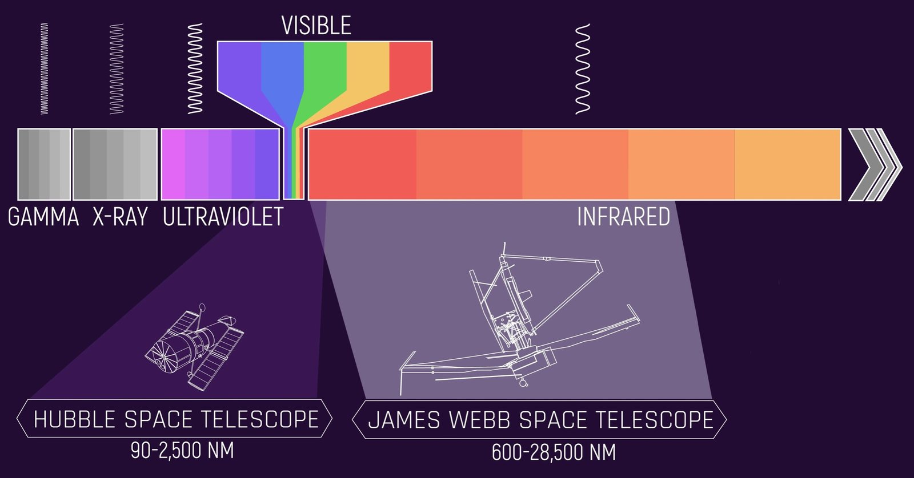
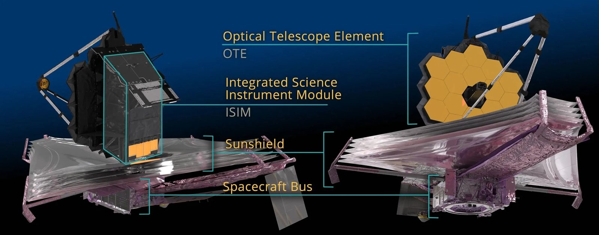
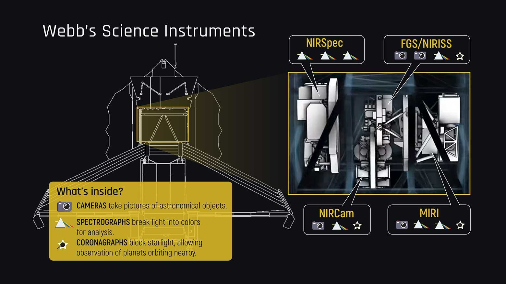
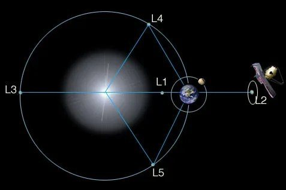
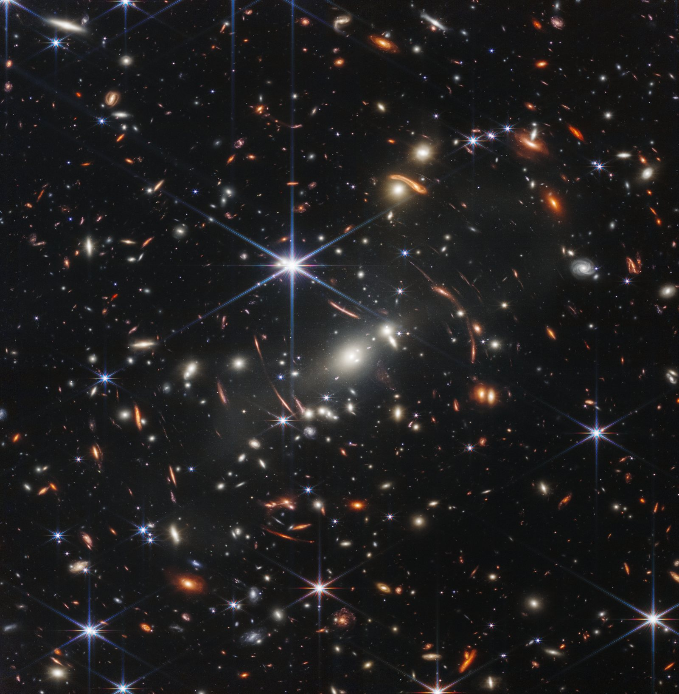
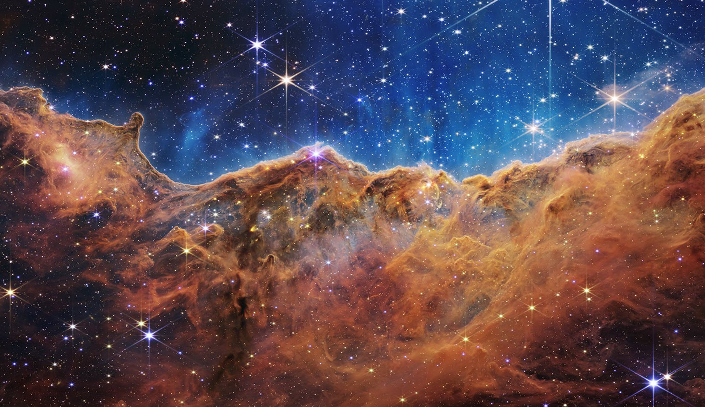
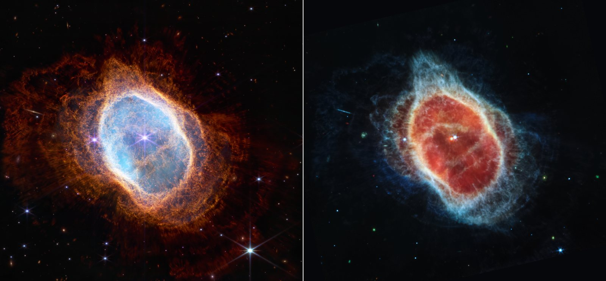
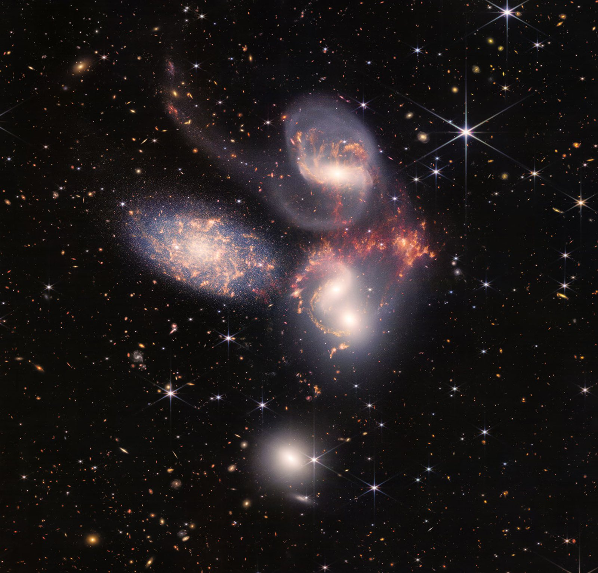
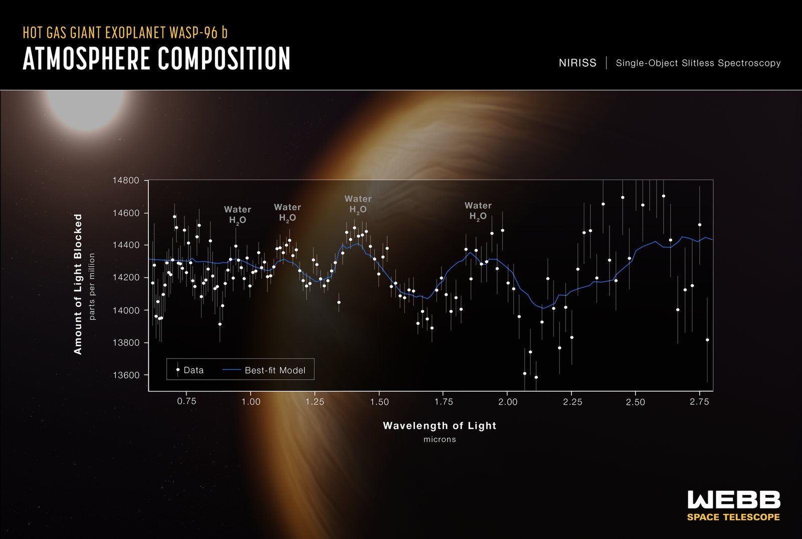

È il telescopio che gli astronomi aspettavano dal 1989, è il frutto di una collaborazione internazionale tra NASA, ESA (European Space Agency) e CSA (Canadian Space Agency) ed è destinato a cambiare la storia dell’universo: benvenuti nell’era del **Telescopio Spaziale James Webb (JWST)**!

## La storia: da Hubble a Webb

È il 1989 e il **Telescopio Spaziale Hubble (HST)** è ancora a terra, ma astrofisici e ingegneri stanno già confabulando sul suo successore: un telescopio capace di spingersi dove Hubble non sarebbe mai arrivato.

Hubble è, a tutti gli effetti, il padre di Webb e a più di 36 anni dal lancio, non ha mai smesso di donarci i suoi tesori. Ha cambiato per sempre la nostra immagine del cosmo. Osservando le supernove di tipo Ia ha misurato con più precisione la costante di Hubble e ha contribuito a scoprire che l'espansione dell'universo non rallenta, ma accelera. Ha mostrato che al centro di ogni grande galassia si nasconde un buco nero supermassiccio, la cui massa è in stretta correlazione con quella del bulge galattico. Ha esplorato le nebulose in cui nascono le stelle e ha analizzato le atmosfere di pianeti extrasolari. Sui suoi dati si basano oltre 22.000 articoli scientifici.

Ma anche l'occhio di Hubble ha un limite. È sensibile soprattutto alla luce ultravioletta e visibile, e non riesce a cogliere il debole bagliore delle prime galassie, nate poco dopo il Big Bang. La loro luce viaggia per circa 13 miliardi di anni in un universo che, nel frattempo, continua a espandersi: lungo il tragitto si “stira”, perde energia e ci raggiunge con una lunghezza d'onda maggiore. È il **redshift cosmologico**, che sposta la luce delle prime galassie dall'ultravioletto e dal visibile fino al vicino infrarosso, fuori dalla portata di Hubble.

Ed è qui che entra in scena Webb, progettato proprio per catturare la luce infrarossa delle prime protogalassie e galassie all'alba cosmica. Il suo obiettivo è capire quando e come si sono assemblate, come si sono evolute e come si sono accese le prime stelle e i primi buchi neri supermassicci. Ma la sua vista infrarossa ha anche un altro superpotere: attraversa le nubi di gas e polvere. Così Webb può spiare la nascita dei sistemi planetari, analizzare le atmosfere degli esopianeti alla ricerca di acqua e di possibili tracce di vita (soprattutto in quelli che orbitano nella zona abitabile della loro stella).

Webb è partito il giorno di Natale del 2021, a bordo di un razzo Ariane 5 lanciato dallo spazioporto europeo di Kourou, nella Guyana francese.  Il suo compito? Provare a rispondere a due domande colossali: come siamo arrivati fin qui? E siamo soli nell'universo?

<figure class="post-fig">

<figcaption>Differenza tra gli intervalli di lunghezza d'onda osservabili da Hubble e dal James Webb. Sebbene Hubble possa rilevare alcune lunghezze d'onda del vicino infrarosso, è stato ottimizzato per osservare quelle più corte, ovvero la luce ultravioletta e quella visibile. Il James Webb, invece, può rilevare il vicino e il medio infrarosso. I due telescopi sono partner osservativi: si completano a vicenda, offrendoci una visione che copre un ampio spettro di lunghezze d'onda. Crediti: NASA, J. Olmsted (STScI).</figcaption>
</figure>

## Il telescopio

Per vedere gli oggetti più deboli dell'universo serve uno specchio enorme. Ma lo specchio di Webb è più largo del razzo che doveva portarlo in orbita. La soluzione? Ispirarsi all'arte degli origami! Webb è partito piegato su sé stesso e si è dispiegato pezzo dopo pezzo durante il viaggio verso il punto L2. Un'impresa da brivido: gli ingegneri avevano contato 344 “punti critici”, meccanismi senza alcun ricambio, ciascuno dei quali, se si fosse bloccato, avrebbe potuto compromettere l'intera missione. Circa l'80% riguardava proprio il dispiegamento, e non è per fortuna che hanno funzionato tutti.

Webb è composto da tre grandi parti: l'Elemento del Telescopio Ottico (OTE), il Modulo Integrato degli Strumenti Scientifici (ISIM) e l'Elemento del Veicolo Spaziale (SCE).

<figure class="post-fig">

<figcaption>I costituenti dell'osservatorio spaziale James Webb. Crediti: <a href="https://science.nasa.gov/mission/webb/spacecraftoverview/">https://science.nasa.gov/mission/webb/spacecraftoverview/</a></figcaption>
</figure>

### 1. Il Telescopio Ottico (Optical Telescope Element, OTE)

Pensando al James Webb, tutti abbiamo in mente un unico grande specchio dorato da 6,5 m di diametro, composto da 18 tasselli esagonali disposti a nido d'ape. La verità è che gli specchi sono quattro: il primario raccoglie la luce, mentre altri tre la indirizzano verso gli strumenti scientifici. Piccoli motori, detti attuatori, regolano posizione e orientamento di ogni tassello con precisione estrema, così che i 18 segmenti lavorino come un unico grande specchio.

Sotto la doratura c'è il berillio, un metallo leggero, resistente e stabile, che mantiene la propria forma anche a temperature bassissime. L'oro, steso in uno strato di appena un decimillesimo di millimetro, serve a riflettere al meglio la radiazione infrarossa. In tutto ce ne sono solo 48 grammi, più o meno il peso di una pallina da golf. A proteggerlo da graffi e particelle c'è un sottile velo di vetro, cioè biossido di silicio amorfo.

E la forma esagonale? Non è un vezzo estetico: gli esagoni si incastrano lasciando pochissimo spazio vuoto e, insieme, formano uno specchio quasi circolare, che concentra in modo efficiente la luce sui rivelatori.

### 2. Il Modulo Integrato degli Strumenti Scientifici (Integrated Science Instrument Module, ISIM)

Webb vede soprattutto nel vicino e nel medio infrarosso, ma riesce a cogliere anche il rosso della luce visibile: in tutto, le lunghezze d'onda tra 0,6 e 28,5 micron. Per farlo usa quattro strumenti, ognuno con una specialità.

<figure class="post-fig">

<figcaption>Gli strumenti scientifici (fotocamere, spettrografi e coronografi) del James Webb, posizionati dietro lo specchio primario. Crediti: NASA e STScI.</figcaption>
</figure>

**NIRCam** (Near InfraRed Camera) è la fotocamera principale e vede dal rosso al vicino infrarosso (0,6–5 micron). Fotografa le prime galassie, le stelle della Via Lattea e gli oggetti più remoti del Sistema Solare. Grazie al coronografo, che oscura la luce di una stella come una mano davanti al Sole, può anche immortalare i pianeti che le orbitano intorno.

**NIRSpec** (Near-Infrared Spectrograph) è uno spettrografo che lavora nello stesso intervallo. Scompone la luce nei suoi colori per svelare la composizione chimica e le proprietà fisiche degli oggetti celesti. Il suo asso nella manica è una griglia di circa 250.000 microsportelli, ciascuno largo quanto pochi capelli, che si aprono e si chiudono per osservare fino a 100 oggetti contemporaneamente. Con NIRSpec possiamo ricostruire le condizioni fisiche e chimiche dell'universo primordiale.

**MIRI** (Mid-Infrared Instrument) combina una fotocamera e uno spettrografo ed esplora il medio infrarosso (5–28 micron). È l'occhio della polvere: osserva regioni di formazione stellare, comete, oggetti della fascia di Kuiper e, grazie al suo coronografo, anche esopianeti.

Infine c'è **FGS/NIRISS** (Fine Guidance Sensor / Near-Infrared Imager and Slitless Spectrograph), due strumenti in uno. FGS è il “timoniere”: mantiene Webb puntato sul bersaglio con precisione estrema. NIRISS (0,6–5 micron) è specializzato negli esopianeti e ne analizza le atmosfere studiando la luce stellare che le attraversa.

### 3. L'Elemento del Veicolo Spaziale (Spacecraft Element, SCE)

Lo Spacecraft Bus è la “sala macchine” di Webb. Fornisce energia grazie ai pannelli solari, mantiene il telescopio stabile e orientato, gestisce le comunicazioni con la Terra ed elabora e archivia i dati raccolti. Ospita anche il sistema di propulsione, che corregge periodicamente l'orbita.

Poi c'è il vero gigante: lo scudo solare. Webb osserva la radiazione infrarossa, cioè, in buona parte, il calore. Il calore del Sole, della Terra, della Luna e perfino quello del telescopio stesso rischierebbe di coprire i debolissimi segnali cosmici. Per questo Webb deve restare gelido. A proteggerlo è un ombrello grande quanto un campo da tennis (21 × 14 m), sempre rivolto verso il Sole, fatto di cinque membrane di Kapton sottili come un capello. Sono rivestite di alluminio e, nei primi due strati, di silicio drogato, che dà allo scudo il suo caratteristico colore rosa-violaceo. Gli strati sono separati da spazi vuoti che disperdono il calore nello spazio, così ogni membrana è più fredda della precedente. Il risultato è una crema solare con fattore di protezione un milione: tra il lato esposto al Sole e quello in ombra ci sono più di 300 gradi di differenza. Il telescopio resta così sotto i −223 °C, mentre NIRCam, NIRSpec e NIRISS lavorano a circa −234 °C. MIRI ha bisogno di ancora più freddo e, grazie a uno speciale refrigeratore a elio, scende a −266 °C: appena 7 gradi sopra lo zero assoluto.

## Dove si trova Webb

Hubble gira intorno alla Terra a circa 500 km di quota. Webb invece abita molto più lontano: a circa 1,5 milioni di chilometri da noi, quattro volte la distanza della Luna, vicino al secondo punto lagrangiano (L2).

I punti lagrangiani sono cinque posizioni speciali del sistema Sole-Terra, studiate nel XVIII secolo dal matematico Joseph-Louis Lagrange nell'ambito del celebre *problema dei tre corpi*. Lì l'attrazione gravitazionale del Sole e della Terra e il moto orbitale si bilanciano, così un piccolo oggetto può muoversi insieme a loro, come se fosse “agganciato”. In L4 e L5 l'equilibrio è stabile, mentre in L1, L2 e L3 è instabile: basta una piccola spinta per allontanarsi.

<figure class="post-fig">

<figcaption>Diagramma dei punti lagrangiani. Crediti: <a href="https://science.nasa.gov/mission/webb/orbit/">https://science.nasa.gov/mission/webb/orbit/</a></figcaption>
</figure>

Perché proprio L2? Perché da lì Webb accompagna la Terra nel suo viaggio intorno al Sole e resta sempre in contatto con noi. Inoltre Sole, Terra e Luna si trovano tutti dalla stessa parte, e lo scudo solare può nasconderli contemporaneamente, tenendo il telescopio al buio e al freddo.

Webb, però, non sta fermo esattamente in L2. Poiché l'equilibrio è instabile, gli gira attorno lungo un'ampia orbita che percorre in circa sei mesi, con piccole accensioni dei motori di tanto in tanto per non perdere la rotta.

## La prima luce e le prime immagini

Il 2 febbraio 2022 Webb vede la sua prima luce: i fotoni della stella HD 84406, dopo aver attraversato l'intero sistema ottico del telescopio, vengono catturati da NIRCam. La stella appare 18 volte, una per ogni segmento dello specchio. È un traguardo storico, ma anche l'inizio di una delle operazioni più delicate dell'intera missione: l'allineamento dei 18 segmenti dello specchio primario, una manovra che ha richiesto circa tre mesi. Per vedere la prima immagine scientifica bisogna però aspettare l'11 luglio 2022, quando il presidente Joe Biden la presenta in anteprima dalla Casa Bianca. Scattata da NIRCam, è l'immagine infrarossa più profonda e nitida dell'universo distante mai ottenuta fino a quel momento.

<figure class="post-fig">

<figcaption>SMACS 0723. Crediti: NASA, ESA, CSA, STScI.</figcaption>
</figure>

Migliaia di galassie affollano una porzione di cielo minuscola, grande quanto un granello di sabbia tenuto a braccio teso. Al centro c'è l'ammasso di galassie SMACS 0723, che vediamo com'era 4,6 miliardi di anni fa. La sua enorme massa curva lo spazio e funziona da lente gravitazionale: un telescopio naturale che amplifica e deforma la luce delle galassie che stanno alle sue spalle, trasformandole in archi luminosi. Alcune ci appaiono com'erano quando l'universo aveva meno di un miliardo di anni. Sono rosse perché l'espansione del cosmo ha “stirato” la loro luce verso l'infrarosso. Grazie alla sua risoluzione, Webb riesce a distinguere in queste galassie bambine ammassi stellari e regioni di formazione stellare mai visti prima. E lo strumento MIRI aggiunge un tocco di colore chimico: le galassie blu hanno stelle ma poca polvere, quelle rosse sono avvolte in spessi strati di polvere, quelle verdi contengono idrocarburi e altri composti.

Il giorno successivo, il 12 luglio 2022, NASA, ESA e CSA organizzano un evento internazionale trasmesso in diretta, durante il quale vengono svelate le altre quattro immagini a colori e i primi dati spettroscopici del telescopio.
La prima, ottenuta dalla sinergia di NIRCam e MIRI, ritrae le *Scogliere Cosmiche*, una zona di formazione stellare chiamata NGC 3324, situata nell'angolo nord-occidentale della Nebulosa della Carena.

<figure class="post-fig">

<figcaption>NGC 3324. Crediti: NASA, ESA, CSA, STScI.</figcaption>
</figure>

Quello che sembra un paesaggio montuoso sotto un cielo tappezzato di stelle è in realtà il bordo di una gigantesca cavità di gas e polvere, con rilievi che raggiungono i 7 anni luce di altezza. A scolpirne le forme sono la radiazione ultravioletta e i venti stellari di stelle giovanissime e massicce, che erodono lentamente le pareti della nebulosa. Anche quello che sembra vapore azzurro sollevarsi dalle vette è in realtà gas ionizzato e polvere calda, trascinati via dall'intensa radiazione stellare.
Grazie alla sua vista infrarossa, Webb riesce a penetrare la polvere, rivelando centinaia di stelle prima invisibili e i getti di materia espulsi dalle stelle appena nate. Le più giovani appaiono come minuscoli puntini rossi, colti in una fase evolutiva che dura appena 50.000–100.000 anni: un battito di ciglia su scala cosmica.

La seconda è la nebulosa planetaria NGC 3132, che ci mostra come alcune stelle tengano il meglio per il finale. A 2.500 anni luce da noi, NGC 3132 è ciò che resta di una stella simile al Sole che ha esaurito il combustibile ed è diventata una nana bianca.

<figure class="post-fig">

<figcaption>NGC 3132 vista da NIRCam (pannello sinistro) e da MIRI (pannello destro). Crediti: NASA, ESA, CSA, STScI.</figcaption>
</figure>

Prima di spegnersi ha espulso a più riprese i suoi strati esterni, come un irrigatore rotante. Ogni anello è uno di questi episodi: i più esterni sono i più antichi, quelli vicini al centro i più recenti. Leggerli è come sfogliare il diario della stella. Accanto a lei orbita una compagna più brillante, che rimescola gas e polvere e rende la nebulosa asimmetrica. Le due fotocamere di Webb raccontano storie diverse. NIRCam, nel vicino infrarosso, mette in risalto le stelle e i sottili raggi di luce che filtrano tra la polvere. MIRI, nel medio infrarosso, fa brillare la polvere e ha rivelato per la prima volta che la nana bianca è avvolta in un mantello di polvere. Quella polvere viaggerà per miliardi di anni e un giorno potrebbe far parte di nuove stelle e pianeti.

La terza immagine presenta una danza cosmica da Oscar.

<figure class="post-fig">

<figcaption>Il Quintetto di Stephan. Crediti: NASA, ESA, CSA, STScI.</figcaption>
</figure>

Con un mosaico di quasi 1.000 file e oltre 150 milioni di pixel, ampio circa un quinto del diametro della Luna, Webb ci mostra il Quintetto di Stephan. Il nome però inganna: solo quattro galassie ballano davvero insieme, a circa 290 milioni di anni luce. La quinta, NGC 7320, è un'intrusa in primo piano, a “soli” 40 milioni di anni luce. Lì NIRCam è riuscita a distinguere le singole stelle, comprese quelle vecchie che producono polvere e appaiono come puntini rossi. Le altre quattro si attraggono a vicenda: le forze mareali strappano via lunghe code di gas, polvere e stelle, mentre la galassia NGC 7318B attraversa il gruppo generando enormi onde d'urto. Le ha catturate MIRI e nell'immagine appaiono in giallo e arancio, mentre le stelle viste da NIRCam sono in blu e bianco. Nel cuore di NGC 7319 c'è un buco nero supermassiccio di 24 milioni di masse solari, che brilla quanto 40 miliardi di Soli. Gli spettrografi NIRSpec e MIRI hanno bucato la polvere che lo avvolge e hanno “affettato” i dati come in una risonanza magnetica, misurando la velocità del gas espulso. Gruppi così affollati erano forse comuni nell'universo primordiale: il Quintetto è un laboratorio vicino per capire come le collisioni hanno fatto crescere galassie e buchi neri. Scoperto dal francese Édouard Stephan nel 1877, regala anche un bonus: sullo sfondo si vedono migliaia di galassie lontanissime.

L'ultima delle prime cinque “immagini” di Webb non è una fotografia ma un grafico, e forse è la più rivoluzionaria.
Siamo davanti allo spettro atmosferico dell'esopianeta WASP-96 b, un gigante gassoso a circa 1.150 anni luce da noi, nella costellazione della Fenice.

<figure class="post-fig">

<figcaption>Spettro atmosferico di WASP-96 b. Crediti: NASA, ESA, CSA, STScI.</figcaption>
</figure>

Non ha equivalenti nel Sistema Solare: ha meno della metà della massa di Giove ma è 1,2 volte più grande, praticamente un pianeta “soffice”. Orbita così vicino alla sua stella, simile al Sole, che un anno lì dura appena tre giorni e mezzo, e la sua atmosfera raggiunge circa 725 °C. Webb non può vederlo direttamente. Lo strumento canadese NIRISS ha però osservato per 6,4 ore la luce della stella mentre il pianeta le passava davanti. Una minuscola parte di quella luce attraversa l'atmosfera del pianeta, e ogni molecola assorbe colori precisi, lasciando la sua impronta digitale. Da 280 spettri combinati è emersa la firma inconfondibile del vapore acqueo, insieme a tracce di foschia e a nuvole che le osservazioni precedenti escludevano. Hubble aveva già trovato acqua su altri esopianeti, la prima volta nel 2013, ma questo è lo spettro più dettagliato mai ottenuto. È anche il primo a coprire in un colpo solo tutto l'intervallo tra 0,6 e 2,8 micron, oltre il limite di 1,6 micron raggiungibile prima, una zona sensibile anche a metano, ossigeno e anidride carbonica. È solo un assaggio: quasi un quarto del primo anno di osservazioni di Webb è stato dedicato agli esopianeti, compresi quelli che potrebbero essere abitabili.

Dalle galassie bambine di SMACS 0723 al vapore acqueo di WASP-96 b, le prime immagini di Webb hanno mantenuto tutte le promesse fatte in trent'anni di progettazione. Se Hubble ci aveva aperto gli occhi sull'universo, Webb è pronto a riscriverne la storia.

Articolo di <strong>Anna Elisabetta Borea</strong>

<strong>Fonti e crediti:</strong> informazioni e immagini tratte dal sito della missione Webb, <a href="https://science.nasa.gov/mission/webb/">NASA Science &ndash; Webb</a>, e dai materiali di NASA, ESA, CSA e STScI. Redshifted non è affiliato a queste organizzazioni e il loro uso non implica alcuna approvazione.

