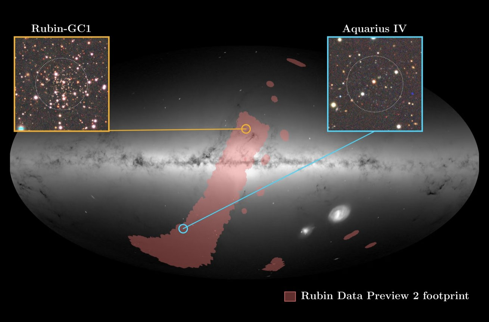
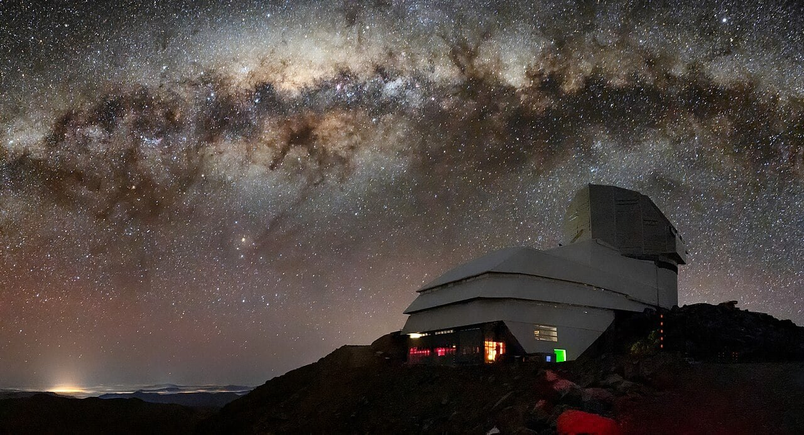
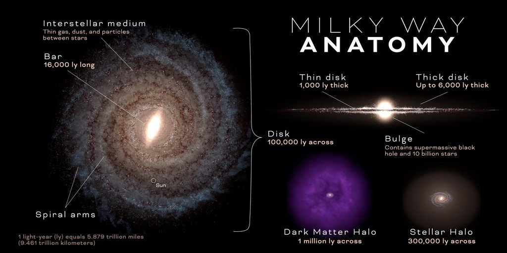

Per miliardi di anni sono rimasti lì, a orbitare intorno alla nostra Galassia, senza che nessuno se ne accorgesse. Il primo è un pugno di stelle antichissime, alla deriva nel buio ai confini della Via Lattea, così fioco da confondersi con il nulla. Il secondo è un ammasso di stelle sepolto dietro un sudario di polvere: forse il relitto di un'altra galassia, che la nostra sta lentamente facendo a pezzi.

Ora, finalmente, li abbiamo visti. Ed è bastata un'occhiata.

A scovarli è stato l'**Osservatorio Vera C. Rubin**, sul Cerro Pachón, in Cile. Il primo oggetto si chiama **Aquarius IV**: è una probabile galassia nana ultradebole, a circa 355.000 anni luce da noi, nelle regioni più remote dell'alone della Via Lattea. Il secondo è **Rubin-GC1**, un piccolo ammasso globulare rimasto nascosto in direzione della costellazione di Ofiuco, dietro una regione affollatissima di stelle e polveri.

<figure class="post-fig">

<figcaption>Una rappresentazione della Via Lattea e delle regioni che la circondano. L’area evidenziata in rosso indica la porzione di cielo esplorata dall’Osservatorio Rubin, le cui osservazioni hanno portato all’identificazione dei nuovi oggetti. I due satelliti galattici appena scoperti sono illustrati nei riquadri di dettaglio: quello arancione mostra l’ammasso globulare Rubin-GC1, chiaramente distinguibile, mentre nell’altro compare Aquarius IV, una galassia estremamente debole e molto più lontana, appena percettibile nell’immagine. Crediti: NSF–DOE Vera C. Rubin Observatory/NOIRLab/SLAC/AURA, ESA/Gaia/DPAC, W. Cerny.</figcaption>
</figure>

La parte più sorprendente è il momento in cui sono arrivate le scoperte. Non sono il frutto di anni di osservazioni, ma dei dati preliminari di Rubin, raccolti prima ancora che iniziasse la survey vera e propria. Questi dati sono stati resi pubblici il 27 luglio 2026 con l'Early Data Preview 2 (EDP2): immagini profonde e cataloghi relativi a circa il 7% dell'intera volta celeste. Con una copertura ancora così limitata, Rubin ha già trovato due satelliti della Via Lattea sfuggiti a tutte le ricerche precedenti.

I risultati sono descritti in due lavori distinti. Il primo, *Discovery of the Distant, Ultra-faint Milky Way Satellite Aquarius IV with the Vera C. Rubin Observatory Early Data Preview 2*, è guidato da William Cerny, della Yale University, ed è pubblicato su *Research Notes of the AAS*. Il secondo, *Rubin Observatory Reveals a Dust-shrouded Halo Globular Cluster in Ophiuchus*, è guidato da Aashay Pai, dell'Università di Chicago, ed è pubblicato su *The Astrophysical Journal Letters*.

<figure class="post-fig">

<figcaption>L'Osservatorio Vera C. Rubin, sul Cerro Pachón in Cile, scruta il cielo australe alla ricerca di oggetti celesti ancora sconosciuti. La sua capacità di esplorare vaste regioni del cielo con grande profondità promette di portare alla luce numerosi nuovi membri della famiglia di satelliti della Via Lattea. Crediti immagine: NSF-DOE Rubin Observatory/AURA/B. Quint.</figcaption>
</figure>

Rubin è dotato della più grande fotocamera digitale mai costruita per l'astronomia e fotografa ripetutamente ampie porzioni di cielo: può così cogliere oggetti estremamente deboli e seguirne i cambiamenti nel tempo. Ma per capire perché queste due scoperte sono così importanti, dobbiamo prima conoscere la famiglia a cui appartengono.

## Il corteo invisibile della Via Lattea

La Via Lattea non viaggia da sola. Intorno a lei si muove un corteo di **satelliti galattici**: sistemi più piccoli, legati alla nostra Galassia dalla gravità. Ne fanno parte galassie nane, ammassi globulari e strutture diffuse, testimoni di una storia lunga miliardi di anni, fatta di aggregazioni, incontri ravvicinati e fusioni.

Molti di loro abitano l'**alone galattico**, una vasta struttura di forma approssimativamente sferica che si estende ben oltre il disco della Galassia e comprende stelle, ammassi globulari e materia oscura. Nonostante decenni di osservazioni, il censimento è ancora incompleto: le galassie satelliti conosciute sono circa 65, e nell'alone sono stati identificati numerosi ammassi globulari. Ma sono quasi certamente solo una parte della popolazione reale. Molti satelliti sono così deboli e diffusi da confondersi con il fondo stellare. Altri si nascondono dietro coltri di polvere interstellare o in regioni di cielo affollate da un numero enorme di stelle.

<figure class="post-fig">

<figcaption>Schema della struttura della Via Lattea. Al centro si trova il disco galattico, dove è concentrata la maggior parte delle stelle. Attorno ad esso si estende l'alone stellare, una regione molto più ampia e rarefatta che ospita stelle antiche, ammassi globulari e correnti stellari, spesso formate dai resti di galassie nane progressivamente disgregate dalla gravità della Via Lattea. Nelle regioni più esterne orbitano inoltre le galassie satelliti, piccoli sistemi galattici legati gravitazionalmente alla nostra Galassia. La figura mostra anche l'alone di materia oscura, una componente distinta da quello stellare e molto più estesa, che avvolge l'intera struttura galattica. Crediti: NASA's Goddard Space Flight Center; graphic design: Scott Wiessinger.</figcaption>
</figure>

Tra i membri più sfuggenti del corteo ci sono le **galassie nane ultradeboli** (in inglese *ultra-faint dwarf galaxies*, **UFD**). Contengono pochissime stelle, quasi tutte formatesi oltre 10 miliardi di anni fa, e brillano così debolmente da passare inosservate anche agli strumenti più sensibili. Sono le reliquie dell'universo primordiale: sopravvissute quasi intatte fino a noi, custodiscono informazioni preziose sulle prime fasi della formazione delle strutture cosmiche.

Le loro stelle contengono pochissimi elementi pesanti, che in astrofisica si chiamano *metalli*: tutti gli elementi più pesanti dell'elio. È il segno di un'evoluzione chimica rimasta quasi congelata. In queste galassie la formazione stellare si è spenta presto, prima che nuove generazioni di stelle potessero arricchire il gas con gli elementi forgiati al loro interno.

C'è poi una ragione ancora più profonda per dare loro la caccia: la **materia oscura**. Secondo il modello cosmologico attuale, le galassie nascono all'interno di enormi aloni di questa componente invisibile, che non emette né assorbe luce e che conosciamo soprattutto attraverso i suoi effetti gravitazionali. È lo scheletro nascosto dell'universo, l'impalcatura gravitazionale su cui le galassie si sono costruite. Nelle UFD le stelle sono così poche che la materia oscura può dominare la massa: sono galassie fatte quasi solo di ombra. Per questo sono laboratori preziosi per studiare come la materia oscura si distribuisce e per mettere alla prova le previsioni dei modelli cosmologici.

Poi ci sono gli **ammassi globulari**: concentrati di stelle con densità altissime, popolati in gran parte da stelle antiche. Alcuni potrebbero non essere nati nella Via Lattea, ma in galassie più piccole che la nostra ha catturato e smembrato, un pezzo alla volta. Di quei mondi divorati, spesso, sono rimasti solo questi ammassi: sopravvissuti di un naufragio, ancora in orbita sui resti della propria galassia d'origine. Ricostruirne le orbite e studiarne la composizione chimica permette di risalire alle fusioni che hanno costruito la Galassia che osserviamo oggi.

Ogni nuovo satellite, quindi, non è solo un oggetto in più in un catalogo: è un indizio sulla storia della Via Lattea. E i due nuovi arrivati ne raccontano due molto diverse.

## Aquarius IV: un fossile galattico ai confini della Via Lattea

Il primo satellite è Aquarius IV, catalogato anche con la sigla Rubin J2201−0234. La sua luce è così fioca che per trovarlo non è bastato guardare: è servito un algoritmo, chiamato *simple*, adattato per analizzare i dati di Rubin.

L'algoritmo cerca nel cielo gruppi di stelle che si comportino come una popolazione di età e composizione chimica definite, descritta da un modello teorico chiamato *isocrona*. Il confronto avviene nel diagramma colore-magnitudine, che mette in relazione il colore delle stelle con la loro luminosità. Per Aquarius IV gli autori hanno usato un'isocrona di 13 miliardi di anni, con una metallicità circa 140 volte inferiore a quella del Sole: hanno cercato, in pratica, alcune delle stelle più antiche e primitive del cosmo. E le hanno trovate. Aquarius IV è emerso dai dati di Rubin con una significatività statistica di circa 8 sigma, ed è stato poi confermato in modo indipendente nelle immagini d'archivio della Dark Energy Camera, dove era sempre stato presente senza che nessuno lo notasse.

Per misurarne la distanza è bastata una sola stella: una stella del **ramo orizzontale blu**, un astro antico in una fase avanzata della sua evoluzione, la cui luminosità è nota con buona precisione e la rende un ottimo indicatore di distanza. Il risultato colloca Aquarius IV a circa 355.000 anni luce dalla Terra. A quella distanza, nell'alone esterno, le stelle della nostra Galassia si fanno rarissime: Aquarius IV è un piccolo arcipelago di luce antica, sospeso nel vuoto ai margini della Via Lattea.

A suggerire che si tratti di una galassia nana ultradebole sono soprattutto la sua luminosità estremamente bassa e le sue dimensioni relativamente estese. La sua natura, però, non è ancora certa: serviranno altre osservazioni per escludere che si tratti di un ammasso globulare. Se la conferma arrivasse, avremmo davanti un sistema debolissimo e remoto, probabilmente dominato dalla materia oscura, utile per capire il ruolo di questa componente invisibile nella nascita delle galassie più piccole. Per arrivarci, però, serviranno osservazioni più profonde e soprattutto misure spettroscopiche.

## Rubin-GC1: l'ammasso sepolto dietro la polvere

Se Aquarius IV si è nascosto nella distanza e nella debolezza, Rubin-GC1 ha scelto un nascondiglio molto diverso. È un ammasso globulare in direzione della costellazione di Ofiuco, vicino alla direzione del centro galattico, ma dalla parte opposta della Galassia rispetto al Sole.

Per raggiungerci, la sua luce deve attraversare quasi tutta la Via Lattea: un campo stellare affollatissimo e spesse nubi di polvere interstellare. La polvere assorbe e diffonde la luce, soprattutto alle lunghezze d'onda ottiche e ultraviolette, e lascia passare meglio quella rossa: le stelle ci arrivano così sbiadite e arrossate, come viste attraverso un vetro affumicato. È l'**estinzione interstellare**, uno dei principali ostacoli quando si cerca di ricostruire la popolazione stellare delle regioni interne della Galassia.

Rubin-GC1, quindi, non era nascosto perché troppo lontano, ma perché sepolto dietro una cortina di polvere, in mezzo a una folla di stelle della nostra stessa Galassia. I dati EDP2 lo hanno comunque fatto emergere come una concentrazione di stelle compatibile con un ammasso globulare. Si trova a circa 31.000 parsec dal Sole, cioè circa 101.000 anni luce: molto più vicino di Aquarius IV, e molto diverso. Le sue stelle hanno un'età stimata di circa 9,2 miliardi di anni, quindi sono molto più giovani di quelle di Aquarius IV, e la sua metallicità è molto più alta. È un sistema compatto e moderatamente ricco di metalli, lontano dalla purezza primordiale del suo compagno di scoperta.

Ma il dettaglio più inquietante riguarda le sue origini. Per capirlo dobbiamo guardare a una galassia vicina che sta subendo una lenta agonia: la **galassia nana sferoidale del Sagittario**. Orbita dopo orbita, la gravità della Via Lattea esercita su di lei forze mareali che le strappano le stelle e le disperdono lungo il suo cammino, come brandelli lasciati lungo una scia. Ne è nato un immenso fiume di stelle, un **flusso mareale**, diviso in due componenti: il *leading arm*, o braccio principale, che precede la galassia lungo l'orbita, e il *trailing arm*, che la segue.

Gli autori hanno confrontato la posizione e il moto di Rubin-GC1 con modelli numerici che simulano la disgregazione del Sagittario e la formazione del suo flusso. Il risultato indica una possibile associazione dell'ammasso con il leading arm. Gli ammassi globulari, infatti, possono essere trascinati via insieme alle stelle della galassia a cui appartenevano e diventare, in seguito, satelliti della Via Lattea. Se l'ipotesi fosse confermata, Rubin-GC1 sarebbe un frammento del Sagittario: un sopravvissuto della galassia che la nostra sta ancora divorando. Per verificarlo serviranno nuove osservazioni spettroscopiche, soprattutto per misurare la velocità radiale dell'ammasso e approfondire la composizione chimica delle sue stelle.

## Due satelliti, due storie diverse, un'unica grande opportunità

Per molto tempo abbiamo pensato ai satelliti della Via Lattea come a oggetti ormai in gran parte noti, almeno nelle nostre vicinanze. Aquarius IV e Rubin-GC1 dimostrano che il quadro è ancora incompleto. Una galassia quasi invisibile ai margini dell'alone e un ammasso nascosto dalla polvere in una delle regioni più affollate del cielo sono riusciti a sfuggire a tutte le ricerche precedenti. A trovarli è stato un osservatorio che ha appena iniziato a mostrare di cosa è capace.

E se questo è il risultato di appena il 7% del cielo, viene spontaneo chiedersi quante altre presenze attendano ancora, nel buio, di essere scoperte. Nei prossimi anni il numero delle galassie nane conosciute intorno alla Via Lattea potrebbe crescere sensibilmente. Potrebbero emergere nuovi ammassi globulari, resti di galassie ormai scomparse, e strutture stellari che oggi non sappiamo nemmeno di dover cercare.

Ogni nuova scoperta ci restituirà un frammento della storia della nostra Galassia: una storia di incontri e di fusioni, in cui galassie più piccole sono state catturate, smembrate e disperse nell'alone. Studiando queste piccole compagne potremo capire meglio come si è costruito l'universo che osserviamo oggi.

Intorno a noi, il corteo è molto più numeroso di quanto pensassimo. E Rubin ha appena cominciato a contarne i membri.

## Riferimenti bibliografici

- Cerny, W. et al. (2026), *Discovery of the Distant, Ultra-faint Milky Way Satellite Aquarius IV with the Vera C. Rubin Observatory Early Data Preview 2*, *Research Notes of the AAS*, 10, 239. DOI: <a href="https://doi.org/10.3847/2515-5172/ae993b">10.3847/2515-5172/ae993b</a>. arXiv: <a href="https://arxiv.org/abs/2608.02601">2608.02601</a>.
- Pai, A. et al. (2026), *Rubin Observatory Reveals a Dust-shrouded Halo Globular Cluster in Ophiuchus*, *The Astrophysical Journal Letters*, 1011, L28. arXiv: <a href="https://arxiv.org/abs/2609.15872">2609.15872</a>.

<strong>Fonti e crediti:</strong> informazioni e immagini tratte dai materiali dell'Osservatorio Vera C. Rubin, <a href="https://rubinobservatory.org/">rubinobservatory.org</a>, di NSF–DOE Vera C. Rubin Observatory, NOIRLab, SLAC, AURA, ESA/Gaia/DPAC, W. Cerny e NASA's Goddard Space Flight Center. Redshifted non è affiliato a queste organizzazioni e il loro uso non implica alcuna approvazione.

