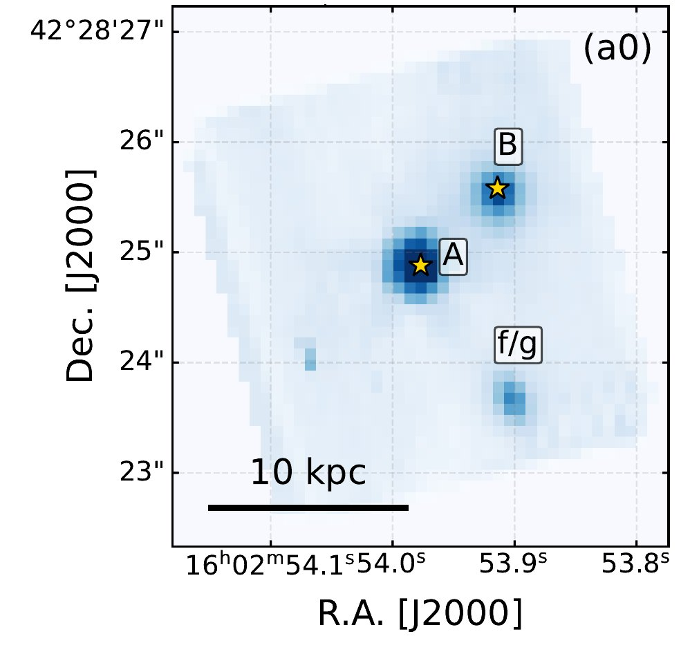
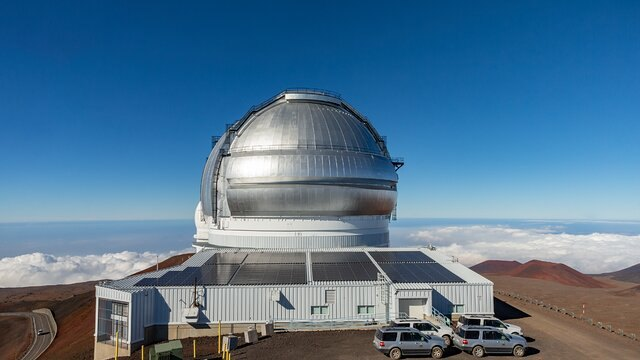
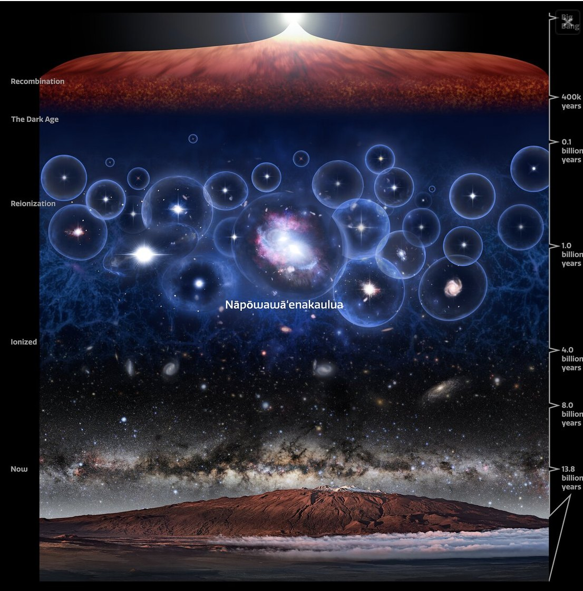

C'è un'epoca, ai confini del tempo, in cui l'universo era ancora un luogo ostile e senza memoria. Aveva appena 900 milioni di anni. Le prime galassie si stavano formando tra nubi di gas e gusci di materia oscura, e le prime stelle accendevano fuochi isolati nella notte primordiale. Ma nel buio, qualcosa si nutriva già. Due **buchi neri supermassicci**, due signori oscuri senza volto, stavano trascinando a sé quantità sterminate di gas, come un tributo dovuto. Prima di sparire per sempre, quella materia si avvolgeva intorno a loro in un vortice incandescente, e nel suo ultimo spasmo bruciava fino a brillare quanto centinaia, perfino migliaia, di galassie come la nostra. Così, ai margini dell'universo bambino, si accesero due quasar: due fari cosmici alimentati dalla fame.

Il **James Webb Space Telescope** e il telescopio **Gemini North** li hanno sorpresi insieme, l'uno accanto all'altro, separati da appena 18.100 anni luce: la **coppia di quasar** compatti più antica mai osservata. Infatti, secondo lo studio che ne racconta la scoperta, è la candidata coppia di quasar più ravvicinata conosciuta nell'Epoca della Reionizzazione, ed è soltanto la terza coppia di quasar mai scoperta all'alba cosmica (cosmic dawn). Trovarli è stata un'impresa. La loro luce ha viaggiato per quasi tredici miliardi di anni prima di raggiungerci e i due sono così vicini da confondersi l'uno nel bagliore dell'altro: persino i telescopi più potenti faticano a separarli. Ma la loro esistenza pone una domanda che inquieta gli astrofisici: come hanno fatto i primi buchi neri a diventare così potenti, così in fretta, quando l'universo era ancora giovanissimo? E che cosa ci dicono sull'assemblaggio delle prime grandi strutture cosmiche, i nidi da cui sarebbero nate galassie sempre più massicce e complesse?

Nei cataloghi astronomici portano una sigla fredda, quasi clinica: J1602+4228AB, dove A e B indicano i due quasar della coppia.

<figure class="post-fig">

<figcaption>Il campo osservato dallo spettrografo NIRSpec del James Webb Space Telescope attorno a Nāpōwawāʻenakaulua. Le stelle gialle segnano i due quasar, A e B, separati da appena 0,98 secondi d’arco. Con “f/g” è indicata la candidata galassia in primo piano vicino a B. Crediti: Onorato et al. 2026, The Astrophysical Journal Letters 1011, L59, Figura 2 (pannello a0, ritagliato), DOI: 10.3847/2041-8213/aeb11f, licenza CC BY 4.0.</figcaption>
</figure>

Ma il loro vero nome suona come un'antica formula evocativa: **Nāpōwawāʻenakaulua**. In lingua hawaiana significa “Due corpi celesti di oscurità insondabile e potente, nella brillantezza del calore che reincarna energia nell'universo”. Il nome è stato scelto attraverso il programma A Hua He Inoa dell'ʻImiloa Astronomy Center of Hawaiʻi, che promuove l'uso della lingua indigena hawaiana nella denominazione degli oggetti astronomici, con il contributo di Larry Kimura, professore associato di lingua e studi hawaiani all'Università delle Hawaiʻi a Hilo e coautore dello studio. In quelle parole c'è tutta l'angoscia e la bellezza di ciò che abbiamo trovato: l'oscurità insondabile dei due buchi neri e il fulgore della materia che precipita verso di loro, urlando luce prima di scomparire. Perché questo è il paradosso più crudele del cosmo: un buco nero non emette luce, eppure può nascondersi nel cuore di uno degli oggetti più luminosi dell'universo. E questa volta, nel bagliore dell'alba cosmica, i signori oscuri erano due.

<figure class="post-fig">

<figcaption>Il telescopio Gemini North, con il suo specchio di 8,1 metri, sulla vetta del Maunakea, alle Hawaiʻi, a oltre 4.200 metri di quota, sopra il mare di nuvole. I suoi spettrografi GNIRS e GMOS hanno raccolto la parte più blu della luce dei due quasar di Nāpōwawāʻenakaulua, completando le osservazioni del James Webb Space Telescope. Crediti: International Gemini Observatory/NOIRLab/NSF/AURA.</figcaption>
</figure>

## I signori oscuri vestiti di luce

Per capire che cosa si agitava in quell'oscurità, dobbiamo tornare indietro fino a un universo che aveva meno del 7% della sua età attuale. Un cosmo bambino, ma già in preda alla violenza. La gravità tesseva una gigantesca ragnatela di filamenti di materia oscura, e lungo quei fili il gas scivolava verso i nodi più densi. Lì le galassie nascevano, si avvicinavano, si scontravano e talvolta si divoravano a vicenda, dando origine a strutture sempre più grandi. In quei nodi regnavano i signori più spaventosi dell'universo primordiale: buchi neri con masse di milioni o addirittura miliardi di volte quella del Sole. Quando uno di loro si nutre a ritmi frenetici, il nucleo della galassia che lo ospita si trasforma in un quasar, una delle sorgenti più luminose del cosmo. I due quasar di Nāpōwawāʻenakaulua brillano rispettivamente come circa 60.000 e 14.000 miliardi di Soli.

Ed ecco il mistero che tormenta gli astrofisici. Non sappiamo ancora spiegare davvero come un buco nero possa ingrassare fino a masse così smisurate in meno di un miliardo di anni di vita dell'universo. È come trovare un re adulto in una culla. Sappiamo però come si nutre. Un buco nero cresce attirando e inghiottendo gas e altra materia. Ma il suo tributo non cade dritto nell'abisso: prima di oltrepassare l'orizzonte degli eventi, il confine oltre il quale nulla, nemmeno la luce, può più tornare indietro, la materia gli gira intorno in una spirale vorticosa, il disco di accrescimento. Lì viene compressa, lacerata e riscaldata a temperature elevatissime, finché non libera quantità immense di energia sotto forma di luce. È questa luce, emessa non dal buco nero ma dalla materia che sta per divorare, a tradire la presenza di un quasar. Il nucleo può brillare tanto intensamente da eclissare tutte le stelle della galassia che lo ospita. Il signore oscuro resta invisibile: a vedersi è il bagliore delle sue vittime.

Nāpōwawāʻenakaulua nasconde due di questi signori oscuri, entrambi già adulti, già enormi, quando l'universo era ancora nella sua infanzia.

<figure class="post-fig">

<figcaption>Rappresentazione artistica della storia dell’universo, dal Big Bang (in alto) fino a oggi (in basso), con la Via Lattea che sorge sopra il Maunakea, alle Hawaiʻi. Dopo la ricombinazione, il cosmo sprofonda nei secoli bui. Poi le prime galassie e i primi quasar cominciano a scavare nell’idrogeno neutro bolle di gas ionizzato, che crescono fino a fondersi: è l’epoca della reionizzazione. Nella bolla centrale, appena 900 milioni di anni dopo il Big Bang, brillano i due signori oscuri di Nāpōwawāʻenakaulua: due quasar, cioè due buchi neri supermassicci che divorano materia e la trasformano in luce. È la coppia compatta di quasar più distante, e quindi più antica, mai osservata. Crediti: International Gemini Observatory/NOIRLab/NSF/AURA/P. Marenfeld/M. Zamani</figcaption>
</figure>

## Il secondo signore nell'ombra

La loro scoperta è cominciata come in ogni storia dell'orrore che si rispetti: con un dettaglio fuori posto. Gli astronomi stavano esaminando i dati del programma Aether, una campagna osservativa condotta con lo spettrografo NIRSpec del James Webb Space Telescope, che ha osservato 200 quasar dell'universo primordiale: circa il 43% di quelli conosciuti nel periodo compreso tra 750 milioni e un miliardo di anni dopo il Big Bang. Uno di questi era J1602+4228, un quasar noto dal 2004. Un vecchio conoscente. Ma questa volta, nelle osservazioni di Webb, accanto a lui c'era qualcos'altro: una seconda sorgente luminosa, praticamente alla stessa distanza da noi. Per più di vent'anni quel compagno era passato inosservato, acquattato nel bagliore del vicino. Distinguerlo non era affatto scontato: i due oggetti sono così vicini che separarli rappresenta una vera sfida. Webb lo ha stanato, ne ha misurato la posizione e ne ha catturato lo spettro: è da quella luce scomposta che gli astronomi hanno ricavato le masse dei due buchi neri. Per completare il ritratto, però, sono serviti anche gli spettrografi di Gemini North, il telescopio che veglia sulla vetta del **Maunakea**, alle Hawaiʻi, che hanno raccolto la parte più blu della loro luce.

Le osservazioni di Webb mostrano che, nel cielo, i due signori oscuri sono separati da appena 0,98 secondi d'arco: più o meno lo spessore di un capello visto da una ventina di metri. Tradotta in distanza cosmica, quella fessura corrisponde a circa 18.100 anni luce, più o meno un quinto del diametro della Via Lattea. Su scala cosmica, praticamente fianco a fianco. Non è detto, però, che i due siano già avvinghiati in un abbraccio mortale, né che le loro galassie si stessero fondendo. Quella misura è la loro separazione proiettata sul cielo: la distanza reale, nello spazio tridimensionale, potrebbe essere diversa. C’è però un indizio che li tradisce. Nell’universo in espansione, più un oggetto è lontano, più velocemente si allontana da noi: la sua velocità, misurata dal redshift, rivela quindi anche la sua distanza. E le velocità dei due signori oscuri sono quasi identiche: differiscono di appena una quindicina di chilometri al secondo. Segno che, con ogni probabilità, sono vicini anche in profondità, non solo nel cielo. Non è una prova definitiva, perché ogni galassia ha anche un suo moto proprio che può confondere la misura; ma tutto lascia pensare che viaggino insieme. E già questo basta a rendere il sistema straordinariamente interessante.

## Sovrani nella culla dell'universo

Poi sono arrivate le masse. Il componente più luminoso (J1602+4228A) nasconde un buco nero di circa 1,5 miliardi di volte la massa del Sole. Il compagno (J1602+4228B), più debole, ne cela uno da circa 400 milioni di masse solari. Per capire quanto siano fuori scala, pensate al buco nero che dorme al centro della nostra Galassia, Sagittarius A*: circa quattro milioni di Soli. I due signori di Nāpōwawāʻenakaulua sono da circa cento a quasi quattrocento volte più massicci.

Ma la loro mole non è la cosa più inquietante. Entrambi stavano attraversando una fase di accrescimento furiosa, con luminosità vicine o leggermente superiori al cosiddetto **limite di Eddington**. Stavano divorando materia a ritmi altissimi, vicini al massimo teorico, sprigionando torrenti di energia. Il limite di Eddington descrive, in condizioni ideali, il punto in cui la pressione della radiazione emessa dal materiale in caduta riesce a contrastare la gravità che lo trascina verso il buco nero. Oltre quella soglia, la luce stessa dovrebbe cominciare a respingere il tributo. Superarlo non è impossibile, ma richiede condizioni particolari, e va interpretato con cautela, tenendo conto delle incertezze delle misure.

Il quadro che emerge è da incubo: due signori oscuri già enormi, entrambi in piena frenesia, in un'epoca in cui le prime grandi galassie erano ancora in costruzione.

## Un doppio o un'illusione?

Ogni storia dell'orrore ha il suo doppio. E prima di parlare di coppia, gli astronomi hanno dovuto affrontare il sospetto più inquietante: e se A e B fossero lo stesso signore oscuro, visto due volte? Non è fantascienza. Una galassia posta tra noi e il quasar potrebbe agire da lente gravitazionale: la sua massa curva lo spazio, piega la luce e può sdoppiare l'immagine della sorgente, come uno specchio deformato. Le due immagini, però, non sarebbero per forza identiche: la loro luce arriva con un ritardo, mostrandoci il quasar in due momenti diversi, e le stelle della galassia-lente possono distorcerle in modo diverso. Per questo gli autori hanno cercato un testimone che la lente non può alterare: le righe strette dell'ossigeno ionizzato ([O III]), prodotte da gas così esteso da non risentire di quelle distorsioni. Se A e B fossero lo stesso quasar, queste righe avrebbero la stessa forma. Invece no: quella di A mostra un'ala blu più marcata, il segno di venti di gas (outflow) più intensi. Due signori, dunque, ciascuno con il suo respiro.

Resta però un'ombra. Le immagini d'archivio di Hubble mostrano una possibile galassia in primo piano vicino a B, che potrebbe spiegare perché B appare molto più arrossato dalla polvere e, in teoria, fare da lente. Il suo aspetto fa pensare che sia troppo vicina a noi per sdoppiare un oggetto così remoto, ma solo uno spettro potrà misurarne la distanza. Per ora, dunque, gli autori propendono per una vera coppia di quasar, ma avvertono che la lente gravitazionale non può ancora essere esclusa del tutto. Fino ad allora, il sospetto del doppio resta lì, sospeso nel buio.

## Due signori, un solo regno

Se i due signori oscuri sono reali, resta un'altra domanda, forse ancora più inquietante: perché due sovrani così rari si trovano così vicini? Nell'universo primordiale i quasar come questi erano rarissimi: in media, uno solo in un cubo di spazio largo circa un miliardo e mezzo di anni luce, misurato con le dimensioni attuali dell'universo. Trovarne due a 18.100 anni luce l'uno dall'altro è come scoprire, in un deserto sterminato, due sovrani rarissimi che regnano sullo stesso territorio.

Gli astronomi misurano questa tendenza a stare vicini con il **clustering**: quanto spesso un quasar ha un compagno accanto, rispetto a quanto accadrebbe per puro caso. Attorno ai 199 quasar del programma Aether, a una distanza così piccola, di compagni ne è spuntato uno solo. Anche un solo caso, però, è troppo: prolungando fino a qui le misure di clustering fatte su scale più grandi, ce ne si aspetterebbe da cento a mille volte di meno.

Ma attenzione: i modelli cosmologici non sono smentiti. Le misure fatte su grandi distanze descrivono come si dispongono quasar che vivono in aloni di materia oscura diversi, ciascuno nel proprio regno. A 18.100 anni luce, invece, i due quasar condividono lo stesso alone, lo stesso regno: e un regno abbastanza grande da sfamare un signore oscuro può ospitarne anche un secondo. Per questo, a distanze così piccole, un eccesso è in parte atteso. Il punto è che questo eccesso è così grande che il regno condiviso, da solo, potrebbe non bastare a spiegarlo. Vivere nello stesso alone rende probabile avere un vicino, ma non che quel vicino sia sveglio: la fase di quasar è un momento di frenesia relativamente breve nella vita di un buco nero, e sorprendere due signori oscuri affamati nello stesso istante, così vicini, è un'enorme coincidenza. A meno che non sia stato qualcosa a risvegliarli insieme.

Ed è qui che la storia si fa più cupa. Se le due galassie ospiti si stanno avvicinando, la loro attrazione reciproca potrebbe sconvolgerle, spingendo il gas verso i rispettivi centri e servendo il banchetto a entrambi i signori nello stesso momento. Nāpōwawāʻenakaulua potrebbe allora essere il primo indizio di un'intera popolazione di coppie di quasar nate dagli scontri tra galassie all'alba cosmica. È uno scenario affascinante, ma non ancora dimostrato: si basa su una sola coppia, e solo trovarne altre permetterà di distinguere un vero effetto fisico da un incontro fortuito. Per ora sappiamo una cosa sola: tra 199 quasar esplorati, almeno un regno con due signori esiste.

## Ciò che ci guarda dall'alba del tempo

Nāpōwawāʻenakaulua ci mostra un universo molto diverso da quello che immaginiamo guardando il cielo notturno, così quieto e immobile. Quando il cosmo aveva appena 900 milioni di anni, due buchi neri supermassicci avevano già raggiunto masse di centinaia di milioni e di miliardi di Soli. Apparivano separati da appena 18.100 anni luce e stavano entrambi divorando materia senza sosta. Studiarli è un'occasione rara per capire come siano nati e cresciuti i primi grandi buchi neri, e quale ruolo abbiano avuto gli incontri tra galassie nella loro evoluzione. Ma le domande restano sospese nell'oscurità. Sono davvero due signori oscuri, o uno solo riflesso due volte? Le loro galassie stanno interagendo? La vicinanza ha alimentato la loro fame, o è soltanto il segno di un regno cosmico eccezionalmente denso? Per ora, l'universo non risponde. Quella che oggi raggiunge i nostri telescopi è luce partita quasi tredici miliardi di anni fa: un messaggio dal passato più remoto, che ci mostra i due signori oscuri come erano allora. Che cosa siano diventati, non possiamo saperlo. Ma il nome hawaiano scelto per loro sembra restituire esattamente ciò che vediamo: due oscurità insondabili, avvolte nel bagliore incandescente della materia che le nutre. E nel buio, forse, altri come loro stanno ancora aspettando di essere scoperti.

## Riferimenti bibliografici

- Onorato, S. et al. (2026), *Nāpōwawāʻenakaulua: A Close Quasar Pair at Cosmic Dawn in the Aether Survey*, *The Astrophysical Journal Letters*, 1011, L59. DOI: <a href="https://doi.org/10.3847/2041-8213/aeb11f">10.3847/2041-8213/aeb11f</a>.

<strong>Fonti e crediti:</strong> informazioni tratte dallo studio di Onorato et al. (2026), <a href="https://doi.org/10.3847/2041-8213/aeb11f">The Astrophysical Journal Letters, 1011, L59</a>, pubblicato con licenza CC BY 4.0 (Figura 2, pannello a0, ritagliato). Immagini di International Gemini Observatory/NOIRLab/NSF/AURA, P. Marenfeld e M. Zamani. Redshifted non è affiliato a queste organizzazioni e il loro uso non implica alcuna approvazione.

