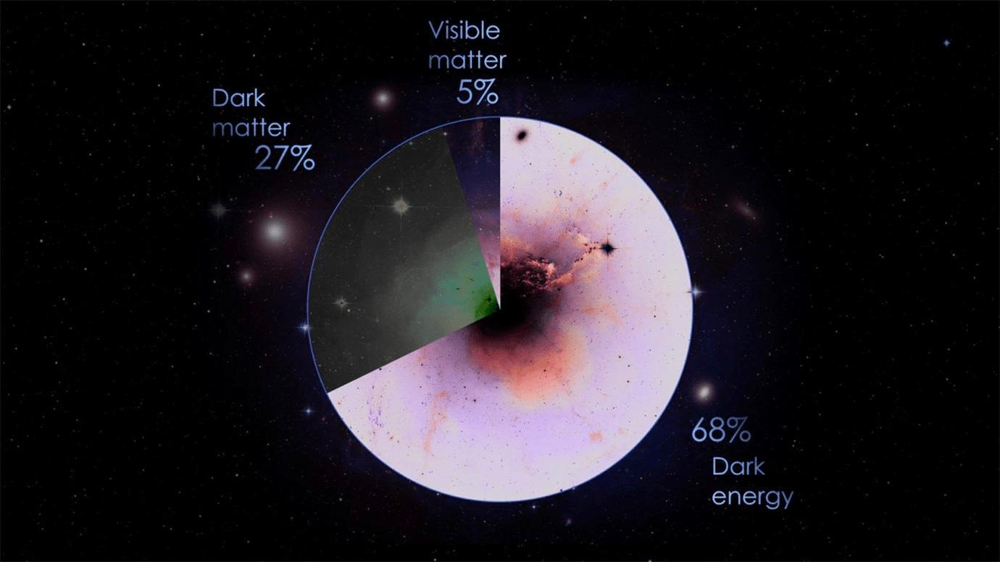
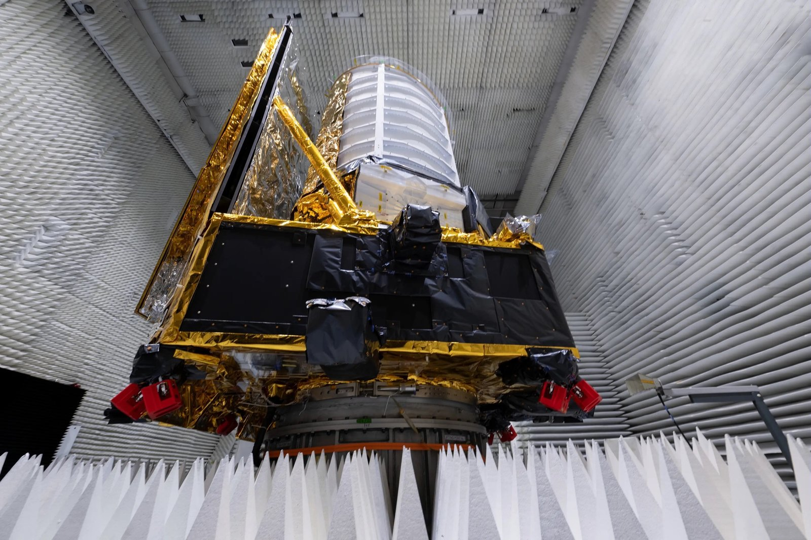
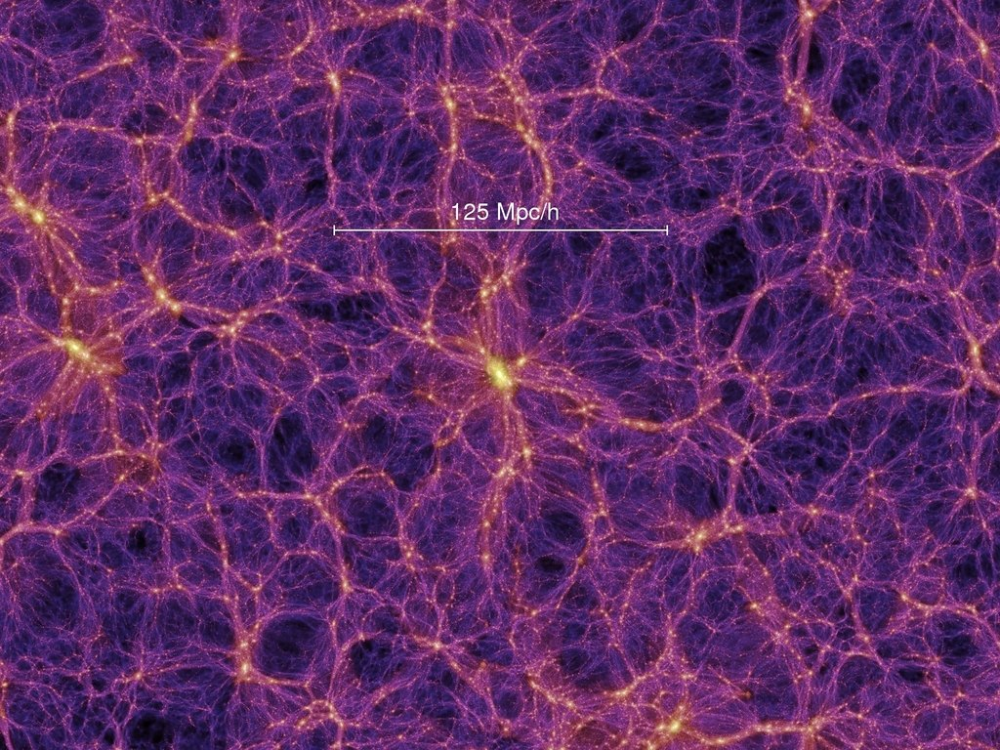
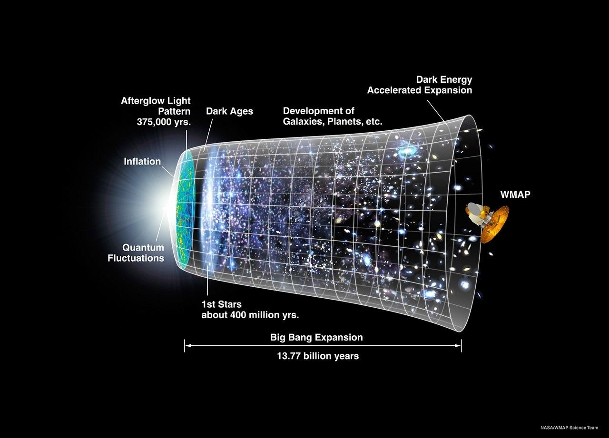
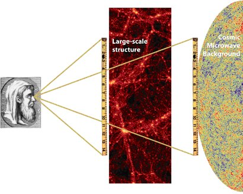
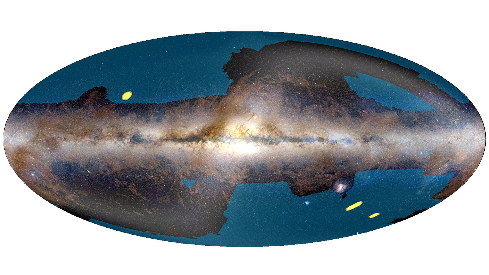
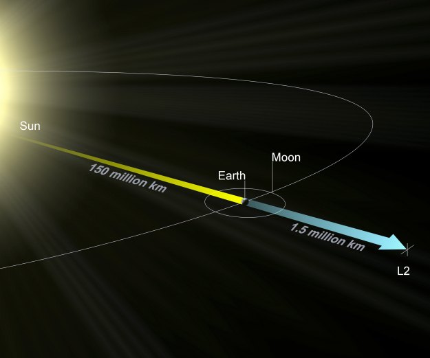
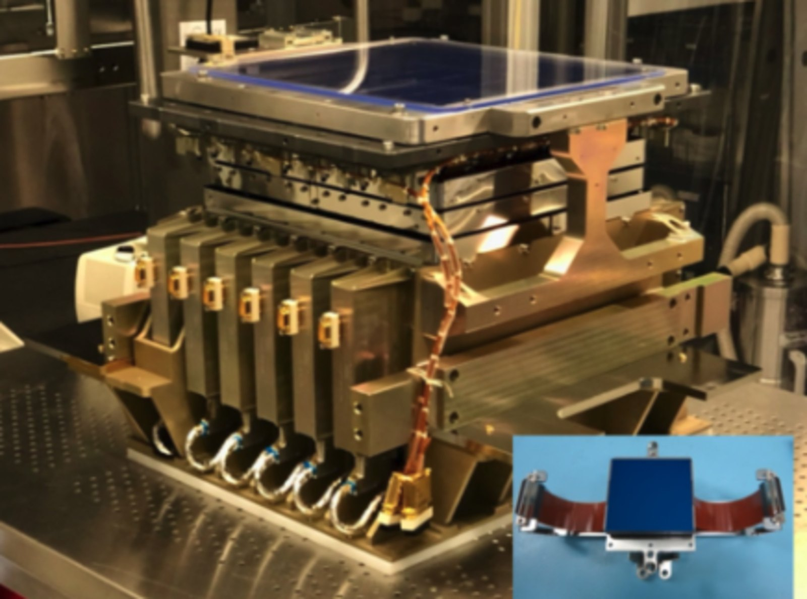
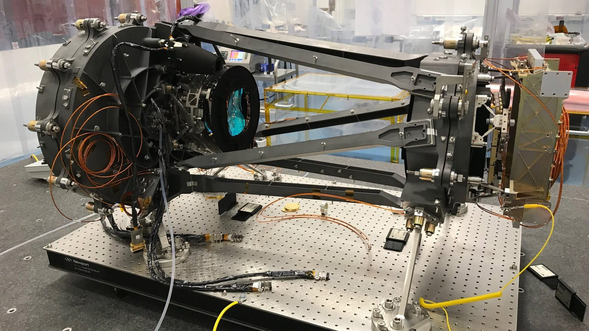

Guardando il cielo notturno, viene spontaneo pensare che stelle, galassie e nebulose siano tutto ciò che esiste. Non è così. La materia ordinaria (in gergo barionica), quella di cui sono fatti gli astri, i pianeti e noi stessi, rappresenta appena il 5% circa del contenuto dell'universo. Il resto è dominato da due componenti misteriose: la materia oscura e l'energia oscura.

<figure class="post-fig">

<figcaption>Il bilancio energetico dell’universo: la materia ordinaria (quella detta barionica), di cui sono fatti stelle, pianeti e galassie, ne rappresenta appena il 5% circa; il resto è materia oscura (circa il 27%) ed energia oscura (circa il 68%). Crediti: NASA’s Goddard Space Flight Center</figcaption>
</figure>

La **materia oscura** non emette, non assorbe e non riflette la luce. È invisibile, ma la tradisce la sua gravità: è proprio osservando come attrae la materia visibile che possiamo dedurne l'esistenza e ricostruirne la distribuzione, dalle singole galassie fino alle scale cosmologiche.

L'**energia oscura**, invece, è il nome che diamo alla causa dell'espansione accelerata dell'universo, scoperta alla fine degli anni Novanta. Che cosa sia, non lo sappiamo. Potrebbe essere la costante cosmologica introdotta da Einstein, un'energia distribuita uniformemente nello spazio; oppure il segnale che la nostra comprensione della gravità, sulle scale più grandi, è ancora incompleta.

Come si studia qualcosa che non si vede? Osservando come influenza ciò che vediamo. E l'influenza dell'universo oscuro è enorme: sono proprio la densità di materia e quella di energia, componenti oscure comprese, a stabilire la geometria del cosmo. È questa la sfida del **telescopio spaziale Euclid**, l'ultimo arrivato nella famiglia dell'ESA, progettato per ricostruire la geometria e l'evoluzione dell'universo. Non a caso porta il nome di Euclide di Alessandria, il matematico greco vissuto intorno al 300 a.C. e considerato il padre della geometria.

<figure class="post-fig">

<figcaption>Il telescopio spaziale Euclid nella camera di test di Thales Alenia Space a Cannes, in Francia, durante le prove di compatibilità elettromagnetica, l’ultimo test prima del lancio. La camera, rivestita di coni che assorbono i segnali radio, simula l’ambiente elettromagnetico dello spazio profondo. Crediti: ESA–Manuel Pedoussaut.</figcaption>
</figure>

L'obiettivo è una gigantesca mappa tridimensionale dell'universo, costruita osservando miliardi di galassie fino a dieci miliardi di anni luce di distanza. E poiché guardare lontano significa guardare indietro nel tempo, la terza dimensione di questa mappa è il tempo: Euclid seguirà la crescita delle strutture cosmiche lungo circa dieci miliardi di anni di storia, abbracciando l'intera epoca in cui l'energia oscura ha preso il sopravvento, accelerando l'espansione dell'universo.

## Gli obiettivi scientifici: mappare l'universo oscuro

Euclid è stato progettato con lo scopo di rispondere a domande aperte dell'astrofisica moderna.

### Che cos'è la materia oscura?

Il primo indizio arrivò negli anni Trenta del Novecento. L'astronomo svizzero-americano Fritz Zwicky misurò la velocità delle galassie nell'ammasso della Chioma e scoprì che si muovevano troppo in fretta: la materia visibile non bastava a spiegarne il moto. Negli anni Settanta l'astronoma americana Vera Rubin ritrovò lo stesso enigma nelle singole galassie, le cui regioni esterne ruotano molto più velocemente del previsto. E nel 1974 uno studio guidato dal fisico americano James Peebles stimò che, per ogni chilogrammo di materia luminosa, ce ne fossero almeno dieci di invisibile. Non poteva trattarsi soltanto di gas non ancora trasformato in stelle: le ricerche non ne trovarono abbastanza. Gli astronomi dovettero spingersi oltre la fisica conosciuta, verso particelle ancora ignote, che non interagiscono con la luce ma producono gravità. Oggi è interpretata come la cosiddetta materia oscura fredda (**cold dark matter**, CDM), fatta di particelle lente, un pilastro del modello cosmologico standard, il **modello Lambda-CDM**. Senza di essa non si spiegherebbero né il moto delle galassie né la rapidità con cui le strutture cosmiche si sono formate. La CDM supera la materia ordinaria di circa cinque a uno. Eppure, dopo decenni di esperimenti, nessun rivelatore è ancora riuscito a catturarla. Euclid prova a sbloccare la situazione da un'altra strada: ricostruirne la distribuzione seguendo la crescita delle strutture cosmiche che ha contribuito a plasmare, e misurando come deforma le immagini delle galassie lontane. Sapere dove si trova e come si comporta darà indizi preziosi sulla sua identità.

<figure class="post-fig">

<figcaption>La ragnatela cosmica nella Millennium Simulation: la distribuzione della materia oscura nell’universo di oggi, in una fetta di spazio spessa circa 70 milioni di anni luce. La materia oscura si raccoglie in lunghi filamenti (in viola e rosa) che si incrociano in nodi densissimi, dove nascono le galassie e i grandi ammassi (in giallo); tra un filamento e l’altro si aprono enormi vuoti (in viola scuro e nero). La barra indica 125 Mpc/h, circa 560 milioni di anni luce. Crediti: V. Springel / Virgo Consortium, Millennium Simulation (Springel et al. 2005, Nature 435, 629).</figcaption>
</figure>

### Che cos'è l'energia oscura?

Alla fine degli anni Novanta, due gruppi indipendenti, il Supernova Cosmology Project guidato da Saul Perlmutter e l'High-z Supernova Search Team guidato da Brian Schmidt, con un ruolo cruciale di Adam Riess, studiarono le supernovae di tipo Ia. Queste stelle esplodono tutte con circa la stessa energia: dalla loro luminosità apparente si ricava la distanza, e quindi la storia dell'espansione cosmica. Gli astronomi si aspettavano di scoprire un'espansione che rallenta, frenata dalla gravità di tutti i corpi celesti. Nel 1998 entrambi i gruppi trovarono l'opposto: l'espansione accelera. Una scoperta che nel 2011 è valsa ai tre scienziati il premio Nobel per la fisica. Nessuna fisica conosciuta poteva spiegarla, e la causa di questa accelerazione prese il nome di energia oscura. Secondo le stime della missione Planck dell'ESA, costituisce circa il 68% del contenuto di materia ed energia dell'universo: più di tutto il resto messo insieme. Sembra essere una proprietà del vuoto stesso: più spazio c'è, più energia oscura c'è, e più i suoi effetti si fanno sentire. L'ipotesi più semplice è la **costante cosmologica**, introdotta da Einstein nel 1917 per mantenere l'universo statico e poi abbandonata quando si scoprì che l'universo si espande. Ma esistono alternative: una nuova forza della natura, oppure una relatività generale che sulle scale più grandi non funziona come pensiamo. Ognuna prevede un'evoluzione leggermente diversa dell'accelerazione nel tempo, e finora nessun esperimento è stato abbastanza preciso da distinguerle. Euclid è stato progettato proprio per questo. Mappando le galassie degli ultimi dieci miliardi di anni, dovrà misurare come varia l'accelerazione cosmica con un'accuratezza migliore del 10%, rivelando se la costante cosmologica è davvero costante. E misurerà con una precisione del 2% il ritmo di crescita delle strutture cosmiche, mettendo alla prova la relatività generale stessa. Se uno di questi test fallisse, il modello Lambda-CDM andrebbe sostituito: servirebbe nuova fisica.

<figure class="post-fig">

<figcaption>La storia dell’universo, dal Big Bang a oggi. Per gran parte del tempo l’espansione cosmica è stata frenata dalla gravità; negli ultimi miliardi di anni, invece, ha ripreso ad accelerare: è l’effetto dell’energia oscura, che nessuno ha mai visto ma di cui misuriamo l’impronta. Crediti: NASA/WMAP Science Team.</figcaption>
</figure>

### La gravità come lente cosmica: il weak lensing

Per rispondere a queste domande, Euclid punta su due fenomeni cosmologici: la lente gravitazionale debole e il *clustering* delle galassie, cioè il modo in cui si distribuiscono e si raggruppano nello spazio. Entrambi permettono di ricostruire la distribuzione della materia e di seguirne l'evoluzione nel tempo; combinati con le distanze delle galassie, mettono alla prova i modelli cosmologici. La luce non viaggia sempre in linea retta: quando passa vicino a una grande concentrazione di massa, la gravità ne devia il percorso. È la lente gravitazionale, uno degli effetti previsti dalla relatività generale di Einstein. Nel **weak gravitational lensing**, o lente gravitazionale debole, l'effetto è minimo. Niente archi spettacolari né immagini multiple: la forma apparente delle galassie lontane viene appena stirata, di pochissimo. Presa da sola, una di queste distorsioni è indistinguibile dalla forma naturale della galassia. Ma analizzandone statisticamente milioni, gli astronomi possono ricostruire le minuscole deformazioni prodotte da tutta la materia che la luce ha incontrato lungo il suo cammino. E qui entra in gioco la materia oscura: anche se invisibile, contribuisce alla gravità che deforma la luce delle galassie di fondo. Misurando queste distorsioni si ottiene così la distribuzione di tutta la massa, visibile e oscura; confrontandola con quella della materia luminosa, si scopre dove si nasconde la componente oscura. Per riuscirci, Euclid deve misurare la forma delle galassie con una nitidezza e una stabilità eccezionali. Il risultato sarà una mappa della materia dell'universo e della sua evoluzione nel tempo.

### L'eco sonora del Big Bang: le BAO

Il secondo strumento di Euclid è lo studio della distribuzione delle galassie su grandissima scala. Questa distribuzione non è casuale: conserva un'impronta delle condizioni dell'universo primordiale, le **oscillazioni acustiche barioniche** (Baryon Acoustic Oscillations, **BAO**). Nelle prime centinaia di migliaia di anni dopo il Big Bang, l'universo era un plasma caldo e denso di fotoni, elettroni e nuclei atomici. La gravità tendeva a far collassare la materia, la pressione della radiazione la respingeva: da questo braccio di ferro nacquero vere e proprie onde sonore, che si propagavano nel plasma. Poi l'universo si raffreddò abbastanza da formare i primi atomi neutri. La radiazione si separò dalla materia e le onde si fermarono, congelate. La loro traccia è rimasta impressa nella distribuzione della materia, e oggi la ritroviamo come una distanza preferita tra le galassie: una scala caratteristica, l'*orizzonte acustico*, che funziona da righello cosmico. Misurandola in epoche diverse, gli astronomi possono ricostruire la relazione tra distanza e redshift e capire come è cambiata nel tempo l'espansione dell'universo. Lensing e BAO sono sonde indipendenti e complementari: il primo pesa la materia, le seconde misurano la geometria dell'universo e la storia della sua espansione.

<figure class="post-fig">

<figcaption>Il righello cosmico delle BAO: la stessa scala caratteristica, l’orizzonte acustico, è impressa sia nella radiazione cosmica di fondo (*Cosmic Microwave Background*, a destra), la luce più antica dell’universo, sia nella distribuzione su grande scala di galassie e materia (*Large-scale structure*, al centro). Misurandone la lunghezza apparente in epoche diverse, Euclid ricostruisce la geometria e la storia dell’espansione dell’universo. Crediti: ©ESA.</figcaption>
</figure>

### Oltre la cosmologia: la Legacy Science

Euclid è nato per indagare la materia oscura e l'energia oscura, ma i suoi occhi vedono molto di più. Un campo di vista enorme, immagini nitidissime nel visibile e osservazioni nel vicino infrarosso: un mix che serve a decine di altre ricerche. È la **Legacy Science**, l'eredità di dati che la missione lascerà a tutta la comunità scientifica. Con Euclid si potranno studiare la formazione e l'evoluzione delle galassie, la crescita degli ammassi e la struttura della ragnatela cosmica (*cosmic web*). Si potranno scovare nuclei galattici attivi, quasar, galassie nane e sistemi così tenui da confondersi con il fondo del cielo. Un ruolo speciale lo avranno le lenti gravitazionali forti, in cui una galassia in primo piano trasforma la luce di una sorgente lontana in archi, anelli o immagini multiple: veri laboratori per pesare le galassie e ingrandire oggetti altrimenti troppo deboli per essere visti. Anche la nostra Galassia sarà protagonista, con le sue popolazioni stellari e le sue strutture, insieme alle sorgenti variabili e ai fenomeni transienti, la cui luminosità cambia nel tempo. Euclid, insomma, non risponderà soltanto a due grandi domande: la sua sterminata raccolta di immagini, spettri e cataloghi alimenterà la ricerca astronomica per decenni.

<figure class="post-fig">

<figcaption>La mappa delle survey di Euclid sull’intera volta celeste. La fascia luminosa orizzontale è il piano della Via Lattea. Le linee blu racchiudono le regioni del Wide Survey, più di un terzo del cielo, scelte lontano dalle stelle e dalle polveri della nostra Galassia e dalla luce zodiacale del Sistema Solare. In giallo, i tre campi del Deep Survey: Euclid Deep Field North, nella costellazione del Drago, Fornax e South, nell’emisfero australe, per un totale di circa 50 gradi quadrati. Crediti: ESA/Euclid/Euclid Consortium/NASA/Planck Collaboration/A. Mellinger; acknowledgment: J.-C. Cuillandre, J. Dinis ed Euclid Consortium Survey Group, <a href="https://creativecommons.org/licenses/by-sa/3.0/igo/">CC BY-SA 3.0 IGO</a>.</figcaption>
</figure>

## Dalla Terra al punto L2: il viaggio di Euclid

Per misurare deformazioni così piccole, Euclid ha bisogno di immagini nitidissime, di temperature stabili e di un cielo libero dalle interferenze dell'atmosfera. Per questo lavora nello spazio, in una regione speciale del sistema Sole-Terra: il secondo punto lagrangiano, **L2**. Il viaggio è iniziato il 1° luglio 2023, quando Euclid è partito da Cape Canaveral, in Florida, a bordo di un razzo **Falcon 9** di SpaceX. Inizialmente doveva volare su un razzo russo Soyuz dalla Guyana francese, ma dopo l'invasione dell'Ucraina l'ESA ha dovuto cambiare lanciatore. Dopo circa quattro settimane, il telescopio ha raggiunto L2, a circa 1,5 milioni di chilometri dalla Terra, nella direzione opposta al Sole: quattro volte la distanza della Luna. I punti lagrangiani sono cinque posizioni speciali in cui l'attrazione gravitazionale di due corpi celesti e il moto orbitale si bilanciano, permettendo a un terzo corpo, molto più piccolo, di muoversi insieme a loro. In L2 un satellite accompagna la Terra nel suo giro intorno al Sole, mantenendo sempre la stessa configurazione rispetto a entrambi. Euclid, però, non sta immobile esattamente in L2: gli gira attorno lungo un'ampia orbita, come il James Webb Space Telescope. Da lì, Sole, Terra e Luna restano sempre dalla stessa parte del cielo. Lo schermo solare può così proteggere costantemente telescopio e strumenti dalla luce diretta, mentre i pannelli solari continuano a ricevere energia e l'antenna resta puntata verso la Terra. Dopo l'arrivo in L2 sono cominciati i mesi di verifiche e calibrazioni. Il 14 febbraio 2024 sono partite le osservazioni scientifiche di routine: la grande esplorazione dell'universo oscuro era ufficialmente iniziata.

<figure class="post-fig">

<figcaption>Il secondo punto lagrangiano del sistema Sole-Terra, L2, si trova a circa 1,5 milioni di chilometri dalla Terra, sulla linea che unisce il Sole e la Terra, dalla parte opposta al Sole: circa quattro volte la distanza della Luna. Da qui Euclid può tenere Sole, Terra e Luna sempre alle proprie spalle e osservare il cielo profondo in condizioni stabilissime. Crediti: ©ESA.</figcaption>
</figure>

## Il telescopio

Dietro la capacità di osservare miliardi di galassie c'è una macchina complessa, progettata per lavorare in modo autonomo e stabile per anni nello spazio profondo. Euclid è alto circa 4,7 metri, ha un diametro di circa 3,7 metri e pesa circa due tonnellate. Il satellite è stato costruito a Torino da Thales Alenia Space Italia, capocommessa dell'ESA, mentre il modulo del telescopio è stato realizzato da Airbus Defence and Space; la NASA ha fornito i rivelatori infrarossi di NISP. La sua architettura si divide in due grandi parti, tenute separate per isolare il più possibile gli strumenti scientifici dal calore e dalle vibrazioni dei sistemi di servizio.

### 1. Il Modulo del Carico Utile (Payload Module, PLM): gli occhi di Euclid

Ospita il telescopio, i due strumenti scientifici e il sensore di guida fine, che mantiene il puntamento con estrema precisione durante le esposizioni. Il requisito che ne ha guidato la progettazione è uno solo: la stabilità. Per misurare le minuscole deformazioni del lensing debole, le immagini non devono essere alterate né da movimenti meccanici né da variazioni di temperatura. Il cuore ottico è un telescopio con uno specchio primario di 1,2 metri di diametro, in configurazione Korsch a tre specchi: uno schema che garantisce un campo di vista molto ampio e immagini nitide su tutta la sua estensione. Specchi e struttura sono in carburo di silicio (SiC), una ceramica rigida e leggera che quasi non si deforma al variare della temperatura: perfetta per un telescopio che deve mantenere un allineamento ottico precisissimo. In un solo scatto, Euclid riprende circa mezzo grado quadrato di cielo: più di due volte e mezzo l'area della Luna piena. La luce raccolta viene poi divisa da un elemento ottico chiamato *dicroico*, che manda la parte visibile a uno strumento e quella infrarossa all'altro. Così i due strumenti osservano contemporaneamente la stessa porzione di cielo.

**VIS** (Visible Instrument) è la fotocamera di Euclid e vede la luce visibile, tra circa 550 e 900 nanometri. Il suo piano focale è un mosaico di 36 sensori CCD, per un totale di circa 600 milioni di pixel. Il suo compito è misurare con grande precisione la forma e l'orientamento di un numero enorme di galassie: è lo strumento chiave del lensing debole. E proprio per questo anche la più piccola instabilità dello strumento potrebbe introdurre deformazioni artificiali e falsare le misure.

<figure class="post-fig">

<figcaption>Il piano focale dello strumento VIS: in alto, sotto una copertura protettiva, il mosaico di 36 sensori CCD, circa 600 milioni di pixel in tutto; sotto, separate da schermi termici, le elettroniche che li controllano e digitalizzano i 144 canali di dati. Nel riquadro, un singolo CCD nel suo supporto per il trasporto. Crediti: CEA, e2v, Airbus, IAS, APCO.</figcaption>
</figure>

**NISP** (Near-Infrared Spectrometer and Photometer) lavora nel vicino infrarosso, fino a circa 2 micron, e combina due funzioni. Come fotometro osserva le galassie attraverso tre filtri, chiamati Y, J e H, e ne misura colore e luminosità: informazioni preziose per stimarne il redshift fotometrico, cioè una prima stima della distanza. Come spettrografo scompone la luce nei suoi colori, producendo uno spettro per ogni sorgente. E lo fa senza fenditura (*slitless spectroscopy*): invece di selezionare un oggetto alla volta, disperde la luce di tutto il campo di vista, ottenendo in un colpo solo gli spettri di moltissime galassie. Dalle righe di emissione e di assorbimento si ricava il redshift spettroscopico, molto più preciso.

<figure class="post-fig">

<figcaption>Lo strumento NISP prima di essere avvolto nella pellicola isolante e integrato nel satellite. È qui che la luce infrarossa raccolta dal telescopio viene filtrata, per la fotometria nelle bande Y, J e H, oppure dispersa, per ottenere gli spettri, prima di raggiungere il piano focale con i 16 rivelatori infrarossi forniti dalla NASA. Crediti: NISP team/LAM.</figcaption>
</figure>

È questa combinazione a dare profondità alla mappa: le immagini dicono dove si trovano le galassie nel cielo, il redshift dice quanto sono lontane, e quindi in quale epoca della storia cosmica le stiamo osservando. Per funzionare, telescopio e strumenti devono restare al freddo, raffreddati in modo passivo da radiatori che disperdono il calore nello spazio. Lo specchio primario resta sotto i −140 °C, i sensori di VIS lavorano intorno ai −120 °C e quelli di NISP, più esigenti, scendono a circa −180 °C.

### 2. Il Modulo di Servizio (Service Module, SVM): la sala macchine

Se il Payload Module sono gli occhi di Euclid, il Service Module è ciò che lo tiene in vita. Qui si trovano i sistemi che producono e distribuiscono l'energia, controllano assetto e orbita, gestiscono la propulsione e le comunicazioni, elaborano e archiviano i dati. Il controllo d'assetto è cruciale: durante le esposizioni, Euclid deve restare puntato su una regione precisa del cielo, senza vibrazioni né movimenti che possano rovinare le immagini. Fa parte del modulo di servizio anche lo schermo solare, combinato con i pannelli solari: da un lato produce energia, dall'altro tiene il telescopio all'ombra. E per non perdere nemmeno un bit, a bordo c'è una memoria di massa da circa 4 terabit, che conserva le osservazioni fino al momento di trasmetterle a Terra.

## Dal satellite ai dati: il segmento di terra

Una missione spaziale non finisce quando il telescopio scatta l'immagine. I dati devono arrivare a Terra, essere controllati, calibrati, elaborati e trasformati in prodotti scientifici. Tutto questo è il compito del **segmento di terra** (Ground Segment), che per Euclid ha due anime. L'*Operations Ground Segment* è il centro di controllo della missione, con sede al Centro europeo per le operazioni spaziali dell'ESA (ESOC) di Darmstadt, in Germania. Mantiene il contatto con Euclid attraverso le grandi antenne di Cebreros, in Spagna, e di Malargüe, in Argentina; ne monitora lo stato di salute, invia i comandi e riceve sia la telemetria sia i dati scientifici. Ogni giorno, in una finestra di circa quattro ore, Euclid trasmette a Terra centinaia di gigabit di dati. Lo *Science Ground Segment* trasforma invece le osservazioni in scienza. È coordinato dal Centro europeo di astronomia spaziale dell'ESA (ESAC), vicino a Madrid, e distribuito tra numerosi centri dell'Euclid Consortium. I dati grezzi non sono subito utilizzabili: vanno ripuliti dagli effetti strumentali, le immagini vanno ricostruite, le sorgenti identificate e misurate, gli spettri estratti e analizzati. Il risultato sono cataloghi con posizione, luminosità, forma, colore e redshift di ogni oggetto osservato.

## Come si costruisce una mappa dell'universo

Euclid non osserva a caso. Ogni puntamento segue una strategia pianificata nei minimi dettagli, che deve fare i conti con le caratteristiche del telescopio, i vincoli termici, l'orientamento rispetto al Sole e la necessità di ottenere osservazioni omogenee. Il metodo si chiama *step-and-stare*, “passo e fissa”. Il telescopio punta una regione del cielo, resta immobile durante le esposizioni e raccoglie immagini e spettri di tutto ciò che si trova nel campo di vista. Poi si sposta sulla regione successiva e ricomincia. Ogni campo viene osservato con più esposizioni leggermente spostate tra loro, una tecnica chiamata *dithering*: questi piccoli scarti coprono gli spazi tra un sensore e l'altro, migliorano il campionamento delle immagini e attenuano gli effetti di eventuali difetti dei rivelatori. La missione prevede due grandi programmi. Il **Wide Survey** è il cuore della missione: circa 14.000 gradi quadrati di cielo extragalattico, più di un terzo dell'intera volta celeste, lontano dal piano della Via Lattea e da quello del Sistema Solare. Il suo scopo è osservare un numero enorme di galassie, abbastanza da rendere solide le analisi cosmologiche. Accanto c'è il **Deep Survey**: tre campi profondi, per un totale di circa 50 gradi quadrati, osservati decine di volte nel corso della missione. Sommando le esposizioni, Euclid scova sorgenti più deboli e lontane e segue l'evoluzione delle galassie attraverso epoche cosmiche diverse. Ogni puntamento deve poi rispettare i vincoli imposti dalla posizione del satellite: il telescopio va tenuto al riparo dal Sole, i pannelli solari devono continuare a ricevere luce, la temperatura deve restare stabile e la luce parassita fuori dagli strumenti. La mappa di Euclid nasce così, tassello dopo tassello, dall'unione di decine di migliaia di campi osservati e calibrati nel corso degli anni.

## Euclid è già al lavoro: i primi grandi risultati

Dalle prime immagini a colori, presentate nel novembre 2023, Euclid ha continuato a raccogliere dati, ampliando giorno dopo giorno la sua copertura del cielo. Nel marzo 2025 ne ha offerto un primo assaggio con la *Quick Data Release* Q1, una sessantina di gradi quadrati di cielo. Il vero salto è arrivato il 12 novembre 2026, con **DR1-Foundation**, la prima parte del primo grande rilascio di dati della missione (*Data Release 1*). Comprende circa 13 mesi di osservazioni: immagini, cataloghi e spettri relativi a circa 1.900 gradi quadrati di cielo, pari al 14% dell'area prevista per il Wide Survey. I numeri sono da capogiro: oltre 900 milioni di galassie, gli spettri di più di 160 milioni di sorgenti, oltre 60 milioni di candidati quasar e circa 15.000 candidate lenti gravitazionali forti, il catalogo più grande mai realizzato, più ricco di tutti quelli precedenti messi insieme. Eppure è solo l'inizio. DR1-Foundation fornisce le immagini e i cataloghi di base per moltissime ricerche astrofisiche. La versione completa di DR1, attesa per la metà del 2027, aggiungerà i prodotti scientifici di livello più alto, quelli necessari alle analisi cosmologiche basate sul lensing gravitazionale debole e sul clustering delle galassie. Euclid non è più una promessa: sta già consegnando alla comunità astronomica una quantità straordinaria di dati, con cui esplorare l'universo su scale e a profondità senza precedenti.

## Uno sguardo nuovo sull'universo

Euclid nasce da una domanda semplice e vertiginosa: di che cosa è fatto l'universo, e come è diventato quello che vediamo oggi? Materia oscura ed energia oscura restano due dei più grandi enigmi della fisica moderna. Non possiamo vederle, ma possiamo seguirne le tracce: nella distribuzione delle galassie, nella luce deviata dalla gravità, nell'espansione dello spazio. Attraverso miliardi di osservazioni, Euclid trasformerà queste tracce in misure precise, ricostruendo la geometria del cosmo e la crescita delle sue strutture nel tempo. La sua mappa tridimensionale non sarà soltanto un ritratto spettacolare dell'universo. Sarà uno strumento per mettere alla prova le nostre teorie, cercare eventuali crepe nel modello cosmologico e capire finalmente che cosa domina il cosmo. E mentre Euclid continua a scandagliare il cielo, ogni nuova galassia aggiunge un tassello a una delle più grandi indagini scientifiche mai intraprese: quella sulla vera natura dell'universo oscuro.

<strong>Fonti e crediti:</strong> informazioni e immagini tratte dai materiali della missione Euclid dell'ESA, <a href="https://www.esa.int/Science_Exploration/Space_Science/Euclid">ESA &ndash; Euclid</a>, e dell'Euclid Consortium, e da NASA, WMAP Science Team, Virgo Consortium e Planck Collaboration, come indicato nelle singole didascalie. Redshifted non è affiliato a queste organizzazioni e il loro uso non implica alcuna approvazione.

