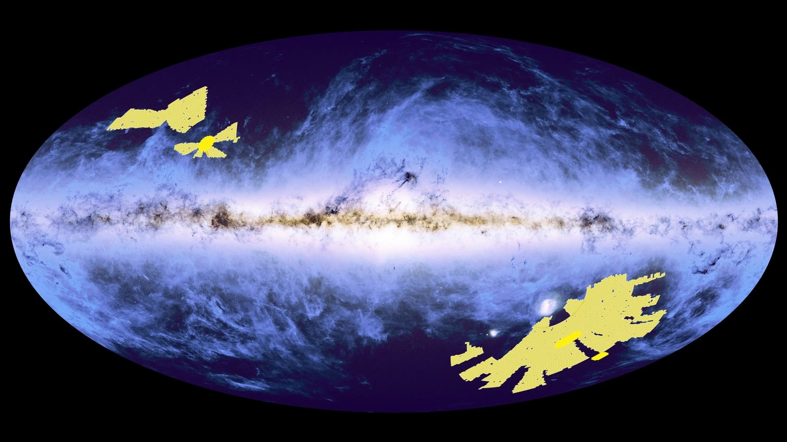
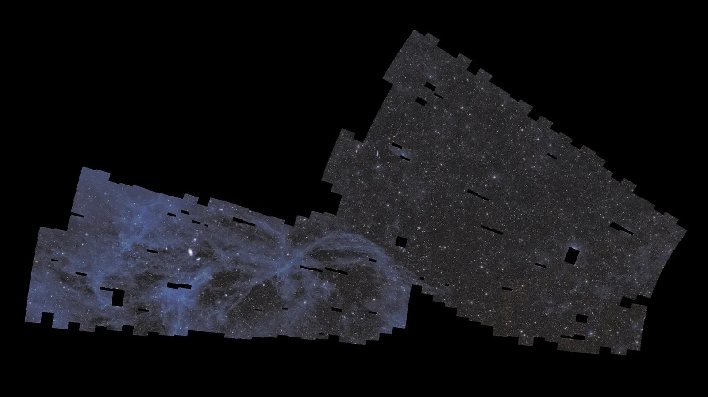
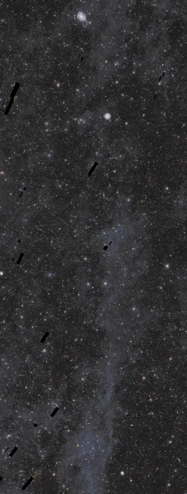
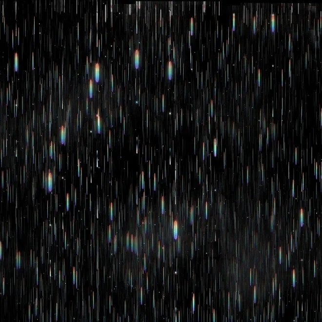
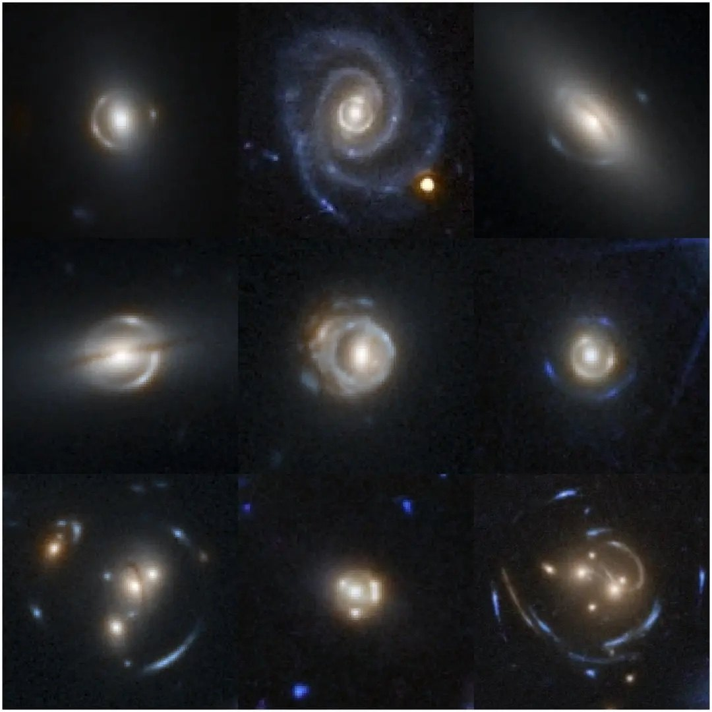
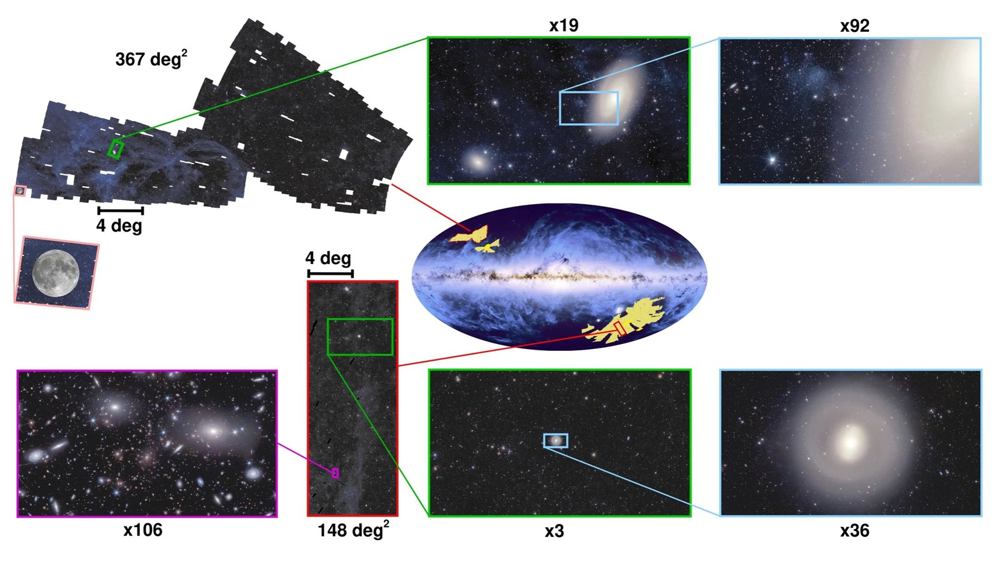
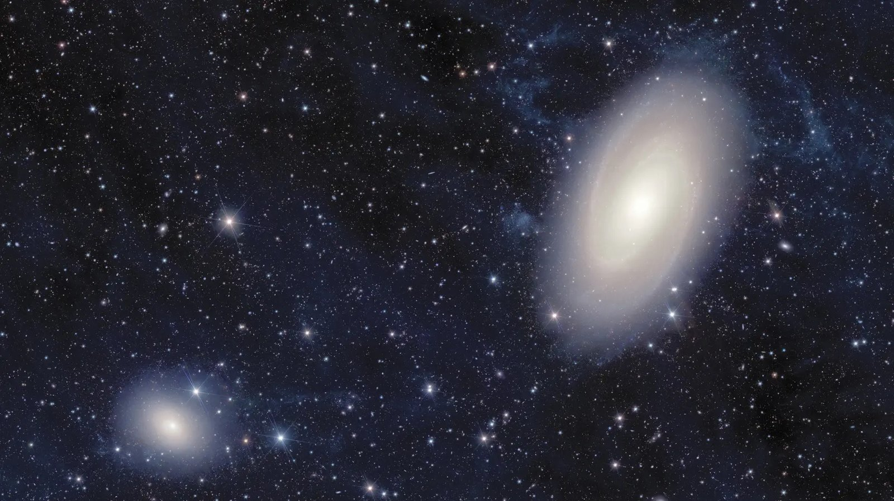
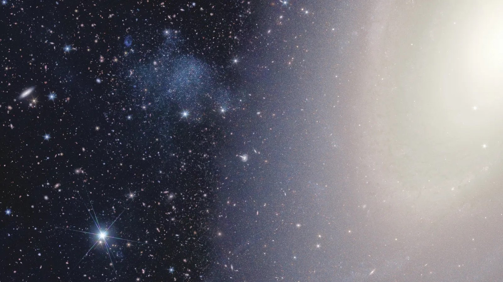
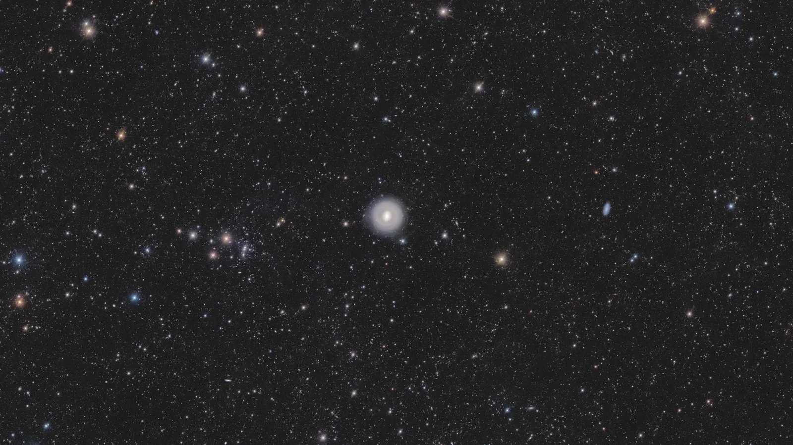
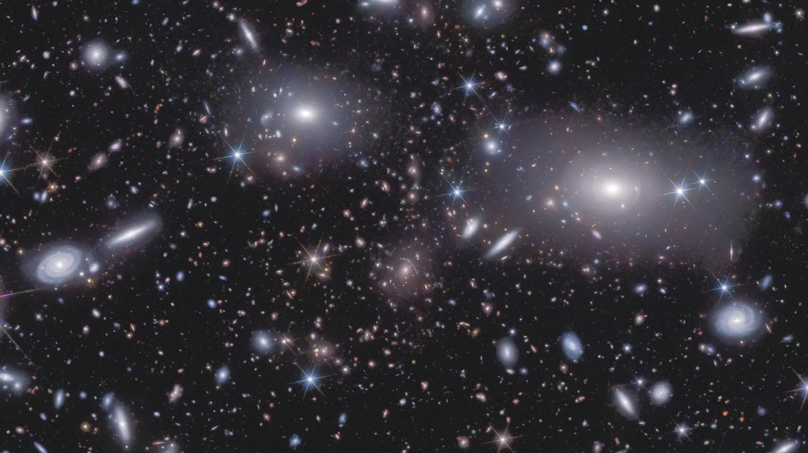

Per più di un anno, a un milione e mezzo di chilometri dalla Terra, un occhio ha fissato l'oscurità. Non cercava ciò che brilla: cercava ciò che si nasconde dietro la luce. Il 12 novembre 2026 ha consegnato il suo primo rapporto, e i numeri fanno girare la testa: più di un miliardo di oggetti cosmici, 900 milioni di galassie, circa 15.000 probabili lenti gravitazionali. Vi presento l'inizio dell'atlante oscuro di **Euclid**!

Ciò che vediamo nel cielo è soltanto una glassa: stelle, galassie, nebulose, tutto ciò che brilla è una minoranza. Il resto appartiene a due presenze che nessuno ha mai visto. La materia oscura, che con la sua gravità regge l'impalcatura del cosmo. E l'energia oscura, la forza che sta spingendo l'universo ad espandersi sempre più in fretta. Non le possiamo osservare, ma possiamo solo seguirne le impronte: il modo in cui piegano la luce, il modo in cui radunano le galassie, il modo in cui plasmano lo spazio. Per farlo, però, non basta guardare una galassia alla volta, ma bisogna ricostruire l'universo intero, nella sua geometria e nella sua storia. È la missione che l'Agenzia Spaziale Europea (ESA) ha affidato al suo telescopio spaziale Euclid, il detective dell'universo oscuro.

## Un miliardo di testimoni

Il rapporto si chiama **DR1-Foundation**, ed è il primo grande rilascio di dati della missione. Raccoglie circa 13 mesi di osservazioni e copre circa 1.900 gradi quadrati di cielo: una distesa grande quanto 9.500 Lune piene. Non è un unico blocco di cielo, ma un mosaico di regioni sparse nei due emisferi, scelte lontano dalla luce accecante della nostra Galassia.

<figure class="post-fig">

<figcaption>Le regioni di cielo comprese in DR1-Foundation, evidenziate in giallo su una veduta dell’intera volta celeste: in giallo chiaro le aree della survey ampia (Wide Survey), in giallo più intenso quelle della survey profonda (Deep Survey). Alcune zone più piccole si trovano nel cielo boreale, in alto a sinistra; una regione molto più ampia si estende nel cielo australe, in basso a destra. Le osservazioni sono state raccolte in circa un anno, tra la primavera 2024 e la primavera 2025. La fascia luminosa e polverosa che attraversa il centro è il piano della Via Lattea, che Euclid evita: le sue stelle e le sue polveri accecherebbero lo sguardo verso l’universo lontano. La mappa delle stelle proviene dalla missione Gaia, quella delle polveri dalla missione Planck. Crediti: ESA/Euclid/Euclid Consortium/NASA; ESA/Gaia/DPAC; ESA/Planck Collaboration, <a href="https://creativecommons.org/licenses/by-sa/3.0/igo/">CC BY-SA 3.0 IGO</a>.</figcaption>
</figure>

Dentro queste regioni si nasconde un censimento vertiginoso:

- oltre 900 milioni di galassie;
- circa 15.000 candidati sistemi di lente gravitazionale forte, il catalogo più grande mai realizzato, più ricco di tutti quelli precedenti messi insieme;
- oltre 60 milioni di candidati quasar;
- gli spettri di più di 160 milioni di sorgenti;
- circa 1,7 milioni di gigabyte di dati, cioè 1,7 petabyte.

Per mostrare che cosa si nasconde in quei dati, l’ESA ha aperto due finestre sul buio, una per emisfero: due immensi mosaici cuciti da centinaia di osservazioni.

<figure class="post-fig">

<figcaption>Le due finestre di Euclid sul buio. <em>A sinistra</em>: il mosaico nel cielo boreale, 740 osservazioni tra l’autunno 2024 e la primavera 2025, quasi 500 gigapixel per 367 gradi quadrati. Nella metà sinistra, i filamenti azzurri dei cirri galattici, polveri della nostra Via Lattea, avvolgono la galassia Messier 81 e altre galassie vicine; la metà destra è più scura e uniforme. <em>A destra</em>: il mosaico nel cielo australe, 370 osservazioni in 18 giorni per 148 gradi quadrati, quanto 740 Lune piene. Qui si estende il superammasso dell’Orologio (Horologium), a circa 800 milioni di anni luce, ma lo sguardo di Euclid arriva fino a 10 miliardi di anni luce; in alto, in primo piano, spiccano la lenticolare NGC 1316 e la galassia ad anello NGC 1291. In entrambi i mosaici, i colori combinano le quattro bande di VIS e NISP, intorno a 0,7, 1,1, 1,3 e 1,7 micron, riportate nei canali blu, verde e rosso; le stelle mostrano sei raggi dovuti alla diffrazione della luce nell’ottica del telescopio. Le zone vuote sono state evitate durante la survey per la presenza di stelle troppo luminose, che avrebbero accecato gli strumenti; i rettangoli inclinati segnano regioni colpite dai raggi X e mascherate durante l’elaborazione. Crediti: ESA/Euclid/Euclid Consortium/NASA, elaborazione delle immagini di J.-C. Cuillandre ed E. Bertin, <a href="https://creativecommons.org/licenses/by-sa/3.0/igo/">CC BY-SA 3.0 IGO</a>.</figcaption>
</figure>

Ma il vero potere di questo archivio non sta nel numero dei testimoni. Sta nella possibilità di interrogarli insieme: di capire dove si trova ciascuno, quanto è lontano, e con chi si raduna nel buio.

## Come si disegna l’atlante oscuro

Guardate il cielo notturno: le galassie sembrano puntini sparsi su una volta piatta. È un'illusione. Alcune sono relativamente vicine, altre ci separano miliardi di anni luce. Per scoprire dove si trovano davvero, bisogna interrogare la loro luce. Mentre attraversa l'universo in espansione, la luce di una galassia viene stirata: le sue lunghezze d'onda si allungano, i suoi colori scivolano verso il rosso. È il **redshift cosmologico**, e più il viaggio è stato lungo, più la luce arriva arrossata. Scomponendo quella luce in uno spettro, gli astronomi cercano le righe di riferimento che la tradiscono e misurano di quanto queste righe si sono spostate rispetto a quelle osservate in laboratorio. Ne ricavano il redshift e, con un modello cosmologico, la distanza della galassia e l'epoca in cui la sua luce è partita. Per questo lavoro Euclid usa lo strumento NISP, che scompone la luce nel vicino infrarosso.

<figure class="post-fig">

<figcaption>Il cielo visto dallo spettrografo di Euclid. Lo strumento NISP non seleziona un oggetto alla volta: scompone insieme la luce di tutte le sorgenti del campo, e ogni stella o galassia si trasforma in una sottile striscia verticale, il suo spettro. Le bande colorate rivelano come la luce si distribuisce tra le diverse lunghezze d’onda: è da qui che si ricava il redshift, e quindi la distanza. Poiché NISP osserva nel vicino infrarosso, invisibile ai nostri occhi, i colori dell’arcobaleno sono una rappresentazione. Crediti: ESA/Euclid/Euclid Consortium/NASA, elaborazione delle immagini di B. Granett, <a href="https://creativecommons.org/licenses/by-sa/3.0/igo/">CC BY-SA 3.0 IGO</a>.</figcaption>
</figure>

Il segnale che insegue è la **riga H-alfa** dell’idrogeno, il bagliore del gas acceso dalla luce di stelle appena nate. Gli spettri di 160 milioni di sorgenti forniscono la terza coordinata di una mappa che non ha più due dimensioni, ma tre. E quando le galassie vengono collocate al loro posto, emerge qualcosa di inquietante: non sono sparse a caso. Si allineano in filamenti sterminati, si ammassano in nodi densissimi e lasciano tra loro vuoti immensi, deserti cosmici dove quasi nulla brilla. È la **rete cosmica**, e a tesserla è soprattutto la **materia oscura**: i suoi filamenti invisibili hanno radunato il gas con la loro gravità, e lì sono nate le galassie. Ciò che vediamo è solo la rugiada che brilla su una ragnatela invisibile. Mappare l'atlante oscuro significa cominciare a intuire la forma della rete, cioè scoprire dove si annida la materia oscura e come si distribuisce.

## Quindicimila lenti nel buio

Tra tutti i tesori di DR1-Foundation, ce n’è uno che gli astronomi aspettavano da anni: circa 15.000 candidati sistemi di **lente gravitazionale forte**. Una lente gravitazionale nasce quando, tra noi e una galassia lontana, si interpone una massa enorme: una galassia, o un intero ammasso. Quella massa deforma la geometria dello spaziotempo, e la luce che passa di lì è costretta a seguirne le pieghe. La massa in primo piano diventa così una lente deformante: stira l’immagine della sorgente nascosta alle sue spalle, la ingrandisce, a volte la moltiplica. Nascono archi luminosi, immagini doppie o quadruple della stessa galassia, come spettri che si ripetono nel buio. E quando l’allineamento è quasi perfetto, la luce si chiude in un anello completo: un anello di Einstein. Dietro queste forme ipnotiche si nasconde un segreto. La deviazione della luce dipende da tutta la massa della lente, compresa quella che non emette luce. Studiando la geometria di queste lenti, gli astronomi possono pesare galassie e ammassi e ricostruire gli aloni di materia oscura che li avvolgono. E possono sfruttarle come telescopi naturali, per ingrandire galassie lontanissime, altrimenti troppo deboli per essere viste. Ma queste lenti sono rarissime: soltanto una galassia su diverse migliaia ne forma una. Per stanarle tra un miliardo di sorgenti, Euclid ha avuto bisogno di alleati: algoritmi di intelligenza artificiale addestrati a riconoscerle e migliaia di cittadini volontari che hanno passato in rassegna le immagini con il progetto Space Warps, sulla piattaforma Zooniverse. Per la prima volta, le lenti forti non sono più curiosità isolate: sono una popolazione da studiare con la statistica. Nel catalogo compaiono anche configurazioni che finora erano scoperte uniche. Lenti composte, in cui una sola galassia piega la luce di più galassie a distanze diverse, disegnando anelli uno dentro l’altro. Galassie a spirale che fanno da lente, pur essendo di solito troppo leggere per riuscirci. E quasar moltiplicati: la loro luce cambia nel tempo, e le diverse immagini dello stesso quasar si accendono e si spengono con un ritardo l’una rispetto all’altra. Misurare quel ritardo permette di calcolare quanto velocemente si espande l’universo.

<figure class="post-fig">

<figcaption>Un campionario delle lenti gravitazionali forti scoperte da Euclid. <em>Prima riga, da sinistra</em>: una classica lente galassia-galassia; un anello di Einstein attorno a una spirale vista di faccia; una galassia con disco polveroso inclinato. <em>Seconda riga</em>: una galassia polverosa vista di taglio; una galassia lensata in cui si distinguono le regioni di formazione stellare; una lente composta, con più anelli prodotti da galassie di fondo a distanze diverse. <em>Terza riga</em>: un gruppo di galassie che fa da lente; un quasar lensato; un secondo gruppo di galassie, avvolto da archi e anelli azzurri. Crediti: ESA/Euclid/Euclid Consortium/NASA, elaborazione delle immagini di N. Lines e T. Li, <a href="https://creativecommons.org/licenses/by-sa/3.0/igo/">CC BY-SA 3.0 IGO</a>.</figcaption>
</figure>

## Benvenuti al luna park cosmico

Il catalogo di Euclid non è un elenco: è un luna park del buio, ma le sue attrazioni sono fatte di luce. Nell'oscurità dell’archivio si muovono oltre 60 milioni di candidati **quasar**. Sono tra gli oggetti più luminosi dell'universo, e il loro fulgore ha un'origine sinistra. Al centro di una galassia, un buco nero supermassiccio attira gas e polveri; prima di sparire, quella materia gli vortica attorno in un disco incandescente, e l'attrito la scalda fino a farla brillare più di intere galassie. Euclid ne ha trovati alcuni la cui luce è partita quando l'universo aveva appena il 5% della sua età attuale. Poi ci sono le attrazioni più grandi del parco: gli **ammassi di galassie**! Sono le strutture più imponenti tenute insieme dalla gravità: centinaia o migliaia di galassie immerse in un gas caldissimo e in un alone di materia oscura che le domina tutte. Euclid ha sorpreso questi giganti perfino prima della loro nascita: i **protoammassi**, strutture ancora in pieno collasso, progenitrici degli ammassi di oggi. Grazie agli spettri, Euclid ne misura direttamente il redshift, cioè la distanza.

## Ritratti dal buio

Accanto a cataloghi e spettri, DR1-Foundation custodisce immagini che mostrano di che cosa è capace l’occhio di Euclid: passare da porzioni sterminate di cielo al dettaglio di una singola galassia, senza perdere nitidezza.

<figure class="post-fig">

<figcaption>Un viaggio nei dati di DR1-Foundation, dall’intero cielo alle singole galassie. Al centro, la volta celeste con le regioni osservate da Euclid evidenziate in giallo. <em>In alto</em>: il mosaico boreale di 367 gradi quadrati (con la Luna piena in scala, in basso a sinistra); il riquadro verde ingrandisce 19 volte Messier 81 con la compagna NGC 3077, quello azzurro arriva a 92 volte, sul disco di Messier 81 e sulla nana Holmberg IX. <em>In basso</em>: il mosaico australe di 148 gradi quadrati, nella regione del superammasso dell’Orologio; i riquadri verde e azzurro ingrandiscono 3 e 36 volte la galassia ad anello NGC 1291, quello viola arriva a 106 volte sull’ammasso di galassie Abell 3128. Crediti: ESA/Euclid/Euclid Consortium/NASA, elaborazione delle immagini di J.-C. Cuillandre ed E. Bertin, <a href="https://creativecommons.org/licenses/by-sa/3.0/igo/">CC BY-SA 3.0 IGO</a>.</figcaption>
</figure>

Nel cielo boreale, un mosaico di quasi 500 gigapixel, cucito insieme da 740 osservazioni raccolte tra l’autunno 2024 e la primavera 2025, abbraccia 367 gradi quadrati. Lì, avvolta da filamenti azzurrini di polvere della nostra stessa Galassia, i cosiddetti cirri galattici, brilla **Messier 81**: una spirale *grand design*, dal centro luminoso e dai bracci ampi e ben disegnati, a circa 12 milioni di anni luce da noi. È il cuore di un gruppo di una quarantina di galassie, e la sua gravità non lascia in pace le vicine. La più piccola NGC 3077 ne è deformata e l’interazione vi accende episodi di intensa formazione stellare e ne rimodella lentamente la forma. Poco lontano brilla una nube di stelle azzurre, la nana irregolare Holmberg IX: forse le sue stelle sono nate proprio dallo scontro gravitazionale tra Messier 81 e la vicina Messier 82. Messier 81 è abbastanza vicina perché Euclid ne distingua le singole stelle: puntini di luce che, nonostante 12 milioni di anni luce di distanza, si staccano uno a uno dal velo del disco.

<figure class="post-fig">

<figcaption>Il cuore del gruppo di Messier 81, a circa 12 milioni di anni luce da noi. <em>A sinistra</em>: in alto a destra la grande spirale <em>grand design</em> Messier 81, in basso a sinistra la più piccola NGC 3077, deformata dalla sua gravità; i filamenti azzurri sullo sfondo sono cirri galattici, polveri della nostra Via Lattea. L’immagine copre circa un grado quadrato, cinque volte la Luna piena, ed è stata raccolta da Euclid in poco più di un’ora. <em>A destra</em>: Euclid alla massima risoluzione. A destra, il disco di Messier 81 si dissolve in un bagliore pallido in cui si distinguono le singole stelle; appena a sinistra, l’ammasso di stelle bluastre è la nana irregolare Holmberg IX. Tutto intorno brillano galassie di fondo molto più lontane, alcune rossastre, altre spirali dai bracci azzurri. Crediti: ESA/Euclid/Euclid Consortium/NASA, elaborazione delle immagini di J.-C. Cuillandre ed E. Bertin, <a href="https://creativecommons.org/licenses/by-sa/3.0/igo/">CC BY-SA 3.0 IGO</a>.</figcaption>
</figure>

Nell’emisfero australe, Euclid ha impiegato 18 giorni e 370 osservazioni per ritrarre 148 gradi quadrati di cielo, un’area grande quanto 740 Lune piene. Qui, a circa 800 milioni di anni luce, si estende il **superammasso dell’Orologio** (Horologium), un’aggregazione di oltre 30 ammassi di galassie. Ma l’immagine è un pozzo senza fondo: davanti al superammasso galleggiano stelle e galassie molto più vicine, mentre dietro di esso si intravedono oggetti dell’universo primordiale, fino a 10 miliardi di anni luce di distanza. In primo piano spiccano altre due presenze. La galassia lenticolare NGC 1316, visibile in cima al mosaico australe, trascina con sé lunghi flussi di stelle, le cicatrici lasciate dagli incontri con le sue compagne. Poco più in basso, a circa 33 milioni di anni luce, la galassia ad anello NGC 1291 fissa il cielo come un occhio pallido; nel suo disco etereo, minuscoli punti azzurri tradiscono stelle che stanno ancora nascendo. Uno dei membri più ricchi del superammasso è **Abell 3128**, che raccoglie centinaia di galassie: spirali vorticanti ed ellittiche sfumate. Al suo centro si nasconde una delle 15.000 lenti: la luce di una galassia più lontana, piegata dalla massa in primo piano, si allunga in archi azzurri. E l’inquadratura cela un altro segreto: sulla stessa linea di vista, circa 5 miliardi di anni luce più indietro, si sovrappone un secondo ammasso, ACT-CL J0330-5227. Due covi di galassie, uno davanti all’altro, separati da un abisso che lo sguardo appiattisce.

<figure class="post-fig">

<figcaption>Due ritratti dal cielo australe. <em>A sinistra</em>: la galassia ad anello NGC 1291, a circa 33 milioni di anni luce da noi, al centro di un campo di 14 gradi quadrati, 70 volte la Luna piena, raccolto da Euclid in circa un giorno e mezzo. Nell’inquadratura compaiono anche l’ammasso di galassie Abell 3122, al centro a sinistra, e la galassia a spirale azzurra MCG-07-07-007, a destra. <em>A destra</em>: l’ammasso di galassie Abell 3128, uno dei più ricchi del superammasso dell’Orologio, a circa 800 milioni di anni luce: due grandi ellittiche pallide dominano la parte alta, circondate da centinaia di galassie più piccole. Al centro esatto dell’immagine, una lente gravitazionale forte piega la luce di una galassia più lontana in archi azzurri. Nella stessa inquadratura si sovrappone un secondo ammasso, ACT-CL J0330-5227, in realtà circa 5 miliardi di anni luce più lontano. Questa vista, di 0,12 gradi quadrati, poco più di mezza Luna piena, ha richiesto circa 70 minuti e mostra Euclid alla sua massima risoluzione. Crediti: ESA/Euclid/Euclid Consortium/NASA, elaborazione delle immagini di J.-C. Cuillandre ed E. Bertin, <a href="https://creativecommons.org/licenses/by-sa/3.0/igo/">CC BY-SA 3.0 IGO</a>.</figcaption>
</figure>

## La prima pagina di un atlante incompiuto

Eppure, tutto questo è soltanto l’inizio. I circa 1.900 gradi quadrati di DR1-Foundation sono appena il 14% del cielo che Euclid esplorerà nei suoi sei anni di missione. Il rilascio completo, DR1, è atteso per la metà del 2027. Aggiungerà le misure del **weak lensing**, la lente gravitazionale debole, e i calcoli su come galassie e ammassi si inseriscono nella rete cosmica. Se le lenti forti si impongono allo sguardo, il weak lensing è un sussurro: distorsioni così lievi che, su una singola galassia, non si vedono affatto. Solo sommandone milioni, e poi miliardi, emerge il disegno della massa invisibile che riempie l’universo. Lenti forti e deboli, spettri, cataloghi di galassie e di ammassi: sono questi gli indizi da cui nascerà l’atlante oscuro. Messi insieme, permetteranno di ricostruire la storia dell’espansione cosmica, di misurare la materia oscura e di mettere alla prova i modelli con cui crediamo di aver capito l’universo. Euclid non ha ancora finito il suo lavoro. Ha consegnato la prima pagina del suo atlante, ma è una pagina di indizi, non ancora una mappa. La ragnatela invisibile che tiene insieme il cosmo non si vede: si intuisce dalla rugiada che brilla sui suoi fili. Per disegnarla serviranno le misure della DR1 completa e gli anni di osservazioni ancora da compiere. È solo la prima pagina. Le altre sono ancora nel buio.

<strong>Fonti e crediti:</strong> informazioni e immagini tratte dai materiali del rilascio dati DR1-Foundation della missione Euclid dell'ESA, <a href="https://www.esa.int/Science_Exploration/Space_Science/Euclid">ESA &ndash; Euclid</a>, e dell'Euclid Consortium, come indicato nelle singole didascalie (ESA/Euclid/Euclid Consortium/NASA, ESA/Gaia/DPAC, ESA/Planck Collaboration). Redshifted non è affiliato a queste organizzazioni e il loro uso non implica alcuna approvazione.

