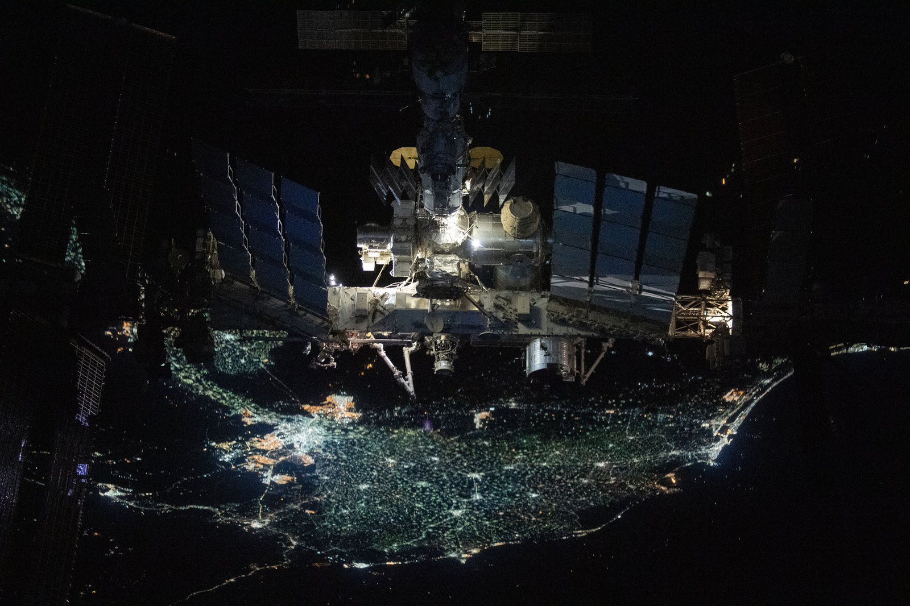
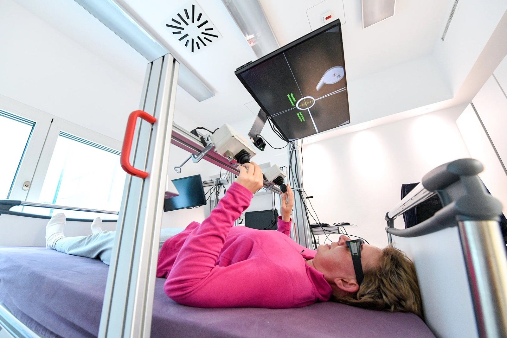
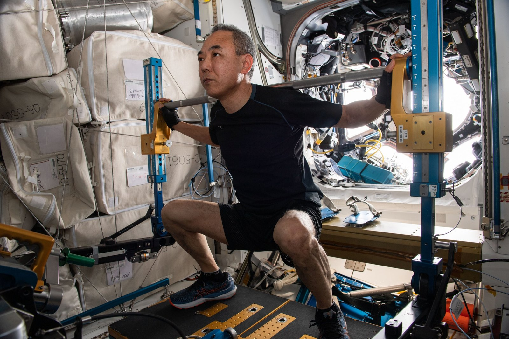
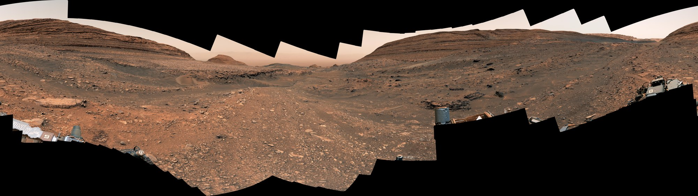
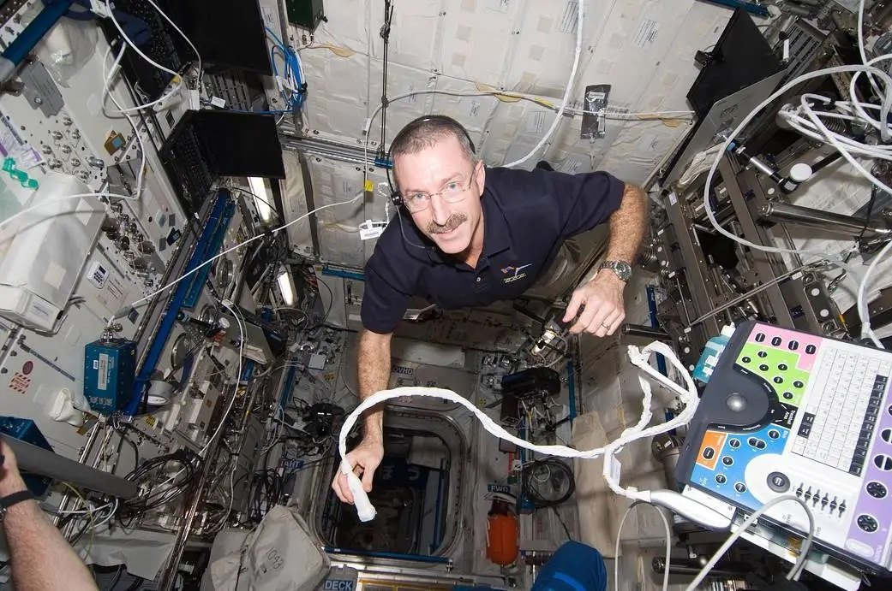
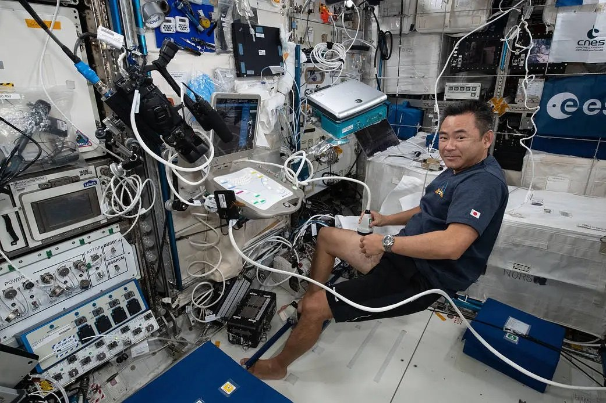

Lassù, dove nulla pesa, il **cuore umano** cambia forma!

Per tutta la vita il nostro cuore combatte una battaglia silenziosa contro una forza che non vediamo. Ogni volta che ci alziamo in piedi, la gravità trascina il sangue verso il basso, nelle gambe, sotto il livello del cuore; e lui, battito dopo battito, deve spingerlo di nuovo in alto, fino al cervello. Ma cosa succede quando quella forza smette di farsi sentire? Quando il cuore si ritrova, per mesi, senza più nulla contro cui lottare?

## Il nemico invisibile

Immaginiamo il sistema circolatorio come un insieme di tubi pieni di liquido, alti quanto il nostro corpo. In una colonna di liquido, la pressione aumenta man mano che si scende, perché ogni strato deve sostenere il peso di tutto il liquido che gli sta sopra: è la legge di Stevino, la stessa per cui in fondo a una piscina la pressione dell’acqua è maggiore che in superficie. Quando siamo in piedi, il sangue nelle gambe si trova quindi sotto una pressione maggiore di quello nella testa, e tende ad accumularsi verso il basso. Il cuore, per mantenere il cervello ben irrorato, deve lavorare in “salita”, contro la gravità. Il nostro organismo è così abituato a questo sforzo da non accorgersene nemmeno: in pochi istanti, quando ci alziamo, i vasi sanguigni si stringono e il battito accelera per compensare. È un equilibrio raffinato, costruito in milioni di anni di evoluzione sulla superficie di un pianeta con una gravità ben precisa. Lo spazio lo spezza.

## Che cos’è davvero la microgravità

Prima di tutto, sfatiamo un mito: sulla **Stazione Spaziale Internazionale** (**ISS**) la gravità non è affatto zero. La Stazione orbita a circa 400 km di quota, dove l’attrazione della Terra è ancora pari a circa il 90% di quella che sentiamo al suolo. Se potessimo salire fin lassù con una scala lunghissima, peseremmo solo un po’ meno di adesso. Allora perché gli astronauti fluttuano? Per capirlo bisogna guardare a come si muove la Stazione. La ISS non è ferma lassù: corre intorno alla Terra a circa 28.000 km/h e compie un giro completo in circa un'ora e mezza. Pensiamo a un sasso legato a una corda e fatto girare in cerchio: se la corda si spezza, il sasso parte dritto per la tangente. Per tenerlo in rotazione serve qualcosa che lo tiri continuamente verso il centro. Per la Stazione, questa “corda” è la gravità terrestre: è lei a curvarne di continuo la traiettoria e a tenerla in orbita. Ora mettiamoci nei panni degli astronauti, che girano insieme alla Stazione. Chi si trova su qualcosa che ruota, come una giostra o un'auto in curva, si sente spinto verso l'esterno: è la **forza centrifuga**. A bordo della ISS questa spinta, diretta lontano dalla Terra, bilancia l'attrazione gravitazionale, diretta verso la Terra. Infatti la Stazione, gli astronauti e ogni oggetto a bordo percorrono la stessa orbita alla stessa velocità, quindi l’equilibrio vale per tutti allo stesso modo: nessun pavimento spinge sotto i piedi, nulla preme su nulla, e il peso apparente quasi sparisce. Per questo si parla di **microgravità**: la gravità c'è eccome, ma a bordo è compensata dal moto orbitale. Restano solo minuscole accelerazioni residue, dell'ordine di un milionesimo di quella che sentiamo a terra. Per il nostro sistema circolatorio, però, il risultato è lo stesso di un mondo senza gravità: la colonna di sangue non “pesa” più e il corpo comincia a trasformarsi.

<figure class="post-fig">

<figcaption>La Stazione Spaziale Internazionale sospesa nella notte, a oltre 400 km di quota, sopra le luci del delta del Nilo, in Egitto. L’ha fotografata l’8 novembre 2021 l’equipaggio della capsula SpaceX Crew Dragon <em>Endeavour</em>, durante il giro intorno alla Stazione dopo lo sgancio. Crediti: NASA (<a href="https://www.flickr.com/photos/nasa2explore/51814547213/">iss066e080034</a>).</figcaption>
</figure>

## Il grande spostamento

Appena arrivati in orbita, i liquidi del corpo, non più trascinati verso il basso, migrano dalle gambe verso il torace e la testa. Il corpo interpreta questo afflusso come un eccesso di liquidi e reagisce riducendo il volume del plasma, la parte liquida del sangue. Con meno sangue in circolo, il cuore si riempie di meno a ogni battito e pompa un volume minore: ciò che i fisiologi chiamano **gittata sistolica**, la quantità di sangue espulsa a ogni contrazione, diminuisce e il cuore, che non deve più spingere il sangue in salita, comincia ad adattarsi alla nuova vita leggera.

## Un cuore più rotondo

Nel 2014 un gruppo di ricerca guidato da James Thomas, allora responsabile scientifico della NASA per l’ecografia, presentò al congresso annuale dell’American College of Cardiology i risultati di uno studio su 12 astronauti della ISS. Gli astronauti erano stati addestrati a usare l’ecografo di bordo per acquisire immagini del proprio cuore prima, durante e dopo la missione. Il risultato fu sorprendente: in microgravità il cuore diventava *più sferico* del 9,4%! Normalmente il cuore ha una forma allungata; nello spazio tendeva ad arrotondarsi. Il cambiamento era vicino a quello previsto dai modelli matematici sviluppati per lo studio, ed era temporaneo: poco dopo il rientro sulla Terra, il cuore riprendeva la sua forma abituale. Il problema è che secondo i ricercatori, una forma più sferica potrebbe indicare che il cuore lavora in modo meno efficiente. Lo stesso Thomas avvertiva: nello spazio il cuore lavora meno, e questo può portare a una perdita di massa muscolare.

## Un muscolo che si consuma

Il cuore è un muscolo, e come ogni muscolo si modella sul lavoro che deve compiere. Negli atleti si ingrandisce; nelle persone con pressione alta si ispessisce. E quando il carico diminuisce, si riduce: è l’**atrofia cardiaca**. Nel 2001 il gruppo di Benjamin Levine, cardiologo della UT Southwestern di Dallas, misurò con la risonanza magnetica il cuore di volontari costretti a letto per settimane. Dopo 42 giorni di riposo a letto, la massa del ventricolo sinistro, la camera che pompa il sangue in tutto il corpo, era diminuita dell’8%. In quattro astronauti, dopo appena 10 giorni di volo, la riduzione media era stata del 12%, anche se su un campione così piccolo il risultato non raggiungeva la piena significatività statistica. Il caso più celebre è quello dell’astronauta Scott Kelly, rimasto 340 giorni sulla ISS tra il 2015 e il 2016. Pur allenandosi sei giorni a settimana, tra cyclette, tapis roulant ed esercizi di forza, il suo ventricolo sinistro ha perso in media 0,74 grammi di massa a settimana. Eppure il suo cuore ha continuato a funzionare bene: si era semplicemente adattato a un carico più leggero. Una curiosità: nello stesso studio, i ricercatori hanno osservato un’atrofia simile nel cuore di Benoît Lecomte, il nuotatore che nel 2018 tentò di attraversare a nuoto l’oceano Pacifico. Ore e ore ogni giorno in acqua, in posizione orizzontale e con un’attività di bassa intensità: per il cuore, quasi come essere nello spazio.

### Lo spazio, sulla Terra

Ed ecco un dettaglio inquietante: per il cuore, restare a lungo a letto è molto simile a vivere in orbita. Per questo le agenzie spaziali usano il **riposo a letto** come laboratorio terrestre della microgravità. Lo standard internazionale, fissato nel 1979 da ricercatori statunitensi e sovietici, prevede che i volontari restino sdraiati con la testa inclinata di 6° verso il basso: in questa posizione i liquidi si spostano verso la testa come accade nello spazio. I volontari restano così anche per 60 giorni, senza mai alzarsi: mangiano, bevono, lavorano e perfino vanno in bagno da sdraiati! Questi studi hanno mostrato che la perdita di massa del cuore è un'atrofia vera e propria, e non una semplice “disidratazione” del muscolo. Per capire come contrastarla, la NASA ha condotto un ulteriore esperimento: 26 volontari sono rimasti a letto per 70 giorni, alcuni senza fare nulla, altri seguendo un programma di allenamento intenso. In chi era rimasto sedentario la massa e la funzionalità del cuore sono calate progressivamente; in chi si allenava, invece, il calo è stato attenuato. Per questo motivo sulla ISS la principale contromisura è proprio l'esercizio fisico. Gli astronauti si allenano in media circa due ore al giorno: corrono su un tapis roulant, pedalano su una cyclette e sollevano “pesi” con l'ARED, una macchina a pistoni che riproduce il sollevamento pesi in assenza di peso. Uno studio pubblicato nel 2023 sul *Journal of the American College of Cardiology* ha misurato con la risonanza magnetica il cuore di 13 astronauti, prima e dopo circa cinque mesi sulla ISS. In orbita il cuore aveva lavorato meno, eppure al rientro la massa del ventricolo sinistro non era cambiata in modo significativo. Con questi allenamenti, l'atrofia sembra quindi evitabile.

<figure class="post-fig">

<figcaption>Due modi per combattere la lenta erosione del corpo. <em>A sinistra</em>: una volontaria del primo studio di riposo a letto condotto insieme da ESA e NASA, nel centro :envihab del DLR a Colonia, nel 2019. Per 60 giorni resta sdraiata con la testa inclinata di 6° verso il basso, per riprodurre sulla Terra gli effetti della microgravità; qui, con un visore di realtà virtuale, prova ad agganciare un veicolo spaziale a una stazione orbitale. Crediti: DLR. <em>A destra</em>: l’astronauta della JAXA Satoshi Furukawa si allena sull’ARED, nel modulo Tranquility della ISS, il 19 gennaio 2024. La macchina riproduce le forze del sollevamento pesi sulla Terra. Crediti: NASA.</figcaption>
</figure>

## Il problema di Marte

Tutto questo diventa cruciale se pensiamo al prossimo grande viaggio. Raggiungere Marte richiederà mesi di volo nello spazio; e all’arrivo gli astronauti dovranno affrontare di nuovo una gravità, pari a circa 0,38 volte quella terrestre. Un cuore indebolito dal viaggio sarà in grado di sostenerli quando dovranno camminare, lavorare, magari affrontare un’emergenza sulla superficie del pianeta rosso?

Per rispondere, un gruppo internazionale guidato da Vinesh Appadurai, con James Thomas (oggi alla Northwestern University) e Benjamin Levine tra gli autori, ha seguito il cuore di **13 astronauti** (9 uomini e 4 donne, età media 49 anni) durante missioni sulla ISS di durata media pari circa cinque mesi e mezzo: un tempo paragonabile a quello di un viaggio verso Marte. Lo studio è stato pubblicato nel 2026 sulla rivista *Circulation*.

<figure class="post-fig">

<figcaption>Il mondo che aspetta i cuori degli astronauti. Il rover Curiosity della NASA ha ripreso questo panorama dentro Gediz Vallis, un canale sulle pendici del Monte Sharp, nel cratere Gale, il 21 e 22 settembre 2024, unendo 341 immagini della sua fotocamera Mastcam. I colori sono stati regolati per mostrare la scena come la vedrebbe un occhio umano con l’illuminazione terrestre. A destra del centro si vede un campo di pietre bianche: è qui che Curiosity, passando sopra una roccia e spaccandola, ha scoperto per la prima volta zolfo puro su Marte. Crediti: NASA/JPL-Caltech/MSSS (<a href="https://photojournal.jpl.nasa.gov/catalog/PIA26410">PIA26410</a>).</figcaption>
</figure>

### Guardare dentro un cuore in orbita

Lo strumento scelto è stato l’**ecocardiografia Doppler**. Gli ultrasuoni, inviati attraverso il torace, rimbalzano sulle strutture del cuore e permettono di ricostruirne forma, dimensioni e movimento. L’effetto Doppler aggiunge un’informazione preziosa: quando un’onda viene riflessa da qualcosa in movimento, come il sangue che scorre, la sua frequenza cambia, proprio come cambia il suono della sirena di un’ambulanza che si avvicina o si allontana. Misurando quel cambiamento, si ricava la velocità del sangue e quindi l’efficienza con cui il cuore pompa. Studi precedenti si erano basati sulla risonanza magnetica, impossibile da usare in orbita. L’ecografo, invece, è a bordo della Stazione. Gli astronauti, addestrati prima della partenza, si sono sottoposti all’esame a vicenda, guidati in tempo reale dal gruppo di ricerca a terra, dopo circa 14, 30, 75 e 135 giorni di volo e infine 15 giorni prima del rientro.

<figure class="post-fig">

<figcaption>Medici di sé stessi, a 400 km dalla Terra. <em>A sinistra</em>: l’astronauta della NASA Dan Burbank, comandante della Expedition 30, si prepara a eseguire un’ecografia al cuore di un compagno, fuori dall’inquadratura, nel laboratorio Columbus della ISS. L’esame faceva parte dell’esperimento <em>Integrated Cardiovascular</em>, che ha studiato come il cuore si atrofizza durante le lunghe missioni e come ne risentono la quantità di sangue pompata a ogni battito e la forma del cuore. <em>A destra</em>: il 25 maggio 2021 l’astronauta della JAXA Akihiko Hoshide, comandante della Expedition 65, esamina con l’ecografo l’arteria femorale della propria gamba destra per lo studio <em>Vascular Aging</em>, che indaga come le lunghe permanenze nello spazio influiscano sul rischio cardiovascolare degli astronauti. Crediti: NASA.</figcaption>
</figure>

### Simulare Marte con un lettino

Prima del lancio, il cuore di ogni astronauta è stato esaminato in tre posizioni diverse: sdraiato, per simulare l’assenza di peso; seduto, per la gravità terrestre; e su un lettino inclinato di 22°, per simulare la gravità di Marte. Entro un giorno dal rientro, l’esame è stato ripetuto da sdraiati e sul lettino inclinato. Perché proprio 22°? Qui entra in gioco un po’ di fisica da liceo. Su un piano inclinato, la gravità si scompone in due parti: una perpendicolare al piano e una parallela, lungo il corpo. È quest’ultima a determinare quanto sangue scivola verso le gambe, e vale g · sin 22° ≈ 0,37 g. Cioè quasi esattamente i 3/8 (0,375) della gravità terrestre: praticamente quella di Marte, pari a 0,38 g! Un semplice lettino inclinato permette così di “trasportare” il cuore di un astronauta sul pianeta rosso, senza lasciare la Terra.

### Cosa hanno scoperto

Dopo due settimane in orbita, rispetto alle misure fatte a terra da sdraiati, il cuore conteneva meno sangue alla fine della fase di riempimento, la gittata sistolica era scesa e anche i parametri che descrivono come il muscolo si deforma durante la contrazione erano cambiati. Un dettaglio curioso: questi valori erano per lo più simili a quelli misurati prima della partenza con gli astronauti in posizione eretta, come se il cuore, in assenza di peso, si comportasse più come quello di una persona in posizione eretta che come quello di una persona distesa. Era il momento più delicato della missione: molti astronauti, all’inizio, soffrono di malessere da movimento mentre il corpo si adatta, e gli impegni operativi lasciano poco spazio all’allenamento. Poi, con il passare delle settimane, il volume del cuore e la gittata sistolica sono risaliti verso i valori iniziali. Dopo circa sei mesi nello spazio, nella simulazione della gravità marziana nessuna delle misure di volume e di flusso indicava per il cuore un carico o uno sforzo maggiore di quello sostenuto, prima della partenza, in posizione eretta sulla Terra. In altre parole: con le contromisure attuali, il cuore sembra pronto per Marte!

### Il ruolo dell’allenamento

Le contromisure sono soprattutto una: l’esercizio fisico. Secondo la Northwestern University, durante la missione gli astronauti si sono allenati fino a circa due ore al giorno, tra 30 e 45 minuti di esercizi aerobici e tra 60 e 75 minuti di esercizi di forza, seguendo il programma della NASA. Per Levine è stato proprio l’allenamento a mantenere il cuore in forma. Ma attenzione a non trarre conclusioni troppo affrettate. Gli stessi autori descrivono il loro lavoro come uno studio piccolo ed esplorativo: 13 persone, tutte allenate, senza un gruppo di confronto che non si allenasse. Non permette quindi di misurare con precisione quanto conti l’esercizio e sei mesi sono meno della durata complessiva di una missione su Marte, che comprende anche il soggiorno sul pianeta e il viaggio di ritorno. È un passo importante, non l’ultima parola.

## E noi, quaggiù?

Questi studi non servono solo agli astronauti. Anzi, alcune delle loro ricadute più preziose riguardano chi non lascerà mai la Terra.

### 1. Le malattie della gravità

Quando ci alziamo dopo essere stati seduti o sdraiati, il sangue scende verso le gambe e per un attimo la pressione cala. Di solito il corpo compensa senza che ce ne accorgiamo; ma se non ci riesce, arrivano capogiri e, a volte, svenimenti. È l’**intolleranza ortostatica**.

Per gli astronauti è stato a lungo uno dei problemi più seri: secondo Levine, tra un quarto e due terzi degli astronauti di ritorno da missioni brevi, di una o due settimane, non riuscivano a restare in piedi per più di 10 minuti. Oggi le cose vanno molto meglio: in uno studio del 2019 su 12 astronauti rimasti sei mesi sulla ISS, che si erano allenati fino a due ore al giorno in orbita e avevano ricevuto liquidi per via endovenosa all’atterraggio, nessuno ha avuto capogiri o svenimenti durante le normali attività quotidiane nelle 24 ore successive. Il problema non è scomparso del tutto, perché nei test più impegnativi la tolleranza alla posizione eretta resta in genere ridotta dopo il volo; ma nella vita di tutti i giorni è sotto controllo.

Sulla Terra esiste un disturbo con molti punti in comune: la **sindrome da tachicardia posturale ortostatica** (**POTS**), che colpisce soprattutto giovani donne e può essere molto invalidante. Passando dalla posizione sdraiata a quella eretta, il battito cardiaco aumenta di oltre 30 battiti al minuto, accompagnato da capogiri, stanchezza e palpitazioni. Il gruppo di Levine studia queste “malattie della gravità” da oltre trent’anni, anche attraverso gli astronauti e i volontari a letto, che ne sono il modello naturale. Da queste ricerche è nato un programma di allenamento graduale, che secondo lo stesso Levine sta già aiutando molti pazienti. Si comincia con esercizi che non richiedono di stare in piedi, come il vogatore, la cyclette reclinata o il nuoto; solo dal secondo mese si passa agli esercizi in posizione eretta, aggiungendo il potenziamento delle gambe. L’allenamento, insieme a un maggiore apporto di sale e liquidi, rafforza il cuore e aumenta il volume del sangue, aiutando i pazienti a tollerare meglio la posizione eretta.

### 2. Chi è costretto a letto

Se il cuore si atrofizza nello spazio come durante un lungo periodo a letto, ciò che impariamo per proteggerlo in orbita può servire anche sulla Terra. Già nel 2014 Thomas suggeriva che i programmi di esercizio sviluppati per gli astronauti potessero aiutare a mantenere in salute il cuore delle persone con gravi limitazioni fisiche, come chi deve restare a lungo a letto o chi soffre di scompenso cardiaco.

### 3. Ecografie da un altro mondo

Sulla ISS non c’è una macchina per i raggi X. Per questo la NASA ha puntato sull’ecografia, sviluppando tecniche che permettono ad astronauti non medici di eseguire esami complessi, guidati in tempo reale da specialisti a terra. Con circa 3 ore di addestramento, contro le circa 500 di un professionista, gli astronauti sono riusciti a ottenere immagini utili alla diagnosi. Quelle stesse tecniche di **ecografia guidata a distanza** sono poi tornate sulla Terra, adattate per portare la diagnosi ecografica in zone remote e con poche risorse, dove un ecografista esperto non c’è, ma un collegamento sì.

## Ciò che lo spazio ci insegna

Il corpo umano non è fatto per lo spazio. È stato plasmato dalla gravità, e quando la gravità svanisce si deforma, si consuma, si smarrisce. Ma si adatta. E ogni volta che impariamo come aiutarlo a sopravvivere lassù, scopriamo qualcosa su come curarlo quaggiù.

Forse il primo cuore umano che batterà su Marte sarà un po’ più rotondo, un po’ più leggero di quando è partito. Ma, se lo avremo allenato bene, continuerà a battere.

## Riferimenti bibliografici

- Appadurai V. et al. (2026). *Impact of Prolonged Spaceflight on Cardiac Structure and Function: An Exploratory Longitudinal Observational Study*. Circulation, 154, 1444–1455. DOI: <a href="https://doi.org/10.1161/CIRCULATIONAHA.125.078665">10.1161/CIRCULATIONAHA.125.078665</a>
- Perhonen M.A. et al. (2001). *Cardiac atrophy after bed rest and spaceflight*. Journal of Applied Physiology, 91(2), 645–653. DOI: <a href="https://doi.org/10.1152/jappl.2001.91.2.645">10.1152/jappl.2001.91.2.645</a>
- MacNamara J.P. et al. (2021). *Cardiac Effects of Repeated Weightlessness During Extreme Duration Swimming Compared With Spaceflight*. Circulation. DOI: <a href="https://doi.org/10.1161/CIRCULATIONAHA.120.050418">10.1161/CIRCULATIONAHA.120.050418</a>
- Scott J.M. et al. (2018). *Efficacy of exercise and testosterone to mitigate atrophic cardiovascular remodeling*. Medicine and Science in Sports and Exercise, 50(9), 1940–1949. <a href="https://pmc.ncbi.nlm.nih.gov/articles/PMC6095799">PMC6095799</a>
- Shibata S. et al. (2023). *Cardiac Effects of Long-Duration Space Flight*. Journal of the American College of Cardiology, 82(8), 674–684. DOI: <a href="https://doi.org/10.1016/j.jacc.2023.05.058">10.1016/j.jacc.2023.05.058</a>
- Fu Q. et al. (2019). *Impact of Prolonged Spaceflight on Orthostatic Tolerance During Ambulation and Blood Pressure Profiles in Astronauts*. Circulation, 140(9), 729–738. DOI: <a href="https://doi.org/10.1161/CIRCULATIONAHA.119.041050">10.1161/CIRCULATIONAHA.119.041050</a>

<strong>Fonti e crediti:</strong> informazioni tratte da UT Southwestern Medical Center, <a href="https://www.utsouthwestern.edu/newsroom/articles/year-2026/sept-exercise-keeps-astronauts-hearts-strong.html">Exercise keeps astronauts’ hearts strong enough for flight to Mars</a> (2026); Northwestern Medicine, <a href="https://www.eurekalert.org/news-releases/1148289">Exercise helps astronauts’ hearts handle months in space, boosting prospects for Mars</a> (2026); American College of Cardiology, <a href="https://www.acc.org/about-acc/press-releases/2014/03/29/09/09/may-hearts-in-space">Study Finds Astronauts’ Hearts Become More Spherical in Space</a> (2014); NASA, <a href="https://www.nasa.gov/learning-resources/for-kids-and-students/what-is-microgravity-grades-5-8/">What Is Microgravity?</a>; NASA, <a href="https://www.nasa.gov/missions/station/ultrasound-scans-in-space-transform-medicine-on-earth/">Ultrasound Scans in Space Transform Medicine on Earth</a>. Immagini: NASA, NASA/JPL-Caltech/MSSS e DLR, come indicato nelle singole didascalie; illustrazione di copertina di Redshifted. Redshifted non è affiliato a queste organizzazioni e il loro uso non implica alcuna approvazione.

