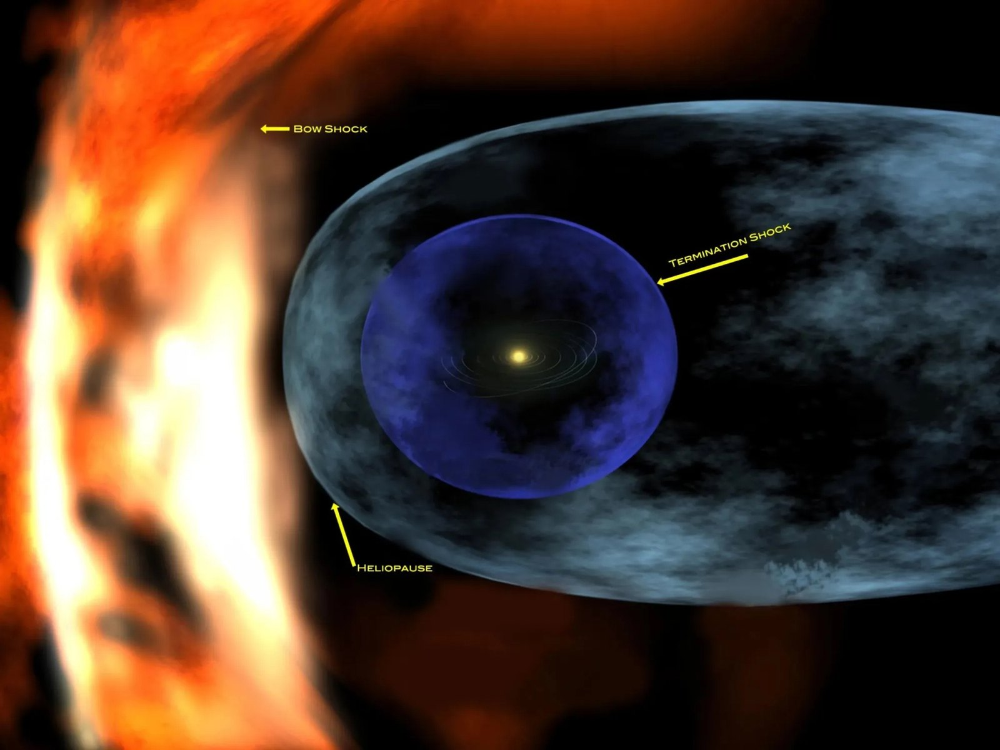
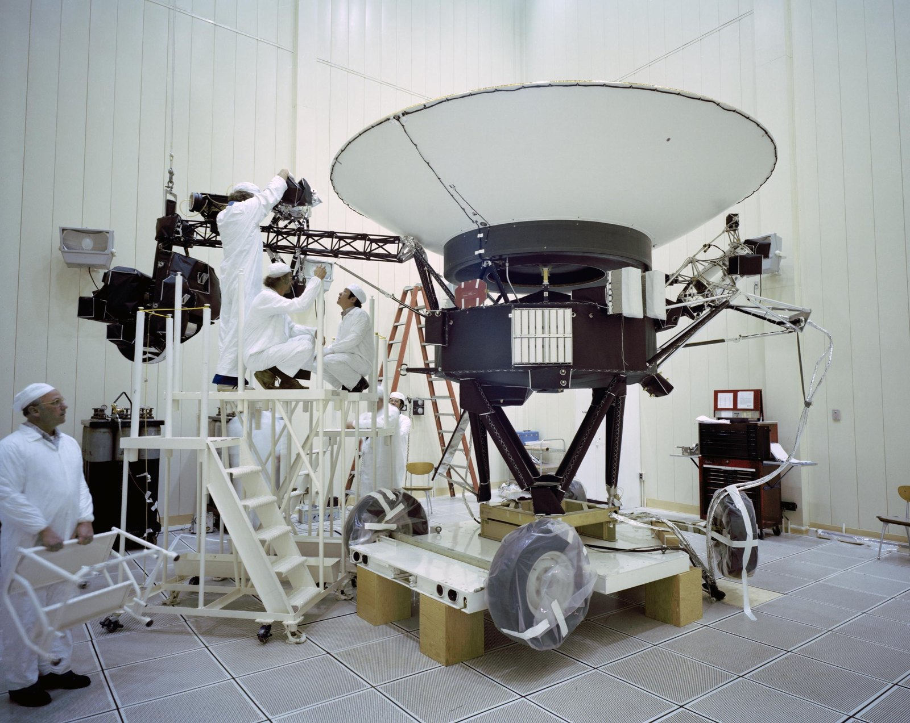
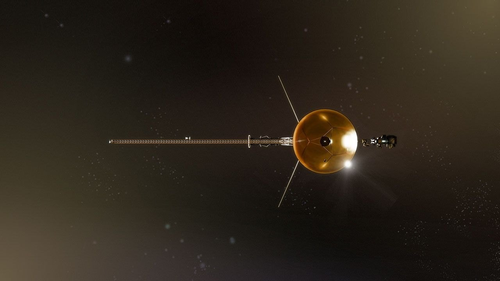
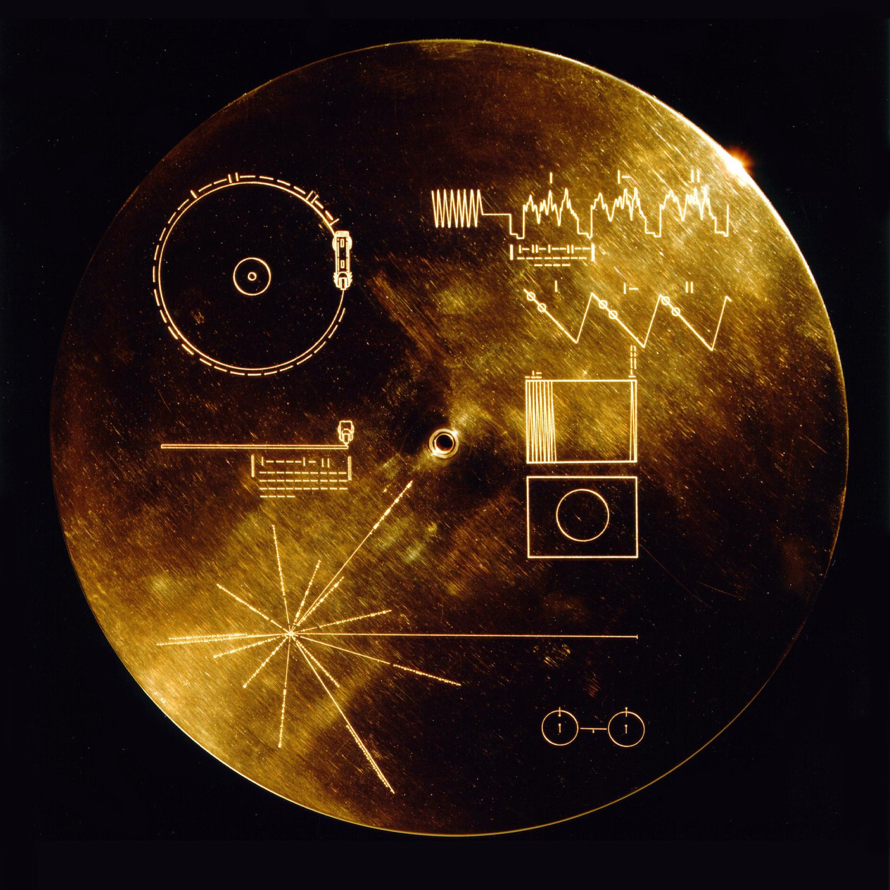
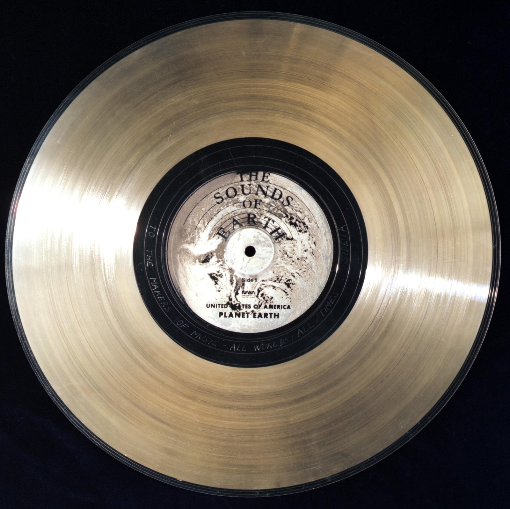

Per la prima volta, un oggetto costruito dall'uomo si trova a un **giorno-luce** dalla Terra!

Ci sono viaggi che si misurano in chilometri, altri in anni. Quello delle sonde **Voyager 1** e **Voyager 2** si misura ormai nel tempo che la luce impiega a raggiungerle. Il 18 novembre 2026 Voyager 1 ha superato una soglia che nessun manufatto umano aveva mai varcato: un segnale radio, partito dalla Terra alla velocità della luce, impiega un giorno intero per raggiungerla. Ventiquattro ore di silenzio tra una domanda e il momento in cui la sonda la riceve. Altre ventiquattro prima che la sua risposta torni a casa.

## Due messaggere nel buio

Voyager 2 partì per prima, il 20 agosto 1977; la sua gemella, Voyager 1, la seguì il 5 settembre. Erano state costruite per esplorare i pianeti giganti, con una missione pensata per durare cinque anni. Quasi mezzo secolo dopo, sono ancora vive. Dopo aver sorvolato Giove e Saturno, Voyager 1 ha puntato verso l'esterno del Sistema Solare. Voyager 2 ha compiuto un itinerario ancora più ampio, sorvolando anche Urano e Nettuno: è l'unica sonda ad averli mai visitati da vicino. Poi, una dopo l'altra, hanno lasciato i pianeti alle spalle e hanno continuato a correre verso il buio.

## Oltre la bolla del Sole

Il Sole non si limita a splendere: soffia. Dalla sua superficie fugge senza sosta un flusso di particelle cariche, il **vento solare**, che gonfia intorno a sé e ai pianeti un'immensa bolla magnetica, l'**eliosfera**. È un guscio che ci protegge in parte dai raggi cosmici in arrivo dalla Galassia. Ma ogni bolla ha un bordo. Là dove la pressione del vento solare non riesce più a respingere il gas rarefatto che riempie lo spazio tra le stelle, si trova l'**eliopausa**. Voyager 1 l'ha attraversata nell'agosto 2012, Voyager 2 nel novembre 2018, entrambe a circa 120 volte la distanza tra la Terra e il Sole. Da quel momento sono le uniche sonde ad aver raggiunto lo spazio interstellare ancora in funzione e quindi le sole ad averlo misurato direttamente: un ambiente che fino ad allora conoscevamo solo attraverso modelli teorici e misure indirette. Eppure, in un certo senso, non sono ancora uscite di casa. L'eliopausa non è il confine gravitazionale del Sistema Solare: l'attrazione del Sole si estende molto più lontano, fino alla **nube di Oort**, l'enorme riserva di corpi ghiacciati da cui provengono le comete di lungo periodo. Voyager 1 impiegherà circa 300 anni soltanto per raggiungerne il bordo interno, e forse 30.000 per uscirne.

<figure class="post-fig">

<figcaption>L’eliosfera, la bolla che il vento solare gonfia intorno al Sole e ai pianeti (rappresentazione artistica). La sfera blu è lo <em>shock di terminazione</em>, dove il vento solare rallenta bruscamente; più all’esterno, l'<em>eliopausa</em> segna l’inizio dello spazio interstellare. Le sonde Voyager 1 e 2 l’hanno attraversata nel 2012 e nel 2018, a circa 120 unità astronomiche dal Sole. Il <em>bow shock</em> a sinistra, invece, probabilmente non esiste: secondo i dati della sonda IBEX il Sole si muove troppo lentamente per generarlo. Crediti: NASA.</figcaption>
</figure>

## Una lenta agonia di watt

Laggiù la luce del Sole è troppo debole per alimentare un pannello solare. Le Voyager vivono di un'altra fonte di energia: ciascuna è alimentata da tre generatori termoelettrici a radioisotopi, che trasformano in elettricità il calore prodotto dal decadimento del plutonio-238. Ma il plutonio si esaurisce e con lui la vita delle sonde. Ogni anno ciascuna Voyager perde circa 4 watt di potenza: meno di quanto consumi una lampadina, ma abbastanza per costringere gli ingegneri a scelte dolorose. Per tenerle in vita, spengono uno dopo l'altro riscaldatori, sistemi non essenziali e infine strumenti scientifici, sapendo che ogni comando può far tacere per sempre un pezzo di scienza. Oggi Voyager 1 conserva soltanto due strumenti attivi: il magnetometro (che misura il campo magnetico) e lo strumento per le onde di plasma (che ascolta le vibrazioni del gas ionizzato che la circonda). L'ultimo a essere spento, il 17 aprile 2026, è stato il rivelatore di particelle cariche di bassa energia. Voyager 2 ne conserva tre: oltre agli stessi due, il rivelatore di raggi cosmici, salvato in extremis nel luglio 2026 da una delicata riorganizzazione dei sistemi di bordo che gli ingegneri hanno soprannominato “Big Bang”. Sono gli unici strumenti dell'umanità immersi nello spazio interstellare. Quando si spegneranno, quel buio tornerà a essere muto.

<figure class="post-fig">

<figcaption>Da una camera bianca al buio tra le stelle. <em>A sinistra</em>: gli ingegneri al lavoro sulla sonda Voyager 2, il 23 marzo 1977, pochi mesi prima del lancio. <em>A destra</em>: la gemella Voyager 1 in una rappresentazione artistica. Il 18 novembre 2026, dopo più di 49 anni di viaggio, è diventata il primo oggetto costruito dall’uomo a raggiungere la distanza di un giorno-luce dalla Terra, circa 25,9 miliardi di chilometri: un segnale radio, viaggiando alla velocità della luce, impiega 24 ore per raggiungerla. Crediti: NASA/JPL-Caltech.</figcaption>
</figure>

## Una telefonata con 24 ore di ritardo

Comunicare con una sonda a miliardi di chilometri di distanza non è come telefonare dall'altra parte del mondo. I segnali radio viaggiano alla velocità della luce, la più alta possibile nell'universo, ma nemmeno lei basta a rendere immediata una conversazione attraverso distanze simili. Il 18 novembre 2026, alle 2:16 del mattino ora della costa pacifica degli Stati Uniti, Voyager 1 ha raggiunto la distanza pazzesca di un giorno-luce dalla Terra: circa 25,9 miliardi di chilometri! Un comando inviato oggi le arriva domani, la risposta torna dopodomani. Non è possibile intervenire in tempo reale: ogni istruzione va preparata con cura, spedita nel vuoto e verificata soltanto due giorni dopo. Ad ascoltarle c'è il **Deep Space Network** della NASA, una rete di grandi antenne radio distribuite in tre complessi: Goldstone, in California; Madrid, in Spagna; Canberra, in Australia. Così, mentre la Terra ruota, almeno una di loro è sempre rivolta verso il cielo giusto.

E proprio nei giorni del traguardo, la voce di Voyager 1 si è affievolita. Il 14 novembre l'antenna di Canberra ha agganciato il suo segnale, ma il segnale era vuoto: c'era solo la portante (l'onda radio che normalmente trasporta i dati), ma nessun dato scientifico o ingegneristico. Quel segnale nudo dice comunque molto: la sonda è viva, la sua antenna è ancora puntata verso casa e il trasmettitore funziona. Grazie a lui e ai calcoli della traiettoria, gli ingegneri hanno potuto confermare il traguardo del giorno-luce. Il guasto sembra riguardare il computer di bordo che raccoglie i dati degli strumenti e li prepara per la trasmissione e mentre scrivo, forse, il team della missione sta ancora cercando di risolverlo. Non è la prima volta. Appena un mese prima, il 18 e 19 ottobre, il segnale di Voyager 1 era scomparso del tutto, per poi tornare da solo il 20 ottobre, prima ancora che gli ingegneri inviassero un comando. Dopo quasi cinquant'anni nello spazio, ogni messaggio che arriva da laggiù è il risultato di un equilibrio fragile tra tecnologia, distanza e ingegno umano.

## Un messaggio per ET

Le Voyager non trasportano soltanto strumenti scientifici. A bordo di entrambe si trova anche uno degli oggetti più simbolici mai lanciati nello spazio: il **Golden Record**. Si tratta di un disco fonografico di rame placcato d'oro, del diametro di circa 30 centimetri, progettato come una sorta di capsula del tempo destinata a eventuali civiltà extraterrestri che potrebbero incontrare le sonde in un futuro remoto. L'idea nacque da un gruppo di scienziati e artisti coordinato dall'astronomo Carl Sagan. Il contenuto del disco è una rappresentazione della Terra e dei suoi abitanti, costruita attraverso immagini, suoni e musica. Il disco contiene 115 immagini, saluti in 55 lingue, suoni naturali del nostro pianeta e circa 90 minuti di musica proveniente da culture ed epoche diverse. Si possono ascoltare composizioni di Bach, Beethoven e Mozart, ma anche brani di artisti come Chuck Berry e Blind Willie Johnson. Tra i suoni registrati ci sono il vento, la pioggia, il tuono, il canto degli uccelli e persino il battito di un cuore umano. Anche la cover è stata progettata per comunicare informazioni a eventuali destinatari. Contiene istruzioni illustrate per riprodurre il disco e decodificare le immagini, oltre a una mappa che individua la posizione del Sole rispetto a quattordici pulsar. Un diagramma dell'atomo di idrogeno fornisce inoltre un riferimento universale per interpretare le unità di misura utilizzate nel messaggio. Sulla copertina è presente anche un piccolo campione di uranio-238, la cui radioattività potrebbe permettere a un eventuale osservatore di stimare quanto tempo sia trascorso dal lancio.

Naturalmente, non sappiamo se qualcuno troverà mai questi dischi. Le probabilità che una civiltà extraterrestre intercetti una delle due sonde sono estremamente basse, considerando le immense dimensioni dello spazio interstellare. Ma il Golden Record non è stato concepito soltanto come un messaggio da consegnare a un'eventuale civiltà extraterrestre. È, prima di tutto, un autoritratto dell'umanità: un tentativo di raccontare chi siamo, cosa abbiamo imparato e quale bellezza siamo stati capaci di creare. Tra le infinite possibilità di descrivere la nostra specie, è stato scelto di condividere ciò che ci unisce: la musica, l'arte, la conoscenza, le emozioni e le voci di popoli diversi. È un'immagine di ciò che può essere l'umanità nella sua espressione più nobile: un mondo fatto di diversità, armonia e convivenza. In fondo, quel disco custodisce un patto: quello di prenderci cura gli uni degli altri, del sassolino blu che ci ospita e di tutte le forme di vita che lo abitano. Un messaggio affidato allo spazio quasi cinquant'anni fa, ma che oggi, forse più che mai, dovremmo tornare ad ascoltare. Perché prima ancora di rivolgerlo a chi potrebbe trovarci un giorno, è un messaggio che dovremmo rivolgere a noi stessi.

<figure class="post-fig">

<figcaption>Un messaggio in bottiglia lanciato nell’oceano cosmico. <em>A destra</em>: il Disco d’oro, a bordo di entrambe le sonde Voyager. È un disco di rame placcato d’oro di 30 cm di diametro, che contiene saluti in 55 lingue, 115 immagini, suoni della natura e musiche di epoche e culture diverse; sulla superficie è incisa a mano la dedica “Ai creatori di musica, di tutti i mondi, di tutti i tempi”. <em>A sinistra</em>: la copertina in alluminio che lo protegge. I disegni spiegano come riprodurre il disco e, in basso a sinistra, una mappa di 14 pulsar indica la posizione del Sole nella galassia; un campione di uranio-238 depositato sulla superficie funziona da orologio radioattivo per datarne l’età. Crediti: NASA/JPL-Caltech.</figcaption>
</figure>

## Verso una stella lontana

Raggiungere un giorno-luce è un traguardo soprattutto simbolico, ma non per questo meno vertiginoso. La gemella Voyager 2, che viaggia in un'altra direzione, dovrebbe arrivarci nel novembre 2035, anche se difficilmente sarà ancora in grado di raccontarcelo. Prima o poi le due sonde smetteranno di parlarci. Non avranno più energia per comunicare, né per scaldare i propri circuiti. Ma continueranno a viaggiare. Non sono dirette verso un pianeta e non entreranno mai in orbita attorno a un'altra stella: seguiranno le loro traiettorie nel silenzio, come due relitti alla deriva tra le stelle. Gli astrofisici, però, sanno già dove le porterà la loro corsa. Tra circa 40.000 anni Voyager 1 passerà a circa 1,7 anni luce da Gliese 445, una piccola stella nana rossa oggi distante più di 17 anni luce da noi. Sarà più vicina a lei che al Sole, ma non sarà un vero incontro: la sonda attraverserà quella regione di spazio senza avvicinarsi a un eventuale sistema planetario e nessuno se ne accorgerà.

È difficile immaginare che cosa resterà della Terra, della nostra civiltà o persino della nostra specie in un futuro così lontano. Eppure le Voyager saranno ancora là fuori, fredde e silenziose, con un piccolo frammento della nostra storia agganciato al fianco.

Forse nessuno ascolterà mai il Golden Record. Forse nessuno leggerà le istruzioni incise sulla sua copertina. Ma questo non rende meno straordinario il gesto che lo ha reso possibile. Quando le Voyager furono lanciate, nel 1977, il loro compito era esplorare i pianeti più esterni del Sistema Solare. Quasi mezzo secolo dopo sono diventate qualcosa di molto più grande: le prime ambasciatrici della nostra specie nello spazio interstellare, così lontane che per ricevere un loro messaggio dobbiamo aspettare un giorno intero e per ottenere una risposta quasi due. È una distanza enorme, ma il filo che ci lega a loro non si è ancora spezzato. Un segnale radio, debole e ostinato, continua ad attraversare il buio per raccontarci che cosa si trova là fuori.

E, almeno per ora, noi siamo ancora qui ad ascoltarlo.

<strong>Fonti e crediti:</strong> informazioni e immagini tratte dai materiali della missione Voyager della NASA, <a href="https://science.nasa.gov/mission/voyager/">NASA Science &ndash; Voyager</a>, come indicato nelle singole didascalie (NASA, NASA/JPL-Caltech). Redshifted non è affiliato a queste organizzazioni e il loro uso non implica alcuna approvazione.

