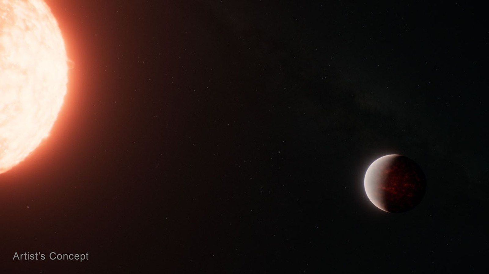
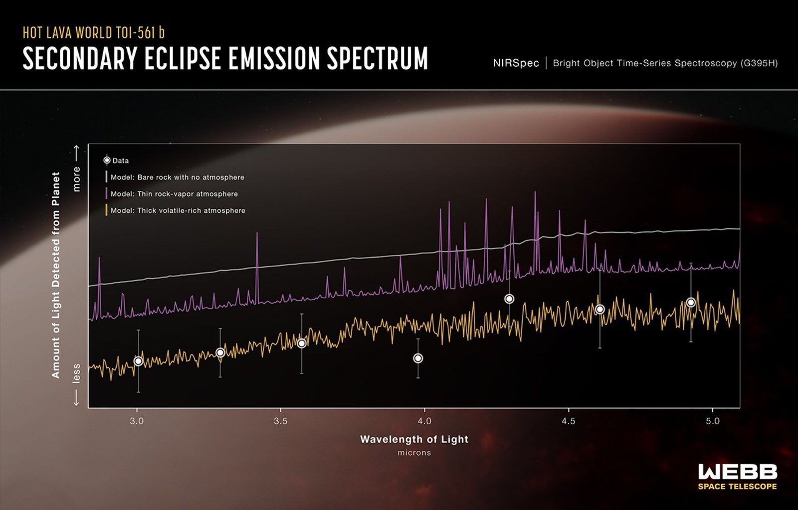
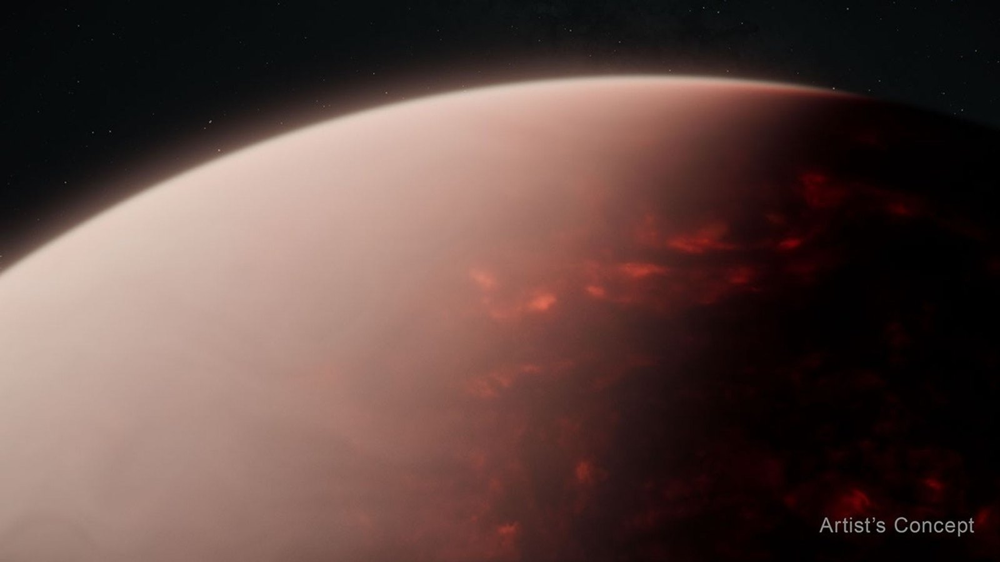

C'è un mondo, a 280 anni luce da noi, dove l'anno dura meno di undici ore. Gira intorno alla sua stella così da vicino che la roccia, sulla sua faccia illuminata, non riesce a restare solida: si scioglie in un oceano di magma che copre il pianeta. Secondo le leggi della fisica come pensavamo di conoscerle, un mondo così dovrebbe essere nudo, scorticato di ogni atmosfera da miliardi di anni di radiazione. Invece il telescopio spaziale **James Webb** ha scoperto che **TOI-561 b** respira ancora: è avvolto da una spessa coltre di gas e il suo cielo riflette la luce come quello di Venere!

È una storia in due atti. Nel 2025 un primo studio ha preso la temperatura del pianeta e ha concluso che deve avere un'atmosfera. Nel 2026 un secondo studio, basato sulle stesse osservazioni ma analizzate per intero, ha confermato il verdetto e ha scoperto qualcosa di inatteso: il cielo di quel mondo infernale è così brillante da rimandare nello spazio circa tre quarti della luce che riceve.

## Un mondo in balia della sua stella

TOI-561 b si trova nella costellazione del Sestante. Il nome viene dal satellite TESS della NASA, che ne ha individuato il transito: TOI sta per *TESS Object of Interest*, “oggetto di interesse di TESS”. È una **super-Terra**: ha un raggio pari a circa 1,4 volte quello terrestre e una massa di circa 2,2 masse terrestri. La sua gravità è appena superiore a quella della Terra: una persona di 70 kg, lì, peserebbe come ne pesasse 78 da noi. Ma nessuno potrebbe mai camminarci.

Il pianeta compie un giro completo intorno alla sua stella in 10 ore e 43 minuti, a circa 1,6 milioni di chilometri da essa: quasi quaranta volte più vicino di quanto Mercurio sia al Sole. Da lì la stella non è un punto luminoso nel cielo, ma un disco enorme, largo quasi 44 gradi: circa ottanta volte il Sole visto dalla Terra. Ogni metro quadrato del pianeta riceve circa 4700 volte l'energia che riceve la Terra.

Come quasi tutti i pianeti così vicini alla loro stella, TOI-561 b è in *rotazione sincrona*: gira su se stesso nello stesso tempo in cui compie un'orbita, e mostra alla stella sempre la stessa faccia, proprio come la Luna mostra alla Terra sempre lo stesso emisfero. Su TOI-561 b esistono così un emisfero di giorno perenne e uno di notte perenne. Sul lato diurno la temperatura supera il punto di fusione della maggior parte delle rocce: è lì che si stende l'**oceano di magma**.

TOI-561 b appartiene a una classe rara di pianeti, i **pianeti a periodo ultra-breve** (in inglese *ultra-short period*, USP): mondi con un raggio fino a due volte quello terrestre che completano un'orbita in meno di un giorno. Ne ha uno circa lo 0,5% delle stelle simili al Sole, più o meno quanto i gioviani caldi. Così vicino alla stella, quando il sistema planetario si stava formando, faceva troppo caldo perfino per la polvere da cui nascono i pianeti: per questo si pensa che questi mondi siano nati più lontano e siano poi scivolati verso il fuoco.

<figure class="post-fig">

<figcaption>Rappresentazione artistica di TOI-561 b e della sua stella. Il pianeta orbita così vicino alla stella da completare un giro in meno di undici ore. L’illustrazione si basa su dati spettroscopici e su altre osservazioni indirette: Webb non ha fotografato il pianeta. Crediti: NASA, ESA, CSA, Ralf Crawford (STScI). <a href="https://science.nasa.gov/asset/webb/super-earth-exoplanet-toi-561-b-and-its-star-artists-concept">Fonte</a>.</figcaption>
</figure>

## Una stella venuta da un'altra epoca

Anche la stella di TOI-561 b viene da un altro tempo. È un po' più piccola e più fredda del Sole, ma molto più vecchia: ha circa 10 miliardi di anni, più del doppio dei 4,6 miliardi del Sole. Brillava già da miliardi di anni quando la nube da cui sarebbe nato il nostro Sistema Solare non aveva ancora iniziato a collassare. È povera di ferro, in proporzione ne contiene circa il 40% di quello del Sole, e relativamente ricca dei cosiddetti elementi alfa, come ossigeno, magnesio e silicio.

Fa parte del **disco spesso** della Via Lattea, una popolazione di stelle antiche che si muovono su orbite più “gonfie” e inclinate rispetto al disco sottile in cui vive il Sole. Queste stelle si sono formate quando la Galassia era giovane e conteneva ancora pochi elementi pesanti. Come ha osservato Johanna Teske, astronoma della Carnegie Science e prima autrice dello studio del 2025, il pianeta deve essersi formato in un ambiente chimico molto diverso da quello dei pianeti del Sistema Solare.

## Una condanna scritta nella fisica

Un pianeta piccolo e caldissimo, secondo le teorie, è condannato a perdere la sua atmosfera. I raggi X e la luce ultravioletta della stella scaldano gli strati più alti dei gas, che acquistano abbastanza energia per sfuggire alla gravità del pianeta e disperdersi nello spazio: gli astronomi parlano di **evaporazione atmosferica**. Per un mondo come TOI-561 b, un involucro di idrogeno dovrebbe evaporare in molto meno di un miliardo di anni. Webb, del resto, ha già osservato diversi pianeti rocciosi molto irraggiati, e i loro dati sono compatibili con superfici di roccia nuda: mondi ormai senza respiro.

Nel Sistema Solare questa regola ha perfino un nome: la *linea di costa cosmica* (in inglese *cosmic shoreline*). È una linea immaginaria che separa i corpi con un'atmosfera da quelli che ne sono privi, e dipende da quanta radiazione ricevono e da quanto è forte la loro gravità. Mercurio e la Luna stanno dal lato “secco”, la Terra, Venere e Titano da quello con l'atmosfera. TOI-561 b, con l'enorme quantità di radiazione che riceve, dovrebbe stare dal lato secco senza alcun dubbio.

## Il primo indizio: un mondo troppo leggero

Prima ancora di Webb, qualcosa non tornava. Conoscendo il raggio (dal transito, cioè dal calo di luce quando il pianeta passa davanti alla stella) e la massa (dall'oscillazione che il pianeta imprime alla stella), si può calcolare la densità. Quella di TOI-561 b è di circa 4,3 grammi per centimetro cubo. Per confronto, la Terra arriva a 5,5.

Il punto non è il confronto diretto con la Terra, ma con quello che ci si aspetterebbe: un pianeta di quella massa con una composizione simile alla nostra, roccia più un nucleo di ferro, sarebbe molto più compresso e quindi più denso. TOI-561 b, invece, ha circa due terzi della densità prevista. La maggior parte dei pianeti a periodo ultra-breve, al contrario, ha densità compatibili con una composizione terrestre.

Le spiegazioni possibili erano due. La prima è un interno insolito, con un nucleo di ferro piccolo e rocce meno dense di quelle terrestri, ipotesi plausibile per un pianeta nato attorno a una stella povera di ferro. La seconda è un'atmosfera spessa. Durante un transito non vediamo il pianeta: vediamo la sua ombra, cioè quanta luce della stella blocca. Gli strati più densi di un'atmosfera spessa bloccano la luce anche loro, e l'ombra risulta più grande di quella del solo corpo di roccia, come la sagoma di una persona avvolta in un piumino. Il raggio che misuriamo comprende quindi anche una parte dell'atmosfera. Il gas, però, aggiunge molto più volume che massa. E poiché la densità è la massa divisa per il volume, il pianeta nel suo insieme risulta meno denso del suo corpo roccioso. Secondo gli autori, un interno leggero da solo non basta a spiegare tutto: anche un pianeta di sola roccia, senza ferro, dovrebbe essere un po' più piccolo di TOI-561 b.

## 2025: Webb prende la temperatura a un pianeta invisibile

Per capire quale delle due ipotesi fosse giusta, il gruppo guidato da Johanna Teske ha puntato Webb su TOI-561 b. Le osservazioni sono state fatte tra il 1° e il 3 maggio 2024, nell'ambito del programma GO 3860: più di 37 ore di fila, quasi quattro orbite complete, con lo spettrografo **NIRSpec** nell'infrarosso vicino, tra 3 e 5 micrometri. I risultati sono stati pubblicati a dicembre 2025 su *The Astrophysical Journal Letters*.

Webb non può fotografare TOI-561 b. Visti da 280 anni luce, pianeta e stella sono separati da un angolo mille volte più piccolo del dettaglio più fine che Webb riesce a distinguere, e la stella è decine di migliaia di volte più luminosa: per il telescopio sono un unico puntino. Per misurare la luce del pianeta, gli astronomi sfruttano l'**eclisse secondaria**, il momento in cui il pianeta passa dietro la stella e scompare per poco più di un'ora. Poco prima dell'eclisse, Webb raccoglie la luce della stella più quella del lato diurno del pianeta, che in quel momento è rivolto verso di noi. Durante l'eclisse raccoglie solo la luce della stella. Dalla differenza, ricavata confrontando con un modello l'intera curva di luce prima, durante e dopo l'eclisse, si ottiene la luce del lato diurno del pianeta.

Il calo è minuscolo: tra 25 e 46 parti per milione, a seconda della lunghezza d'onda. È come accorgersi che, in uno stadio illuminato da 40.000 lampadine, se ne sono spente una o due. Per questo le osservazioni hanno coperto quattro eclissi consecutive e sono state analizzate con due procedure indipendenti, per verificare che il segnale fosse davvero del pianeta e non un effetto dello strumento.

Tra 3 e 5 micrometri, nell'infrarosso osservato da NIRSpec, la luce che arriva dal pianeta è quasi tutta emissione termica: radiazione che il pianeta stesso emette a causa della sua temperatura, non luce della stella riflessa. Dalla sua intensità si ricava la **temperatura di brillanza**: la temperatura che dovrebbe avere un corpo nero, un emettitore ideale, per emettere la stessa intensità a quelle lunghezze d'onda.

Il risultato è stato sorprendente. Se TOI-561 b fosse una roccia scura e nuda, il suo lato diurno dovrebbe arrivare a circa 2950 kelvin, cioè quasi 2700 °C. Webb ha misurato invece tra circa 1800 e 2150 kelvin, a seconda dell'analisi, cioè tra circa 1500 e 1900 °C. È ancora un inferno, ma molto più freddo del previsto: è persino più freddo dei circa 2300 kelvin che si avrebbero se il calore fosse distribuito in modo perfettamente uniforme su tutto il pianeta. Qualcosa, su quel mondo, sta raffreddando il lato diurno.

<figure class="post-fig">

<figcaption>Lo spettro di emissione del lato diurno di TOI-561 b misurato da NIRSpec durante le eclissi secondarie. I cerchi bianchi sono i dati di Webb. La linea grigia è la previsione per una roccia scura senza atmosfera, quella viola per un’atmosfera sottile di vapore di roccia: entrambe sono troppo luminose, cioè troppo calde. I dati si accordano meglio con un’atmosfera ricca di sostanze volatili. Crediti: NASA, ESA, CSA, Ralf Crawford (STScI); scienza: Johanna Teske, Anjali Piette, Tim Lichtenberg, Nicole Wallack. <a href="https://science.nasa.gov/asset/webb/super-earth-exoplanet-toi-561-b-nirspec-emission-spectrum">Fonte</a>.</figcaption>
</figure>

### Tre sospetti

Gli autori hanno messo alla prova tre scenari.

Il primo era il pianeta senza atmosfera. Un oceano di magma può spostare un po' di energia termica con le sue correnti, come fanno gli oceani terrestri. Ma senza un'atmosfera il lato notturno si raffredderebbe fino a solidificarsi, e le correnti di magma non potrebbero raggiungerlo. Il lato diurno resterebbe così caldissimo: ogni suo punto restituirebbe allo spazio l'energia ricevuta dalla stella, a una temperatura molto più alta di quella osservata.

Il secondo era un'atmosfera sottile di vapore di roccia. A quelle temperature anche i minerali evaporano in parte, come l'acqua in una pentola sul fuoco, e sopra l'oceano di magma formerebbero un'atmosfera tenue di gas come monossido di silicio e ossido di magnesio, con una pressione di circa un centesimo di quella terrestre. Un'atmosfera così sottile, però, non riesce a portare energia sul lato notturno, e il lato diurno resterebbe caldissimo: Webb lo vedrebbe molto più luminoso di quanto è. Questo scenario è nettamente escluso dai dati, e non spiegherebbe nemmeno la bassa densità del pianeta.

Il terzo era un'atmosfera spessa e ricca di **volatili**: sostanze che evaporano facilmente, come acqua, anidride carbonica e ossigeno. Per metterla alla prova, gli autori hanno calcolato con un modello lo spettro che tre diverse atmosfere produrrebbero su TOI-561 b e lo hanno confrontato con quello misurato. Un'atmosfera di solo vapore acqueo e una di ossigeno con tracce d'acqua riproducono bene i dati. Una miscela al 50% di acqua e anidride carbonica funziona peggio: l'anidride carbonica assorbe con forza la luce attorno a 4,5 micrometri e dovrebbe scavare un avvallamento nello spettro, che Webb non vede.

Questo non significa che l'atmosfera sia fatta di acqua o di ossigeno. Lo spettro misurato è quasi liscio, senza segni chiari di molecole, e i dati sono compatibili con più composizioni. Per ora sappiamo che un'atmosfera spessa c'è, non di che cosa è fatta.

### Come fa un'atmosfera a raffreddare un inferno

Un'atmosfera spessa può abbassare la temperatura del lato diurno in tre modi, che possono anche agire insieme. I venti possono trasportare il calore verso il lato notturno. Delle nubi chiare possono riflettere nello spazio parte della luce della stella prima che venga assorbita. Infine, l'atmosfera può essere più trasparente a lunghezze d'onda più corte di quelle osservate da Webb e irradiare energia nello spazio attraverso quelle “finestre”, come una casa che si raffredda dalle finestre aperte.

Secondo gli autori, è la prova più forte finora di un'atmosfera spessa su un pianeta a periodo ultra-breve. Il comunicato della NASA la descrive come la prova più solida mai trovata di un'atmosfera su un pianeta roccioso fuori dal Sistema Solare. Tim Lichtenberg, dell'Università di Groningen, coautore dello studio, ha riassunto il risultato con un'immagine efficace: TOI-561 b è come una “palla di lava bagnata”.

## 2026: lo sguardo sul lato oscuro

Lo studio del 2025 lasciava una domanda aperta. Il lato diurno di TOI-561 b è più freddo del previsto, ma dove finisce l'energia che manca? Potrebbe essere l'atmosfera a trasportarla sul lato notturno, oppure il pianeta a riflettere nello spazio una parte della luce della stella prima di assorbirla. Osservando solo le eclissi, cioè solo il lato diurno, non si possono distinguere i due casi. Bisognava guardare anche nella notte eterna del pianeta: ed è proprio quello che Webb aveva già fatto. Durante le 37 ore di osservazione, il telescopio ha registrato senza interruzioni la **curva di luce** del sistema, cioè la luminosità di stella e pianeta insieme, misurata istante per istante lungo quasi quattro orbite. Nel 2025 gli astronomi ne avevano analizzato solo i tratti attorno alle eclissi. Nel 2026 un gruppo guidato da Samuel Boucher, dell'Università di Montréal, e coordinato da Lisa Dang, dell'Università di Waterloo, l'ha analizzata per intero. I risultati sono stati pubblicati su *The Astronomical Journal*.

Da questa curva di luce gli autori hanno ricavato la **curva di fase**, che descrive come cambia la luce del pianeta mentre percorre la sua orbita. Il pianeta, infatti, rivolge alla stella sempre la stessa faccia, ma a noi ne mostra porzioni diverse a seconda della sua posizione, come accade con le fasi della Luna. Poco prima e poco dopo l'eclisse vediamo il lato diurno, durante il transito vediamo il lato notturno, e nelle posizioni intermedie una parte dell'uno e una parte dell'altro. Misurando quanta luce emette il pianeta in ciascuna fase, gli astronomi ricavano la temperatura del lato diurno e quella del lato notturno. Confrontandole, capiscono quanta energia l'atmosfera trasporta dal giorno alla notte e quanta luce della stella il pianeta riflette nello spazio.

C'era però un ostacolo: anche la stella varia. La sua superficie ribolle come una pentola d'acqua sul fuoco, perché il gas caldo sale dall'interno, si raffredda e ridiscende. Questo fenomeno, la *granulazione*, fa oscillare la luminosità della stella di circa 55–60 parti per milione, cioè più o meno quanto l'intero segnale del pianeta! Per fortuna i due segnali hanno ritmi diversi. La luce del pianeta cambia lentamente e si ripete identica a ogni orbita, mentre le oscillazioni della stella sono casuali e cambiano nel giro di una ventina di minuti. Poiché l'osservazione copriva quasi quattro orbite, gli autori hanno potuto riconoscere ciò che si ripete a ogni giro, cioè il pianeta, e separarlo da ciò che non si ripete, cioè la stella.

### Il lato notturno e il cielo che splende come Venere

Il lato diurno risulta a circa 2050 kelvin (circa 1800 °C), in accordo con lo studio del 2025. Per la prima volta è stato misurato anche il lato notturno: circa 1100 kelvin, cioè circa 800 °C. Nella notte eterna di TOI-561 b fa abbastanza caldo da far brillare il ferro di rosso, ma non abbastanza da spiegare l'energia che manca dal lato diurno. Se quell'energia non finisce sul lato notturno, deve essere rimandata nello spazio prima di essere assorbita.

Da queste temperature gli autori hanno ricavato due numeri. Il primo è l'efficienza con cui il calore viene ridistribuito dal giorno alla notte, che risulta moderata. Il secondo è l'**albedo di Bond**, cioè la frazione di tutta l'energia luminosa ricevuta dalla stella che il pianeta riflette nello spazio, considerando tutte le direzioni e tutte le lunghezze d'onda. Un'albedo di 0 indica un corpo che assorbe tutto, un'albedo di 1 un corpo che riflette tutto. La Terra ha un'albedo di circa 0,3. TOI-561 b arriva a circa 0,74: riflette quasi tre quarti della luce che riceve, più o meno come Venere, il pianeta più luminoso del nostro cielo.

È un valore sorprendente, perché le misure di laboratorio mostrano che la lava è un pessimo specchio: è scura e assorbe quasi tutta la luce. Qualcosa di molto chiaro deve quindi trovarsi sopra l'oceano di magma.

Per capire che cosa, gli autori hanno usato un *modello di circolazione generale*, lo stesso tipo di simulazione con cui si studiano il clima e il meteo della Terra. Hanno simulato atmosfere di composizioni diverse, con pressioni al suolo da un decimo di quella terrestre a dieci volte tanto. Il risultato è netto: una roccia nuda produrrebbe una curva di fase molto diversa da quella osservata, mentre i modelli che si avvicinano di più ai dati hanno un'atmosfera di almeno 1–10 bar e un'albedo alta. Gli autori pensano che l'atmosfera reale sia probabilmente ancora più spessa, perché un'atmosfera sottile non resisterebbe miliardi di anni sotto quella radiazione e non spiegherebbe la bassa densità del pianeta.

Il pianeta è così vicino alla stella da vederla come un disco enorme, largo quasi 44 gradi. Per questo la luce non illumina solo metà del pianeta, come accadrebbe con una stella lontana, ma fino a circa due terzi della sua superficie. Anche dove il centro della stella è già tramontato, il bordo del suo disco resta sopra l'orizzonte e continua a illuminare il suolo, come un tramonto che non finisce mai. Gli autori ne hanno tenuto conto nelle loro simulazioni. E poiché ruota su se stesso in meno di undici ore, la sua atmosfera si comporta in modo simile a quella terrestre: le differenze di temperatura restano piccole in un'ampia fascia attorno all'equatore e diventano grandi alle medie latitudini.

## Nubi di silice sopra un oceano di lava

Che cosa rende così brillante il cielo di TOI-561 b? Gli autori hanno calcolato quali sostanze potrebbero condensare in nubi, partendo dai vapori che si levano dall'oceano di magma. Sul lato diurno, lungo il terminatore, la linea che separa il giorno dalla notte, possono formarsi **nubi di silicati**: in particolare di silice, cioè biossido di silicio (SiO2), lo stesso composto di cui sono fatti il quarzo, la sabbia e il vetro, e di un silicato di magnesio (MgSiO3). Nelle nubi questi minerali sarebbero minuscole particelle solide, condensate dal vapore di roccia. Sopra un mare di lava, forse, galleggiano nuvole di minerale.

Le particelle di silice sono ottime per riflettere la luce. Anche con la stima più prudente, cioè con il lato diurno più caldo possibile, le sole nubi di silice ai margini del giorno porterebbero l'albedo a circa 0,24. E potrebbe innescarsi un circolo che si autoalimenta: le nubi riflettono luce, il pianeta si raffredda, si formano altre nubi e l'albedo cresce ancora. Sul lato notturno potrebbero esistere strati estesi di nubi di silice e, in certe condizioni, nubi di composti del sodio più in profondità.

Queste nubi potrebbero perfino aiutare il pianeta a conservare la sua atmosfera, come uno scudo. Riflettendo la luce, riducono l'energia assorbita e quindi la spinta che fa fuggire i gas nello spazio. Un meccanismo simile è stato proposto per LTT 9779 b, un “Nettuno caldo” anch'esso molto brillante e avvolto, secondo gli astronomi, da nubi di silicati.

<figure class="post-fig">

<figcaption>Rappresentazione artistica di come potrebbe apparire un’atmosfera spessa sopra il vasto oceano di magma di TOI-561 b. Un’atmosfera ricca di sostanze volatili come acqua, ossigeno e anidride carbonica distribuirebbe il calore attorno al pianeta. Crediti: NASA, ESA, CSA, Ralf Crawford (STScI). <a href="https://science.nasa.gov/asset/webb/super-earth-exoplanet-toi-561-b-artists-concept">Fonte</a>.</figcaption>
</figure>

## Il segreto del respiro

Resta la domanda principale: come fa un pianeta così piccolo e così irraggiato a conservare un'atmosfera per miliardi di anni? Nessuno lo sa ancora con certezza, ma gli autori dello studio del 2026 propongono quattro possibilità, che potrebbero anche combinarsi.

La prima è che il pianeta sia nato con un'enorme riserva di volatili, magari come un piccolo “sub-Nettuno” ricco di gas, e ne stia ancora consumando una parte. La seconda è che un'atmosfera fatta di molecole pesanti, come acqua o anidride carbonica, sfugga nello spazio molto più lentamente di un'atmosfera di idrogeno ed elio. La terza è che il pianeta si sia formato più lontano e sia arrivato nella sua orbita attuale tardi, quando la stella era ormai meno aggressiva. La quarta, forse la più affascinante, chiama in causa l'oceano di magma.

Un oceano di roccia fusa può sciogliere al suo interno grandi quantità di gas, un po' come l'acqua gassata trattiene l'anidride carbonica. Secondo Lichtenberg ci sarebbe un equilibrio tra magma e atmosfera: il magma libera gas che alimentano l'atmosfera, e allo stesso tempo ne riassorbe una parte. L'oceano di magma farebbe così da serbatoio, restituendo al cielo ciò che lo spazio gli strappa. Già lo studio del 2025 notava che i pianeti più caldi, con temperature di irraggiamento oltre i 2000 kelvin, potrebbero ricostituire la loro atmosfera più in fretta di quanto la perdano. Se fosse così, la linea di costa cosmica del Sistema Solare non varrebbe ovunque.

## Ciò che ancora si nasconde

Resta una domanda fondamentale: di che cosa è fatta l'atmosfera di TOI-561 b? Somiglia a quella di Venere, una spessa coltre di anidride carbonica, oppure a una versione estrema di quella di Io, la luna vulcanica di Giove, ricca di anidride solforosa? Per scoprirlo, gli astronomi vogliono osservare di nuovo il pianeta con Webb, a lunghezze d'onda più lunghe, dove alcuni gas lasciano impronte più facili da riconoscere.

Come ha detto Johanna Teske, questi dati aprono più domande di quante ne risolvano. Secondo le teorie, TOI-561 b avrebbe dovuto essere una roccia nuda, arrostita da miliardi di anni di radiazione. Invece, attorno a una stella più antica del Sole, un mondo di lava continua a respirare sotto un cielo così brillante da rimandare nello spazio tre quarti della luce che riceve.

## Riferimenti bibliografici

- Teske, J. K. et al. (2025), *A Thick Volatile Atmosphere on the Ultrahot Super-Earth TOI-561 b*, *The Astrophysical Journal Letters*, 995, L39. DOI: <a href="https://doi.org/10.3847/2041-8213/ae0a4c">10.3847/2041-8213/ae0a4c</a>.
- Boucher, S. et al. (2026), *A Highly Reflective Atmosphere on the Lava World TOI-561 b Revealed by JWST/NIRSpec Phase Curve*, *The Astronomical Journal*. arXiv: <a href="https://arxiv.org/abs/2608.21519">2608.21519</a>.

<strong>Fonti e crediti:</strong> informazioni e immagini tratte dal sito della missione Webb, <a href="https://science.nasa.gov/mission/webb/">NASA Science &ndash; Webb</a>, e dai materiali di NASA, ESA, CSA e STScI (Ralf Crawford), come indicato nelle singole didascalie. Redshifted non è affiliato a queste organizzazioni e il loro uso non implica alcuna approvazione.

